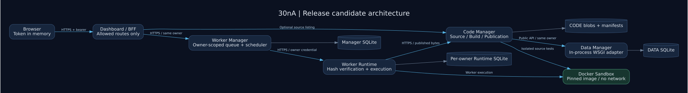
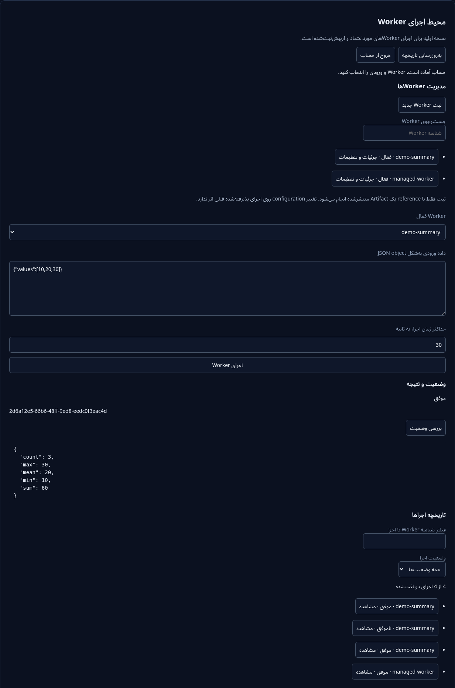

# 30nA Hybrid Architecture

Monorepo سرویس‌های DATA MANAGER، CODE MANAGER، WORKER MANAGER، WORKER RUNTIME و Dashboard.

**وضعیت: Release candidate؛ پذیرش نهایی Production هنوز باز است.**

## نصب کامل روی Ubuntu VPS

یک VPS خالی با **Ubuntu 24.04 LTS**، دسترسی root و دامنه یا subdomain متصل به IP آن آماده کنید. TCP `80/443` باید در firewall سرور و پنل VPS باز باشند. installer، HTTPS رایگان Let’s Encrypt با `Certbot --standalone` و تمدید آن، Rootless Docker، سرویس‌ها و Worker نمونه را تنظیم می‌کند.

```bash
sudo -i
bash <(curl -fsSL https://raw.githubusercontent.com/sina1991/30nA-Hybrid-architecture/feat/release-readiness/install.sh)
```

در مراحل نصب، **دامنه و email** پرسیده می‌شوند؛ خرید یا دریافت دستی certificate لازم نیست. این فرمان مربوط به branch `feat/release-readiness` است. پس از Build و اجرای موفق نمونه، آدرس `https://دامنه-شما` نمایش داده می‌شود. token ورود در فایل root-only `/etc/30na/customer-token` ساخته می‌شود و چاپ نمی‌شود.

installer وجود مسیرها، حساب‌ها و portهای مرتبط را بررسی و در صورت تداخل متوقف می‌شود؛ شناسایی همه داده‌ها و سرویس‌های نامرتبط ممکن نیست، پس آن را فقط روی VPS خالی اختصاصی اجرا کنید. [راهنمای installer](docs/deployment/installer.md) شامل پیش‌نیاز، دانلود قابل بررسی، `--check-only`، ادامه نصب ناموفق، تمدید certificate و خطایابی است. نصب موفق جای پذیرش امنیتی نهایی VPS نیست.

## دفترچه کامل پروژه

[فهرست دفترچه جامع](docs/manual/README.md) · [کتاب یک‌جلدی](docs/manual/BOOK.md) · [PDF قابل دانلود](docs/manual/PROJECT_MANUAL.pdf) · [HTML قابل چاپ](docs/manual/PROJECT_MANUAL.html)

معماری، APIها، تنظیمات، توسعه، Docker، Ubuntu، امنیت، DB، backup/recovery، تست، تحویل و مرجع ماشینی فایل‌ها در ۲۱ فصل ارائه شده‌اند. اسناد baseline قدیمی از مرجع فعلی جدا هستند.

## معماری و نمای Dashboard



هر اتصال سرویس، identity همان owner را حفظ می‌کند. Build و اجرای Worker در Docker جدا انجام می‌شوند؛ جزئیات مرزها در [فصل معماری](docs/manual/01-architecture.md) است. [منبع نمودار](docs/assets/architecture.dot) با Graphviz قابل بازتولید است.



Screenshot از تست واقعی محلی Chromium → Dashboard → Manager → Runtime با Artifact ساخته‌شده در Docker است؛ ورودی `[10,20,30]`، مجموع `60` را برگردانده است. این تصویر مربوط به VPS نیست و هیچ tokenی در آن نمایش داده نمی‌شود.

## راهنمای Agentهای هوش مصنوعی

[راهنمای فنی مستقل Agent](docs/AGENT_GUIDE.md) شامل نقشه تغییر، توابع و signatureها، APIها، schemaها، envها و تست‌های مرتبط است. [AGENTS.md](AGENTS.md) نقطه ورود Agent به مخزن است.

## شروع توسعه

Python 3.11 یا 3.12، Docker و OpenSSL لازم‌اند. برای تست کامل UI، Node و Chrome/Chromium نیز لازم است. از checkout موجود استفاده کنید؛ Git worktree تازه لازم نیست.

```bash
bash scripts/deployment/prepare.sh
source .venv/bin/activate
npm ci --prefix units/consumers/dashboard-core/browser-tests --ignore-scripts --no-audit --no-fund
docker build -t 30na-sandbox -f units/worker-runtime/tests/sandbox-image/Dockerfile .
python scripts/testing/run_ci.py --image "$(docker image inspect --format '{{.Id}}' 30na-sandbox)"
```

runner یک DATA MANAGER موقت و DB جداگانه ایجاد و پس از تست متوقف می‌کند. suite کامل شامل تست‌های واقعی Docker/HTTPS است و تست skipped را برای Release نمی‌پذیرد. برای بررسی محدود بدون Docker، `--unit-only` صریح است و پذیرش انتشار محسوب نمی‌شود.

## قابلیت‌ها

- ثبت source، تست Build ایزوله، بسته‌بندی deterministic، hash/provenance و Publication gate.
- HTTP API با bearer identity، ownership و SQLite persistence برای مدیریت Worker و اجراها.
- interval scheduler با claim/lease تراکنشی و رفتار صریح restart؛ فقط یک process مالک هر state است.
- Runtime با Sandbox اجباری در HTTP، تاریخچه جداگانه هر owner و transport HTTPS.
- Dashboard با themeها، ماژول‌ها، اجرای Worker و مشاهده نتیجه و history کاربر.

## استقرار و محدودیت‌ها

- [راهنمای Ubuntu VPS و systemd](docs/deployment/ubuntu.md)
- [وضعیت آماده‌سازی و Release checklist](docs/PROJECT_FINALIZATION_STATUS.md)
- [فهرست مستندات](docs/README.md)
- [قرارداد Manager HTTP](contracts/worker/manager.openapi.json)
- [قرارداد Runtime HTTP](contracts/worker/runtime.openapi.json)

Native dependency wheel، scheduler توزیع‌شده، exactly-once و replay خودکار اجرای نامعلوم پشتیبانی نمی‌شوند. Rootless host acceptance، live daemon fault-injection و تنظیمات واقعی TLS/identity باید پیش از انتشار نهایی روی staging بررسی شوند. هیچ token یا private key را در مخزن ثبت نکنید.

## تحویل نسخه اولیه

[راهنمای تحویل اولیه به کارفرما](docs/deployment/first-delivery.md) شامل آماده‌سازی Worker نمونه، اجرای آن از Dashboard، نتیجه مورد انتظار و Terminal محدود به مشاهده است.
برای تست کامل UI، Node و Chrome/Chromium لازم‌اند؛ ابتدا اجرا کنید:

```bash
npm ci --prefix units/consumers/dashboard-core/browser-tests --ignore-scripts --no-audit --no-fund
```
