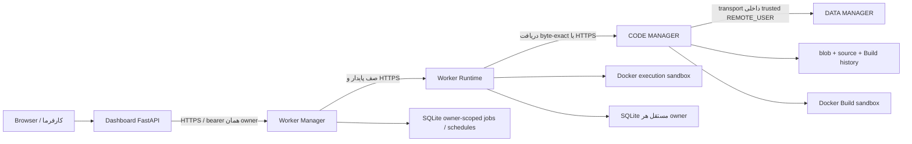

# ۰۱ — معماری و جریان داده

سامانه یک Monorepo مبتنی بر Python و SQLite است. واحد منطقی با process یا سرویس شبکه یکسان نیست: CORE فقط قرارداد است؛ DATA در entrypoint تولیدی CODE داخل همان process با transport داخلی WSGI استفاده می‌شود؛ Manager و Runtime و Dashboard entrypointهای مستقل دارند.

کد Mermaid در Markdownهای GitHub به نمودار تبدیل می‌شود؛ در بعضی viewerها و HTML چاپی به‌صورت متن نمودار دیده می‌شود. جدول زیر معنای اتصال‌ها را مستقل از renderer مشخص می‌کند.

| واحد | مالک چه چیزی است؟ | مالک چه چیزی نیست؟ |
|---|---|---|
| CORE | envelope، error، identifier، version و operation status | DB، scheduler یا business logic |
| DATA | model، resource، record، validation و owner checks | Artifact یا اجرای Worker |
| CODE | source version، blob، Build، provenance و publication | زمان‌بندی اجرای Worker |
| Manager | definition، lifecycle، configuration، queue و schedule | import یا اجرای مستقیم source |
| Runtime | hash check، sandbox، execution، timeout/cancel و children | تولید Artifact معتبر یا مدیریت نقش‌های سازمانی |
| Dashboard | UI و BFF با مسیرهای صریح حساب | اتصال مستقیم DB یا public proxy دلخواه |
| Agent08 | integration proof قدیمی و خروجی loopback | مسیر اصلی تحویل فعلی |

## مسیر کامل source تا نتیجه

۱. operator منبع trusted و ZIP را با identity صاحب source به CODE می‌دهد. ۲. ZIP اصلی hash و metadata در DATA ذخیره می‌شود. ۳. Build، normalize/test/package/hash را با policy محدود اجرا می‌کند. ۴. Publication Gate فقط report معتبر با همه stageهای اجباری passed را می‌پذیرد. ۵. Worker با Artifact ID، hash و entrypoint immutable در Manager ثبت و enable می‌شود. ۶. کارفرما از Dashboard درخواست می‌دهد. ۷. Manager پیش از dispatch، job و idempotency را ذخیره می‌کند. ۸. Runtime متعلق به همان owner از API واقعی Artifact را دانلود و hash را تطبیق می‌دهد. ۹. container اجرا می‌شود؛ نتیجه terminal در history ثبت و در Dashboard نمایش داده می‌شود.

## مرزهای واقعی

- CODE production از DATA DB مستقیم در domain خودش استفاده نمی‌کند؛ transport داخلی، API WSGI DATA را با `REMOTE_USER` معتبر فراخوانی می‌کند. این معماری in-process با یک deployment توزیع‌شده DATA متفاوت است.
- HTTP Manager به `worker_manager` و Runtime به مدل `ExecutionRequest` همان package وابسته است. جداسازی واحدها به معنی استقلال کامل package/dependency نیست.
- Dashboard در حالت configured به package مشترک `worker_manager.http_common` نیاز دارد؛ PYTHONPATH آن در unit file مشخص است.
- برای Runtime هر owner یک instance و DB جدا ساخته می‌شود؛ backend Docker می‌تواند بین آن‌ها مشترک باشد، اما history/provider نباید مشترک شوند.
- SQLite و file lockها برای یک process مالک state طراحی شده‌اند؛ HA یا multi-host scheduler ادعا نمی‌شود.

## موجودی پروژه

`units/` کد واحدها؛ `contracts/` قراردادها؛ `examples/` نمونه trusted؛ `deployment/` templateهای systemd و helper؛ `scripts/` ابزارهای نصب، تست، امنیت و مستندسازی؛ `tests_support/` fixtureها؛ `agents/` اسناد مسئولیت؛ `docs/` دفترچه، ADR و تاریخچه. مسیرهای دقیق، signatureها و hash فایل‌ها در [مرجع ماشینی](20-generated-reference.md) آمده‌اند.
