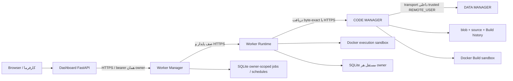

# دفترچه جامع پروژه 30nA Hybrid Architecture

تاریخ بررسی: `2026-10-30`؛ مبنای رفتار برنامه: `87ad0ab696276e7fdeb75f118e78185f81e4dfc7`.

این کتاب نسخه یک‌جلدی فصل‌های همین پوشه است. فصل‌ها و مرجع ماشینی منبع نگهداری هستند؛ BOOK.md و HTML را دستی ویرایش نکنید.

## فهرست مطالب

- [۰۰ — دامنه، وضعیت و روش استفاده](#chapter-00)
- [۰۱ — معماری و جریان داده](#chapter-01)
- [۰۲ — آماده‌سازی توسعه و اجرای محلی](#chapter-02)
- [۰۳ — قراردادها، شناسه‌ها و نسخه‌بندی](#chapter-03)
- [۰۴ — DATA MANAGER](#chapter-04)
- [۰۵ — CODE MANAGER، Build و Artifact](#chapter-05)
- [۰۶ — WORKER MANAGER، صف و scheduler](#chapter-06)
- [۰۷ — WORKER RUNTIME و قرارداد برنامه Worker](#chapter-07)
- [۰۸ — Dashboard، UI و BFF](#chapter-08)
- [۰۹ — Agent08 و مسیرهای legacy](#chapter-09)
- [۱۰ — مرجع تنظیمات و limitها](#chapter-10)
- [۱۱ — ذخیره‌سازی، migration و سازگاری داده](#chapter-11)
- [۱۲ — امنیت و مرز اعتماد](#chapter-12)
- [۱۳ — استقرار Ubuntu VPS](#chapter-13)
- [۱۴ — عملیات روزمره و مشاهده‌پذیری](#chapter-14)
- [۱۵ — backup، restore، rollback و disaster recovery](#chapter-15)
- [۱۶ — تست، CI و اعتبار شواهد](#chapter-16)
- [۱۷ — تحویل نسخه اولیه به کارفرما](#chapter-17)
- [۱۸ — توسعه، تصمیم‌ها و نگهداری مستندات](#chapter-18)
- [۱۹ — عیب‌یابی، اختلاف‌ها و کارهای باز](#chapter-19)
- [مرجع ماشینی و پوشش فایل‌ها](#chapter-20)

<a id="chapter-00"></a>

# ۰۰ — دامنه، وضعیت و روش استفاده

این دفترچه، مرجع نسخه فعلی Monorepo برای توسعه‌دهنده، operator و کارفرماست. تاریخ بررسی ۲۰۲۶-۱۰-۳۰ و مبنای رفتار برنامه Commit `87ad0ab696276e7fdeb75f118e78185f81e4dfc7` روی branch `feat/release-readiness` است. تغییر مستندات لزوماً همین SHA را ندارد؛ SHA فوق نسخه کدِ بررسی‌شده است، نه وعده نصب آن روی VPS.

## وضعیت قابل اثبات

- نسخه فعلی **Release candidate برای demo با Workerهای trusted و ازپیش‌ثبت‌شده** است.
- اجرای کامل محلی روی Python 3.11 و 3.12: `303 passed, 65 subtests passed`، بدون skipped یا warning.
- [CI پیشین c3b97d2](https://github.com/sina1991/30nA-Hybrid-architecture/actions/runs/40976228604) روی Ubuntu 24.04 شامل تست‌های هر دو Python، Chromium و security scans موفق بوده است؛ این لینک evidence تاریخی همان SHA است. اصلاحات فعلی به‌صورت محلی در هر دو Python تأیید شده‌اند؛ نتیجه CI checkout جدید را در [صفحه Actions branch](https://github.com/sina1991/30nA-Hybrid-architecture/actions?query=branch%3Afeat%2Frelease-readiness) بررسی کنید.
- کد برای VPS، systemd، credential files و HTTPS آماده شده؛ **استقرار واقعی، Rootless host acceptance، fault-injection روی میزبان هدف و backup/restore عملیاتی هنوز تأیید نشده‌اند**.
- Docker محیط Cloud rootful بود. نتیجه آن پذیرش امنیتی rootless روی VPS نیست.

## ترتیب منابع و حل تعارض

۱. رفتار کد و تست اجراشده روی SHA مشخص؛ ۲. OpenAPIهای HTTP فعلی؛ ۳. این دفترچه و ADR؛ ۴. قراردادهای YAML با توجه به وضعیت و اختلاف‌های ثبت‌شده؛ ۵. اسناد baseline و migration تاریخی. در تعارض، هیچ اختلافی را پنهان یا یک قرارداد را خودسرانه بازتعریف نکنید؛ [دفتر اختلاف‌ها](#chapter-19) را ببینید.

اسناد `docs/audit/` و فصل‌های baseline قدیمی `docs/handbook/` گزارش تاریخی‌اند. READMEهای فعال، CODE API YAML و Worker YAML در بازبینی سراسری با رفتار فعلی هماهنگ شده‌اند؛ label قرارداد به معنی تأیید deployment نیست. اختلاف‌های باقی‌مانده در دفتر عیب‌یابی صریح‌اند.

## مسیر مطالعه بر اساس نقش

| نقش | فصل‌های شروع | خروجی مورد انتظار |
|---|---|---|
| کارفرما | Dashboard، تحویل، عیب‌یابی | اجرای نمونه و ثبت درخواست تغییر |
| توسعه‌دهنده | معماری، توسعه، واحد مربوط، API و تست | تغییر قابل بازبینی و آزموده‌شده |
| operator | تنظیمات، امنیت، استقرار، عملیات، recovery | سرویس قابل راه‌اندازی و بازیابی |
| reviewer | قراردادها، storage، خطاها، CI و اختلاف‌ها | سنجش شواهد و محدودیت‌ها |

## پوشش دفترچه

معماری، تمام واحدها و entrypointها، APIهای HTTP و library، state machineها، envها، limitها، DBها، migration، credentialها، Docker، Ubuntu، Terminal، Dashboard، demo، CI، backup/restore، troubleshooting، extension، ADR و ابزار ساخت مستندات پوشش داده می‌شوند. فصل مرجع ماشینی، فایل‌های فنی Git، همه نمادهای Python، DDL و schemaهای OpenAPI را فهرست می‌کند؛ فایل tracked داخل directory نادیده‌گرفته‌شده‌ای مانند `contracts/code/build/` نیز جا نمی‌افتد.

پوشش فایل با اثبات همه نیازهای محصول یا ممیزی امنیتی برابر نیست. هر نیاز خارج از رفتار قابل بررسی، با وضعیت «تصمیم/تأیید لازم» ثبت می‌شود.

## قالب‌های دفترچه

- فصل‌های مستقل: منبع نگهداری در همین پوشه؛
- `BOOK.md`: نسخه یک‌جلدی قابل خواندن در GitHub؛
- `PROJECT_MANUAL.html`: نسخه راست‌به‌چپ، قابل چاپ و جست‌وجو؛
- `source-inventory.json`: موجودی فنی قابل پردازش؛
- PDF همراه، خروجی چاپ HTML است؛ نسخه PDF را برای بررسی لینک‌ها جایگزین Markdown نکنید.

<a id="chapter-01"></a>

# ۰۱ — معماری و جریان داده

سامانه یک Monorepo مبتنی بر Python و SQLite است. واحد منطقی با process یا سرویس شبکه یکسان نیست: CORE فقط قرارداد است؛ DATA در entrypoint تولیدی CODE داخل همان process با transport داخلی WSGI استفاده می‌شود؛ Manager و Runtime و Dashboard entrypointهای مستقل دارند.



کد Mermaid در Markdownهای GitHub به نمودار تبدیل می‌شود؛ در بعضی viewerها و HTML چاپی به‌صورت متن نمودار دیده می‌شود. جدول زیر معنای اتصال‌ها را مستقل از renderer مشخص می‌کند.

| واحد | مالک چه چیزی است؟ | مالک چه چیزی نیست؟ |
|---|---|---|
| CORE | envelope، error، identifier، version و operation status | DB، scheduler یا business logic |
| DATA | model، resource، record، validation و owner checks | Artifact یا اجرای Worker |
| CODE | source version، blob، Build، provenance و publication | زمان‌بندی اجرای Worker |
| Manager | definition، lifecycle، configuration، queue و schedule | import یا اجرای مستقیم source |
| Runtime | hash check، sandbox، execution، timeout/cancel و children | تولید Artifact معتبر یا مدیریت نقش‌های سازمانی |
| Dashboard | UI و BFF با مسیرهای صریح حساب | اتصال مستقیم DB یا public proxy دلخواه |
| Agent08 | integration proof قدیمی و خروجی loopback | مسیر اصلی تحویل فعلی |

## مسیر کامل source تا نتیجه

۱. operator منبع trusted و ZIP را با identity صاحب source به CODE می‌دهد. ۲. ZIP اصلی hash و metadata در DATA ذخیره می‌شود. ۳. Build، normalize/test/package/hash را با policy محدود اجرا می‌کند. ۴. Publication Gate فقط report معتبر با همه stageهای اجباری passed را می‌پذیرد. ۵. Worker با Artifact ID، hash و entrypoint immutable در Manager ثبت و enable می‌شود. ۶. کارفرما از Dashboard درخواست می‌دهد. ۷. Manager پیش از dispatch، job و idempotency را ذخیره می‌کند. ۸. Runtime متعلق به همان owner از API واقعی Artifact را دانلود و hash را تطبیق می‌دهد. ۹. container اجرا می‌شود؛ نتیجه terminal در history ثبت و در Dashboard نمایش داده می‌شود.

## مرزهای واقعی

- CODE production از DATA DB مستقیم در domain خودش استفاده نمی‌کند؛ transport داخلی، API WSGI DATA را با `REMOTE_USER` معتبر فراخوانی می‌کند. این معماری in-process با یک deployment توزیع‌شده DATA متفاوت است.
- HTTP Manager به `worker_manager` و Runtime به مدل `ExecutionRequest` همان package وابسته است. جداسازی واحدها به معنی استقلال کامل package/dependency نیست.
- Dashboard در حالت configured به package مشترک `worker_manager.http_common` نیاز دارد؛ PYTHONPATH آن در unit file مشخص است.
- برای Runtime هر owner یک instance و DB جدا ساخته می‌شود؛ backend Docker می‌تواند بین آن‌ها مشترک باشد، اما history/provider نباید مشترک شوند.
- SQLite و file lockها برای یک process مالک state طراحی شده‌اند؛ HA یا multi-host scheduler ادعا نمی‌شود.

## موجودی پروژه

`units/` کد واحدها؛ `contracts/` قراردادها؛ `examples/` نمونه trusted؛ `deployment/` templateهای systemd و helper؛ `scripts/` ابزارهای نصب، تست، امنیت و مستندسازی؛ `tests_support/` fixtureها؛ `agents/` اسناد مسئولیت؛ `docs/` دفترچه، ADR و تاریخچه. مسیرهای دقیق، signatureها و hash فایل‌ها در [مرجع ماشینی](#chapter-20) آمده‌اند.

<a id="chapter-02"></a>

# ۰۲ — آماده‌سازی توسعه و اجرای محلی

## پیش‌نیازها

Linux، Python 3.11 یا 3.12، Git، Docker daemon قابل‌دسترسی و OpenSSL لازم‌اند. تست کامل UI به Node و Chrome/Chromium نیز نیاز دارد. runtime سرویس‌های Python برای اجرا به Node یا Chrome وابسته نیست؛ این دو ابزار مربوط به اعتبارسنجی UI هستند. Ubuntu 24.04 پلتفرم هدف CI/deployment است؛ موفقیت روی این پلتفرم به همه سیستم‌عامل‌ها تعمیم داده نمی‌شود.

هر task ابری checkout ایزوله دارد. از checkout موجود استفاده کنید؛ worktree تازه نسازید مگر صریحاً خواسته شود. قبل از کار `git status --short` را ببینید و تغییرهای کاربر را نگه دارید. dependencyها و lockfile را صرفاً برای رفع خطای نصب خودسرانه تغییر ندهید.

## نصب قابل تکرار

از root مخزن:

```bash
bash scripts/deployment/prepare.sh
source .venv/bin/activate
npm ci --prefix units/consumers/dashboard-core/browser-tests --ignore-scripts --no-audit --no-fund
docker build -t 30na-sandbox -f units/worker-runtime/tests/sandbox-image/Dockerfile .
python scripts/testing/run_ci.py --image "$(docker image inspect --format '{{.Id}}' 30na-sandbox)"
```

`prepare.sh` یک venv ساخته و با `pip --require-hashes`، `requirements.lock` را نصب و `pip check` اجرا می‌کند. OS package، account، Docker، firewall یا TLS را provision نمی‌کند. اگر Python با venv ساخته نمی‌شود، روی Ubuntu پکیج `python3-venv` را از repository رسمی نصب کنید؛ خطای آن را با نصب global یا تغییر lock دور نزنید.

اگر `.venv` از قبل موجود است، پیش از اجرای prepare، نسخه Python و مالکیت آن را بررسی کنید؛ اجرای `python3 -m venv .venv` با interpreter متفاوت نباید ناخواسته محیط کاربر را تغییر دهد.

در محیط Cloud فعلی، `uv` و Python مدیریت‌شده نیز قابل استفاده‌اند؛ install script محیط، `.venv` و cache را خارج از source یا در مسیرهای ignored آماده می‌کند. proxy و CA trust ارث‌رسیده را حفظ کنید؛ TLS یا checksum verification را خاموش نکنید.

## رفتار runner

`run_ci.py` مالک یک DATA MANAGER موقت روی port تصادفی و SQLite disposable است. health همان process را می‌سنجد، همه suiteهای انتخاب‌شده را اجرا می‌کند و در پایان فقط process خودش را متوقف می‌کند. به service احتمالی روی 8080 تکیه نمی‌کند. image باید immutable و preload شده باشد. containerهای تست شبکه پیش‌فرض deny و منابع محدود دارند.

خروجی در `tmp/release-evidence/`: `tests.log`، `tests.xml`، `metadata.json` و `data-manager.log`. metadata شامل SHA، dirty بودن checkout، hash diff، Python و image است؛ env یا credential value در آن dump نمی‌شود. تست skipped در حالت کامل یا zero-test، Release Gate را رد می‌کند.

برای بررسی محدود بدون Docker/Chrome:

```bash
python scripts/testing/run_ci.py --unit-only --evidence-dir tmp/unit-only-evidence
```

این فرمان محدودیت خود را صریح گزارش می‌کند؛ نتیجه آن پذیرش E2E یا انتشار نیست.

## Dashboard مستقل

```bash
cd units/consumers/dashboard-core
../../../.venv/bin/python -m uvicorn dashboard.app:app --host 127.0.0.1 --port 8020
```

این entrypoint فقط shell/theme/module محلی است. برای account panel اجرایی، `dashboard.production:create_app --factory` و credential/upstream معتبر لازم است؛ صرف اجرای shell، اتصال سرویس‌ها را ثابت نمی‌کند.

## کار روزمره

تغییر را محدود نگه دارید؛ تست مرتبط را اجرا و در تغییرات بین‌واحدی runner کامل را اجرا کنید. formatter یا syntax check جای تست کارکردی نیست. خروجی‌های `__pycache__`، `.venv`، `node_modules`، `tmp` و logها در Git قرار نگیرند. برای نصب مجدد، فایل‌های user، DB یا branch را reset/delete نکنید.

<a id="chapter-03"></a>

# ۰۳ — قراردادها، شناسه‌ها و نسخه‌بندی

## مرجع‌های ماشینی

| حوزه | مرجع | وضعیت تفسیر |
|---|---|---|
| مشترک | `contracts/core/` | YAMLهای draft، قواعد پایه |
| DATA | `contracts/data/` و WSGI واقعی | draft؛ response خام با envelope عمومی یکسان نیست |
| CODE | `contracts/code/` و API واقعی | وضعیت فایل‌ها مستقل؛ API با Build/publish/download فعلی هماهنگ شده است |
| Worker | `contracts/worker/contract.yaml` | draft domain؛ مسیر download و الزام Sandbox اصلاح شده؛ OpenAPI ملاک شکل HTTP است |
| Manager HTTP | `contracts/worker/manager.openapi.json` | schema تولیدشده از factory فعلی |
| Runtime HTTP | `contracts/worker/runtime.openapi.json` | schema تولیدشده از factory فعلی |
| Dashboard HTTP | `contracts/dashboard/openapi.json` | shell و BFF فعلی |

فهرست endpointها و تمام fieldها، requiredها، defaultها و constraintهای سه OpenAPI در [مرجع ماشینی](#chapter-20) درج شده است. ایجاد یک YAML یا سبز بودن parsing test، به معنی approval همه semantics آن نیست.

## envelope و error

CODE، Manager، Runtime HTTP و BFF حساب معمولاً از ساختار زیر استفاده می‌کنند:

```json
{"contract_version":"1.0.0","payload":{"example":"value"}}
```

```json
{"contract_version":"1.0.0","error":{"code":"NOT_FOUND","message":"Resource not found"}}
```

`retryable` در بعضی errorها هست و در همه پاسخ‌های FastAPI الزامی نیست. خطای معنایی Runtime ممکن است داخل `payload` با `status: failed` و HTTP 200 برگردد. job Manager نیز نتیجه Runtime را در `payload.result` نگه می‌دارد؛ موفقیت HTTP با موفقیت محاسبه برابر نیست.

DATA success، object خام و error آن object دارای `error` و `contract_version` داخل error است. Artifact content باینری است. `/health` JSON ساده است. هیچ‌کدام را بی‌بررسی به envelope واحد تبدیل یا ادعا نکنید.

## شناسه‌ها

- شناسه‌های عمومی بسیاری از مسیرها: حداکثر ۱۲۸ کاراکتر، شروع با حرف/عدد و سپس حروف/اعداد/`._:-`؛ قید دقیق هر endpoint را در schema/validator ببینید.
- Worker ID با Artifact ID و execution ID متفاوت است. Artifact ID معمولاً `source_id@source_version` است؛ Build ID، ۳۲ hex؛ execution ID در HTTP Runtime، UUID.
- `owner_id` از authentication می‌آید؛ فرستادن آن در body برای تغییر مالکیت مجاز نیست.
- idempotency key مالکیت نمی‌سازد؛ scope و fingerprint آن را سرویس مصرف‌کننده تعریف می‌کند.
- correlation ID credential نیست. CODE API مقدار معتبر را پشتیبانی می‌کند، اما gateway تولیدی `HTTP_X_*` را حذف می‌کند؛ propagation سرتاسری آن تضمین نشده است.

## چهار حوزه نسخه

نسخه قرارداد، API، implementation و calculation مستقل‌اند. `/api/v1` و `contract_version: 1.0.0` به معنی نسخه نهایی 1.0 محصول نیستند. تغییر نتیجه calculation به version مستقل نیاز دارد. تغییر field required یا معنی status می‌تواند breaking باشد حتی اگر type ثابت بماند.

کلاینت‌های موجود معمولاً major `1.` را می‌پذیرند؛ این پذیرش رشته‌ای schema validation کامل یا negotiation نیست. تغییر قرارداد باید implementation، adapter، OpenAPI، مثال و تست سازگاری را با هم به‌روز کند.

## statusهای مستقل

lifecycle Worker: `configured → enabled/disabled`. وضعیت اجرا: `accepted → running → succeeded/failed/cancelled`، با امکان شکست/لغو قبل از running. وضعیت Build و stageها حوزه جداگانه‌اند؛ `blocked` یا `not_run` نباید succeeded محسوب شوند. نتیجه مبهم شبکه یا cleanup باید صریح باقی بماند.

<a id="chapter-04"></a>

# ۰۴ — DATA MANAGER

مرجع کد: [API](../../units/data-manager/api/app.py)، [DataService](../../units/data-manager/services.py)، [validation](../../units/data-manager/validation.py) و [SQLiteStorage](../../units/data-manager/storage.py).

## مسئولیت و مدل

Model شامل `model_id`، `owner_id`، `version`، `fields` و `required` است. Resource به یک model version دقیق متصل و owner-scoped است. Record درون resource با `record_id` نگه داشته می‌شود. کلید model در DB، `(model_id, version)` و کلید resource سراسری است؛ دو owner نمی‌توانند همان model/version یا resource ID را بی‌قید با هم به اشتراک بگذارند.

نوع‌های پشتیبانی‌شده field: `string`، `integer`، `number`، `boolean`، `object` و `array`. bool به‌جای integer/number پذیرفته نمی‌شود. field ناشناخته و required مفقود رد می‌شود. validation فعلی shallow است؛ constraints کامل JSON Schema، ساختار nested، foreign relation یا قواعد business خودکار ارائه نمی‌شود. finite بودن همه numberها نیز سراسری enforce نشده است.

نمونه ثبت Model:

```json
{"model_id":"customer-demo-model","owner_id":"customer-demo","version":"1.0.0","fields":{"name":{"type":"string"},"value":{"type":"number"}},"required":["name","value"]}
```

نمونه Resource:

```json
{"resource_id":"customer-demo-resource","model_id":"customer-demo-model","model_version":"1.0.0"}
```

body Record فقط داده مدل است، مثلاً `{"name":"sample","value":42}`؛ wrapperهایی مانند `data` را بدون قرارداد همان endpoint اضافه نکنید.

## همه endpointها

| method | مسیر | رفتار |
|---|---|---|
| GET | `/health` | بدون auth، وضعیت ساده process |
| POST | `/api/v1/models` | ثبت version؛ همان definition idempotent، definition متفاوت conflict |
| GET | `/api/v1/models/{model_id}` | version از query؛ نبود آن آخرین row ثبت‌شده است، نه بیشترین SemVer |
| POST | `/api/v1/resources` | ایجاد resource؛ تکرار ID conflict |
| GET | `/api/v1/resources/{resource_id}` | metadata owner-scoped |
| POST | `/api/v1/resources/{resource_id}/records` | ایجاد record با UUID؛ overwrite نمی‌کند |
| GET | `/api/v1/resources/{resource_id}/records` | لیست، `limit` پیش‌فرض 100 و بازه 1..1000 |
| GET | `/api/v1/resources/{resource_id}/records/{record_id}` | خواندن |
| PUT | همان مسیر record | جایگزینی کامل، requiredها لازم‌اند |
| PATCH | همان مسیر record | shallow merge با رکورد فعلی و validation نتیجه؛ body خالی رد می‌شود |
| DELETE | همان مسیر record | حذف صریح، پاسخ deleted |

موارد list همه modelها، حذف model/resource و endpoint عمومی مدیریت migration در این implementation وجود ندارند.

## identity و wire format

`REMOTE_USER` trusted مرجع است. `X-Manager-ID` فقط با `DATA_MANAGER_ALLOW_INSECURE_HEADER=1` پذیرفته می‌شود؛ این پرچم برای loopback تست است. خود برنامه bearer token را decode نمی‌کند. owner مدل باید با requester یکی باشد و دسترسی به resource/record دوباره بررسی می‌شود.

پاسخ موفق JSON خام است؛ example `{"records":[...]}`. خطاهای `NOT_FOUND`، `CONFLICT`، `FORBIDDEN`، `INVALID_INPUT` و `UNSUPPORTED_VERSION` با HTTP مناسب برمی‌گردند. exception ناشناخته به `INTERNAL_ERROR` امن تبدیل می‌شود. سقف body برابر ۱٬۰۰۰٬۰۰۰ byte است.

## storage و راه‌اندازی

`DATA_MANAGER_DB` پیش‌فرض `/tmp/data-manager/data.sqlite3` برای دوام Production مناسب نیست؛ مسیر persistent را صریح تنظیم کنید. import ماژول API، `SQLiteStorage` را initialize و migration را اجرا می‌کند؛ قبل از import مسیر را تعیین و backup را بررسی کنید. schema فعلی version 2 و شامل `dm_models`، `dm_resources`، `dm_records` و `dm_schema_version` است.

در production factory CODE همین API با transport داخلی استفاده می‌شود؛ runner تست یک process loopback disposable می‌سازد. هیچ واحد systemd مستقل DATA در templateهای فعلی وجود ندارد. پیاده‌سازی فعلی RBAC یا چندنویسنده توزیع‌شده نیست. برای format دقیق DDL و migration به فصل storage مراجعه کنید.

<a id="chapter-05"></a>

# ۰۵ — CODE MANAGER، Build و Artifact

مرجع کد: [API](../../units/code-manager/code_manager/api.py)، [source registration](../../units/code-manager/code_manager/source_registration.py)، [registry](../../units/code-manager/code_manager/source_registry.py)، [Build pipeline](../../units/code-manager/code_manager/build_pipeline.py)، [publication](../../units/code-manager/code_manager/published_artifacts.py).

## ثبت source

`POST /api/v1/sources`، identity را از gateway می‌گیرد و `source_id`، `source_version`، `source_content_base64`، `entrypoint`، `input_schema` و `output_schema` را می‌پذیرد. `contract_dependencies` و `calculation_version` اختیاری‌اند. owner در body قابل انتخاب نیست. همان owner/ID/version با ZIP byte-identical idempotent است؛ تغییر bytes همان version، 409 می‌دهد.

ZIP اصلی قبل از هر پردازش SHA-256 می‌شود. metadata از DATA API و bytes از blob store CODE بازیابی می‌شوند. source registry قبل از ارائه source، hash را دوباره می‌سنجد. owner تازه در list، آرایه خالی می‌گیرد؛ lookup دقیق منبع مفقود، 404 است.

## ZIP و limitها

Source inspection در host، بدون extract یا execute انجام می‌شود: حداکثر archive بیست MiB، expanded صد MiB، ۲۰۰۰ entry و compression ratio برابر 100. absolute/Windows drive path، backslash، traversal، symlink، duplicate و encrypted entry رد می‌شوند. entrypoint باید `module:function` و ماژول آن در ZIP موجود باشد. سقف HTTP body سی MiB شامل overhead Base64 است. Runtime بعداً limit کوچک‌تر خود را نیز اعمال می‌کند؛ عبور source inspection تضمین اجرا نیست.

## مراحل Build واقعی

| stage | معنی |
|---|---|
| inspect_archive | ساختار و resource limitهای ZIP |
| verify_source_hash | صحت bytes منبع ثبت‌شده |
| validate_archive_paths | مسیر و نوع entry |
| syntax_check | parse فایل Python بدون import در host |
| dependency_check | policy آفلاین/allowlist و shadowing |
| contract_check | schema objectها؛ meta-validation کامل JSON Schema هنوز انجام نمی‌شود |
| normalize_working_copy | ترتیب، timestamp، permission و line ending استاندارد |
| test | unittest و entrypoint داخل Docker با منابع محدود |
| reproducibility | دو normalization مستقل byte-identical؛ تضمین بازتولید همه رفتارهای دلخواه Worker نیست |
| package | بسته بدون test/cache؛ منع credential-like files |
| hash | hash و ذخیره content-addressed خروجی نهایی |

نبود تست، stage ناموفق، dependency نامعتبر، image غایب یا cleanup نامطمئن، خروجی publishable نمی‌سازد. test runner ورودی نرمال‌شده را فقط داخل container extract/import می‌کند. Build اجرای آزمون trusted policy است، نه approval امنیتی کد برای هر نوع میزبان.

## dependency policy

بدون manifest فقط stdlib و import محلی قابل قبول است. در حالت dependency خارجی فقط `requirements.txt` در root پذیرفته می‌شود؛ exact version، SHA-256، allowlist و wheelhouse معتبر لازم‌اند. wheel باید pure-Python `py3-none-any` باشد. transitive dependency فقط با `Requires-Dist` بدون شرط و exact pin و pin/allowlist صریح همه وابستگی‌ها پشتیبانی می‌شود. native wheel، version range، extras، marker، `.pth`، manifestهای دیگر و dynamic import حل‌نشده fail-closed هستند. Build از اینترنت package دلخواه نصب نمی‌کند. Runtime هنگام بارگذاری vendored wheelها hash را دوباره بررسی می‌کند؛ سقف مجموع vendoring آن هشت MiB است.

## Publication Gate

`source_zip` با `built_artifact` متفاوت است. publish، Build report owner-scoped را با stageهای mandatory، hash، provenance و هویت Artifact تطبیق می‌دهد؛ request نمی‌تواند صرفاً با ادعای success خروجی منتشر کند. manifest/blob immutable و conflict/idempotency کنترل می‌شوند. download فقط built artifact منتشرشده را با hash معتبر ارائه می‌کند. provenance فعلی metadata محلی است؛ attestation امضاشده مستقل یا SBOM کامل محسوب نمی‌شود. registry Python یک مرز trusted داخلی است؛ دسترسی مستقیم filesystem یا متد داخلی را به کاربر ناشناس ندهید.

## تمام عملیات HTTP فعلی

| method | مسیر زیر `/api/v1` | پاسخ و نکته |
|---|---|---|
| POST / GET | `/sources` | ثبت / لیست owner |
| GET | `/sources/{id}/versions/{version}` | metadata؛ raw ZIP عمومی نیست |
| POST | همان source با `/inspect` | inspection بدون اجرا |
| POST | `/builds` | body شامل source ID/version؛ HTTP 200 ممکن است report failed/blocked داشته باشد |
| GET | `/builds` | history؛ limit پیش‌فرض 50 و بازه 1..100 |
| GET | `/builds/{build_id}` | جزئیات owner، ID ۳۲ hex |
| POST | `/artifacts/{artifact_id}/publish` | body `build_id`؛ 201 جدید، 200 تکراری معتبر |
| GET | `/artifacts/{artifact_id}/content` | bytes با `application/octet-stream`، `X-Artifact-Hash` و ETag |
| GET / POST | `/artifacts/{artifact_id}` | metadata operation هنوز 501؛ وجود download به معنی وجود این route نیست |

HTTP 401/400/404/409/413/422/500/501/502/503 را با status report اشتباه نگیرید. خطاهای DATA transport به `DATA_MANAGER_UNAVAILABLE` و upstream 502 تبدیل می‌شوند. download باینری را با JSON adapter نخوانید.

## entrypoint و دوام

`code_manager.production:create_app()` زیر Gunicorn یک process با threadها، DATA in-process و bearer gateway را وصل می‌کند. `python -m code_manager.production` سرور ساده `wsgiref` است و production-grade HTTP server محسوب نمی‌شود. Build history و publication manifest در storage CODE persistent هستند؛ برای مکان واقعی فایل‌ها به فصل storage مراجعه کنید. source ID/hash، Artifact hash، Build ID و calculation version را جداگانه ثبت کنید.

<a id="chapter-06"></a>

# ۰۶ — WORKER MANAGER، صف و scheduler

مرجع کد: [domain service](../../units/worker-manager/worker_manager/service.py)، [ControlService](../../units/worker-manager/worker_manager/control_service.py)، [API](../../units/worker-manager/worker_manager/api.py) و [SQLiteWorkerStore](../../units/worker-manager/worker_manager/sqlite_store.py).

## domain و lifecycle

`WorkerDefinition` شامل `worker_id`، `artifact_id`، `artifact_hash` و `entrypoint` است و rebind شدن identity موجود مجاز نیست. configuration و Schedule از definition جدا هستند. lifecycle با `configured` شروع، enable/disable می‌شود. disable/remove مانع درخواست آینده است؛ job پذیرفته‌شده را خودکار cancel نمی‌کند. `WorkerManager()` بدون Store، in-memory باقی می‌ماند؛ ControlService HTTP از SQLite استفاده می‌کند.

نمونه ثبت از حساب معتبر:

```json
{"worker_id":"customer-worker","artifact_id":"customer-source@1.0.0","artifact_hash":"sha256:REPLACE_WITH_64_HEX_DIGEST","entrypoint":"worker:run","configuration":{},"schedule":{"kind":"manual","interval_seconds":null}}
```

Placeholder hash نمونه، درخواست قابل اجرا نیست؛ باید hash واقعی Artifact منتشرشده باشد. body owner قبول نمی‌کند. سپس endpoint enable فراخوانی می‌شود.

## API و queue

`/api/v1/workers`: GET list و POST ثبت؛ `/{worker_id}`: GET/PATCH/DELETE؛ `/{worker_id}/enable` و `/disable`: POST؛ `/{worker_id}/executions`: POST. `/api/v1/executions`: GET history و `/{execution_id}`: GET detail؛ `/cancel`: POST. schema تمام fieldها در OpenAPI و فصل مرجع آمده است.

```json
{"input_payload":{"values":[10,20,30]},"timeout_seconds":30,"idempotency_key":"customer-request-unique-id"}
```

POST run با HTTP 202 ممکن است job accepted یا پاسخ job قبلی همان key را برگرداند. ControlService پیش از dispatch، request snapshot و fingerprint را پایدار می‌کند. همان owner/key با request یکسان همان execution را می‌دهد؛ body/config/timeout متفاوت conflict است. ظرفیت سراسری accepted/running فعلاً ۱۰۰۰ job و concurrency پیش‌فرض executor چهار است؛ quota مستقل هر tenant پیاده‌سازی نشده است.

workerهای owner از DB مشترک ولی با کلید `(owner_id,worker_id)` خوانده می‌شوند. history HTTP آخرین ۱۰۰ job را برمی‌گرداند؛ pagination عمومی بیشتر در این API وجود ندارد. history result لایه‌ای است: job در `payload`، نتیجه Runtime در `payload.result` و مقدار محاسبه در `payload.result.result`.

## scheduler و lease

Schedule فقط `manual` یا `interval` با interval صحیح مثبت است؛ cron/timezone/calendar API وجود ندارد. اولین موعد interval هنگام مشاهده Worker enabled با `now + interval` ثبت می‌شود. tick تقریباً هر 0.25 ثانیه اجرا می‌شود؛ deadline سخت real-time نیست. input زمان‌بندی‌شده `{}` و timeout آن 30 ثانیه است؛ Worker باید با این ورودی سازگار باشد. configuration از metadata Worker می‌آید.

Claim با `BEGIN IMMEDIATE` و lease owner انجام می‌شود. lease برابر timeout درخواست به‌اضافه ۶۰ ثانیه است. دوره‌های ازدست‌رفته burst replay نمی‌شوند. configure/enable/disable، رکورد موعد را reset می‌کند. یک سرویس process/file lock مالک DB است؛ `--workers 2` یا replica مستقل روی همین state ممنوع است.

## خطای مبهم و retry

- restart Manager، jobهای `running` را `failed` با `MANAGER_RESTARTED` می‌کند؛ remote workload ممکن است هنوز زنده باشد.
- lease منقضی، `LEASE_EXPIRED` می‌دهد؛ job به accepted برنمی‌گردد.
- transport failure یا پاسخ nonterminal/ناسازگار، `RUNTIME_OUTCOME_UNKNOWN` می‌دهد؛ موفقیت جعل نمی‌شود.
- retry خودکار و backoff برای نتیجه نامعلوم وجود ندارد. قبل از key تازه، remote execution ID را بررسی/cancel کنید. exactly-once یا resume فرایند تضمین نمی‌شود.
- queued cancel در DB terminal می‌شود و dispatch نمی‌شود. cancel اجرای دوردست best-effort است؛ false به معنی تأیید نشدن توقف است.

## اتصال Runtime

`RuntimeHTTPGateway` URL origin HTTPS و credential owner را می‌گیرد، redirect را رد و response را به دو میلیون byte محدود می‌کند. submit timeout برابر timeout Worker + 30 و get/cancel پیش‌فرض 15 ثانیه است. در production، credential file خروجی برای هر owner جدا mapping می‌دهد؛ credential یک owner را برای همه کاربران substitute نکنید.

<a id="chapter-07"></a>

# ۰۷ — WORKER RUNTIME و قرارداد برنامه Worker

مرجع: [Runtime](../../units/worker-runtime/worker_runtime/runtime.py)، [Docker backend](../../units/worker-runtime/worker_runtime/docker_sandbox.py)، [runner داخل container](../../units/worker-runtime/worker_runtime/_runner.py)، [HTTP](../../units/worker-runtime/worker_runtime/api.py).

## نوشتن Worker

entrypoint استاندارد Runtime، یک تابع synchronous با دو argument است:

```python
def run(data, configuration):
    values = data.get('values', [])
    return {'count': len(values), 'sum': sum(values)}
```

ورودی و configuration باید JSON object و خروجی JSON-compatible باشد؛ NaN/Infinity خروجی پذیرفته نمی‌شود. نتیجه را `return` کنید؛ stdout پروتکل JSON runner است و چاپ دلخواه Worker می‌تواند خروجی را خراب یا limit را رد کند. stderr اجرای Worker در مسیر فعلی به DEVNULL می‌رود و log API مستقل Worker وجود ندارد؛ برای عیب‌یابی روی تست‌های trusted و error code تکیه کنید. خروجی stderr Build با stdout محدود جمع‌آوری می‌شود. dependency خارجی فقط از vendoring معتبر Build قابل استفاده است. SDK نصب از اینترنت، filesystem میزبان یا دسترسی شبکه برای Worker ارائه نمی‌شود.

Archive معتبر، hash برابر و entrypoint موجود پیش از launch بررسی می‌شوند. max entries Runtime برابر ۱۰۲۴ و expanded limit چهار برابر max artifact است؛ source با ۲۰۰۰ entry ممکن است inspection اولیه را بگذراند ولی برای Runtime مناسب نباشد.

## request و result

`ExecutionRequest` شامل definition، configuration، input_payload، execution_id، timeout_seconds، idempotency_key و depth است. HTTP Runtime، UUID، key اجباری، timeout مثبت تا 300 و depth صفر را می‌پذیرد. submission همگام است: HTTP request معمولاً تا پایان Runtime منتظر می‌ماند؛ Manager آن را از طریق executor پس‌زمینه فراخوانی می‌کند و به UI 202 می‌دهد.

```json
{"execution_id":"11111111-1111-4111-8111-111111111111","worker_id":"demo-summary","accepted":true,"status":"succeeded","result":{"sum":60},"error":null,"children":[]}
```

شناسه نمونه را برای درخواست‌های واقعی تکرار نکنید. reuse نامعتبر ID قبلی با `EXECUTION_CONFLICT` رد می‌شود و history جاری یا terminal را تغییر نمی‌دهد؛ این رفتار با regression test روی SQLite و restart بررسی شده است. همان key و request معتبر همچنان replay نتیجه قبلی است. HTTP result داخل envelope است؛ نتیجه error ممکن است HTTP 200 و status failed داشته باشد. get execution owner دیگر 404 است. factory جلوی اشتراک یک Runtime instance بین ownerها را می‌گیرد و HTTP بدون backend امن 503/failed می‌شود.

## state، timeout و cancel

accepted/running در history نگه داشته می‌شوند؛ فقط terminal success موفقیت است. timeout بین دانلود/اجرای parent و children بودجه مشترک دارد؛ transportهای شبکه timeout مستقل هم دارند، پس عدد timeout لزوماً کل latency HTTP نیست. خروجی stream محدود و container پس از timeout/cancel/overflow برای removal بررسی می‌شود. خروج Docker CLI به‌تنهایی تأیید توقف container نیست.

نبود image/backend، `SANDBOX_UNAVAILABLE`؛ hash نادرست، `ARTIFACT_HASH_MISMATCH`؛ download خراب، `ARTIFACT_UNAVAILABLE`؛ concurrency پر، `CAPACITY_EXCEEDED`؛ خروجی حجیم، `OUTPUT_LIMIT_EXCEEDED`؛ خطای Worker، `EXECUTION_ERROR`؛ cleanup نامطمئن، `SANDBOX_CLEANUP_UNCONFIRMED` است. error.retryable تضمین retry امن یا موفق نیست.

## children و orchestration

Worker می‌تواند `{"value":7,"children":[{"worker_id":"child","input":{}}]}` برگرداند. Runtime children را از `definitions` همان instance پیدا، به‌ترتیب اجرا و نتایج را در `ExecutionResult.children` نگه می‌دارد؛ مقدار parent، field `value` می‌شود. depth پیش‌فرض 3 و تعداد child پیش‌فرض 8 است. child failure موجب `CHILD_FAILED` یا cancellation parent می‌شود. cancellation به descendantها منتقل می‌شود.

**محدودیت HTTP فعلی:** production factory Runtime، definitions فرزند را از Manager populate نمی‌کند و endpoint ثبت child definition ندارد. بنابراین قابلیت library برای children را به‌عنوان child orchestration آماده در deployment HTTP معرفی نکنید؛ بدون provisioning تعریف‌ها `CHILD_NOT_FOUND` می‌گیرید.

## durability و isolation

`SQLiteExecutionStore` history/idempotency را ذخیره می‌کند. restart، snapshotهای accepted/running را failed با `RUNTIME_RESTARTED` می‌کند و فرایند را resume نمی‌کند. فایل هر owner با SHA-256 نام owner ساخته می‌شود؛ نام owner یا token خام نام فایل نیست. process lock روی state root از مالک دوم جلوگیری می‌کند.

حالت `require_sandbox=False` فقط برای fixtureهای trusted/legacy است؛ HTTP آن را از request قبول نمی‌کند. عدد default `require_sandbox=True` به‌تنهایی کافی نیست: backend، image preload، daemon/rootless policy و resource controller باید واقعاً آماده باشند. Docker، لایه isolation است و ادعای حذف همه ریسک escape نیست.

<a id="chapter-08"></a>

# ۰۸ — Dashboard، UI و BFF

مرجع: [app و factory](../../units/consumers/dashboard-core/dashboard/app.py)، [پنل اجرا](../../units/consumers/dashboard-core/dashboard/upstream_panel.py)، [routeهای BFF](../../units/consumers/dashboard-core/dashboard/upstreams.py)، [PublicAPI](../../units/consumers/dashboard-core/public_api.py).

## دو حالت مستقل

`dashboard.app:app`، shell مستقل با theme/moduleهای محلی است. `dashboard.production:create_app --factory` با `DASHBOARD_CREDENTIAL_FILE` و URL upstreamها، account panel را در ابتدای صفحه اضافه می‌کند. نبود تنظیم upstream به ساخت endpoint فرضی یا fallback ناامن منجر نمی‌شود؛ درخواست مربوط 503 می‌گیرد.

## راهنمای کاربر

۱. صفحه HTTPS را باز کنید؛ Access token اختصاصی حساب را وارد کنید. ۲. Worker enabled را انتخاب کنید. ۳. JSON object و timeout بین ۱ تا ۳۰۰ ثانیه بدهید. ۴. اجرای Worker را بزنید. ۵. وضعیت و execution ID را ببینید؛ خروجی موفق به‌صورت JSON نمایش داده می‌شود. ۶. در history، اجرای قبلی را انتخاب کنید. ۷. cancel، درخواست best-effort می‌فرستد؛ تا وضعیت terminal نیاید، cancelled ساخته نمی‌شود.

ورودی پیش‌فرض برای Worker نمونه `{"values":[10,20,30]}` است؛ همه Workerها الزاماً همین input را نمی‌پذیرند. نبود Worker فعال را operator با seed/register/enable حل می‌کند؛ UI کارفرما registration یا source upload ندارد.

در ارسال مبهم، UI snapshot body و idempotency key را در حافظه نگه می‌دارد و همان درخواست را retry می‌کند. ارسال معمول بعدی key تازه دارد. قبل از قطعیت، refresh کامل صفحه یا ارسال مستقل جدید می‌تواند وضعیت ابهام را از حافظه UI پاک کند؛ ابتدا history را بررسی کنید. خروج از حساب requestهای UI را abort و داده قابل مشاهده را پاک می‌کند؛ workload پذیرفته‌شده سرور ادامه دارد.

## امنیت session

Token در HTML server-rendered، URL، localStorage، sessionStorage یا cookie ذخیره نمی‌شود؛ فقط تا logout/reload در closure صفحه می‌ماند. درخواست‌ها bearer دارند و cookie ارسال نمی‌کنند. ورود روی HTTP غیرloopback در UI رد می‌شود. `textContent` برای نمایش داده استفاده می‌شود. defaultهای theme و یادداشت‌های slot در localStorage نگهداری می‌شوند؛ این storage مربوط به token حساب نیست.

BFF قبل از تماس upstream، credential کاربر را از hash mapping احراز می‌کند و همان credential را forward می‌کند؛ token ادمین عمومی جایگزین نمی‌شود. owner در body قابل انتخاب نیست. پاسخ account `Cache-Control: no-store` و `Vary: Authorization` دارد. CSRF cookie session یا OAuth/OIDC در این نسخه وجود ندارد؛ این سیستم login/password عمومی نیست.

## routeهای اصلی

| نوع | route |
|---|---|
| shell | GET `/`، `/health`، `/api/themes`، `/api/themes/{theme_id}`، `/api/modules` |
| مشاهده حساب | GET `/api/upstreams/workers`، `/executions`، `/sources` |
| اجرا | POST `/api/upstreams/workers/{worker_id}/executions` |
| نتیجه | GET `/api/upstreams/executions/{execution_id}` |
| cancel | POST `/api/upstreams/executions/{execution_id}/cancel` |

تمام APIهای فوق زیر prefix نوشته‌شده‌اند؛ `/executions` و `/sources` در ردیف مشاهده ادامه همان `/api/upstreams` هستند. schemaهای UUID/body در OpenAPI آمده‌اند. request شامل owner یا field اضافه، JSON نامعتبر یا timeout نامجاز رد می‌شود. handler، جزئیات محرمانه upstream را به client برنمی‌گرداند. 401/403/404/409/413/422 حفظ می‌شوند و بیشتر خطاهای سرویس به 503 تبدیل می‌شوند.

## theme و module

Themeهای واقعی `compact-6`، `standard-8` و `wide-12`، metadata/grid/slot دارند. شناسه theme باید با نام فایل JSON برابر باشد. moduleها از manifestهای package کشف می‌شوند و فقط typeهای whitelist `empty`، `health`، `theme-summary`، `slot-note` و `dice-roller` فعال‌اند. manifest شامل id/name/description/version/api_version/type و api_version برابر `1` است. registry به معنی اجازه import/execution کد دلخواه نیست.

dice-roller در browser اجرا می‌شود، Worker Runtime نیست؛ تعداد dice از ۱ تا ۱۰۰ و sides از ۲ تا ۱۰۰۰ دارد. module health، سلامت Dashboard را می‌خواند و اثبات سلامت همه سرویس‌ها نیست. انتخاب theme/slot در browser باقی می‌ماند؛ account history server-side است.

## زمان و ظرفیت UI

Polling حدود هر ثانیه، window خودکار شش دقیقه و fetch timeout هشت ثانیه است. پایان polling خودکار به معنی پایان اجرای سرور نیست؛ از بررسی وضعیت/history ادامه دهید. textarea تا ۵۰۰٬۰۰۰ کاراکتر و بررسی input encoded تا ۹۰۰٬۰۰۰ byte دارد؛ body و transport نیز limit مستقل دارند. خطا را با execution ID، نسخه و ورودی بدون credential گزارش کنید.

<a id="chapter-09"></a>

# ۰۹ — Agent08 و مسیرهای legacy

Agent08 یک integration proof مستقل در [agent08.py](../../units/integration/agent08/agent08.py) است. مسیر اصلی MVP فعلی، Dashboard → Manager HTTP → Runtime HTTP است و به راه‌اندازی Agent08 نیاز ندارد.

## حالت demo

از `script/modules_ok.py` یک ZIP ثابت می‌سازد، با `DemoArtifactProvider` آن را به WorkerRuntime می‌دهد، Manager in-memory می‌سازد و Worker `agent08-modules-ok` را enable می‌کند. interval این proof دقیقاً یک ثانیه، timeout اجرا پنج ثانیه و state خروجی در حافظه است. loop خودش schedule را اجرا می‌کند؛ Schedule domain به‌تنهایی process زمان‌بندی نمی‌سازد.

در demo، `require_sandbox=False` است و artifact فقط fixture trusted مخزن است. این حالت را برای ZIP ناشناس یا سرویس عمومی استفاده نکنید. `sequence` و timestamp در snapshot نشان می‌دهند poll جدیدی تولید شده؛ history durable یا exactly-once نیست.

## HTTP خروجی

`serve()` پیش‌فرض روی loopback port 8098، فقط GET `/v1/modules/agent08-modules-ok/output` ارائه می‌کند. خروجی شامل type/data/status/source/mode/sequence/execution_id/worker_id/timestamp/error است. endpoint عمومی auth gateway ندارد و فقط proof محلی است. مسیرهای دیگر 404 هستند. expose کردن آن روی public interface نیازمند طراحی auth جداگانه است.

## حالت code-manager و محدودیت مهم

`AGENT08_ARTIFACT_MODE=code-manager` از `AGENT08_CODE_MANAGER_URL` و Authorization از env یا `CREDENTIALS_DIRECTORY/code-manager-token` استفاده می‌کند. URL HTTPS به provider اصلی و HTTP loopback به adapter legacy داده می‌شود.

اما constructor فعلی در این mode، `require_sandbox=True` می‌دهد و **sandbox_backend را provision نمی‌کند**؛ بنابراین داشتن URL/token به‌تنهایی مسیر اجرایی آماده ایجاد نمی‌کند و Runtime بعد از دریافت Artifact می‌تواند `SANDBOX_UNAVAILABLE` بدهد. همچنین hash تعریف Worker از fixture محلی محاسبه می‌شود و Artifact مقصد باید دقیقاً با آن متناسب باشد. این mode به‌عنوان deployment کامل توصیه نمی‌شود.

`LoopbackArtifactProvider` در این proof محدود به hostname loopback برای HTTP است؛ این استثنای قدیمی را مجوز انتقال bearer روی HTTP عمومی یا جایگزین transport production ندانید. API artifact نسخه‌دار فعلی در provider اصلی وجود دارد؛ Worker YAML در بازبینی سراسری به همین مسیر اصلاح شده است.

## نگهداری و توسعه

دو تست integration موجود، اجرای واقعی subprocess trusted و متمایز بودن executionها را بررسی می‌کنند. این تست‌ها production authentication، Rootless acceptance یا این mode ناقص را تأیید نمی‌کنند. برای مهاجرت، ابتدا نیاز محصول را مشخص کنید: حفظ proof مستقل یا جایگزینی با Manager/Runtime HTTP؛ سپس owner binding، provider، hash، sandbox، lifecycle، history و تست منفی را یکپارچه کنید. صرف تغییر env یا README کافی نیست.

<a id="chapter-10"></a>

# ۱۰ — مرجع تنظیمات و limitها

هیچ مقدار عملیاتی از env یا credential file در این دفترچه خوانده نشده است. جدول‌ها از نام‌های مصرف‌شده در source و defaultهای کد تهیه شده‌اند. محل دقیق هر lookup در فصل مرجع ماشینی است.

## ورودی‌های اجباری production factory

| سرویس | نام | نوع و نقش |
|---|---|---|
| CODE | `CODE_MANAGER_BLOB_ROOT` | directory persistent متعلق به CODE |
| CODE | `CODE_MANAGER_CREDENTIAL_FILE` | مسیر JSON hash-to-owner ورودی |
| DATA/CODE | `DATA_MANAGER_DB` | path DB؛ از نظر کد default دارد ولی در deployment باید صریح و persistent باشد |
| Manager | `WORKER_MANAGER_DB` | مسیر SQLite queue/metadata |
| Manager | `WORKER_MANAGER_CREDENTIAL_FILE` | credential mapping ورودی |
| Manager | `WORKER_MANAGER_RUNTIME_CREDENTIALS` | فایل mapping هر owner به HTTPS URL/token Runtime |
| Runtime | `WORKER_RUNTIME_STATE_ROOT` | directory DBهای owner و process lock |
| Runtime | `WORKER_RUNTIME_CREDENTIAL_FILE` | credential mapping ورودی |
| Runtime | `WORKER_RUNTIME_CODE_CREDENTIALS` | فایل mapping هر owner به HTTPS URL/token CODE |
| Runtime | `WORKER_RUNTIME_SANDBOX_IMAGE` | digest registry یا immutable image ID؛ نبود آن startup را رد می‌کند |
| Dashboard | `DASHBOARD_CREDENTIAL_FILE` | credential mapping حساب‌ها |

Manager و Runtime، outbound binding را به‌صورت lazy و cached می‌سازند. تغییر فایل outbound برای owner فعال ممکن است تا restart مصرف‌کننده اعمال نشود. تغییر incoming map در هر request دوباره خوانده می‌شود.

## CA خصوصی در outbound mapping

در JSON فایل `WORKER_MANAGER_RUNTIME_CREDENTIALS`، هر owner علاوه بر `url` و `token` می‌تواند `ca_file` با مسیر PEM CA داشته باشد؛ مثال غیرعملیاتی: `{"owner-example":{"url":"https://runtime.example.com","token":"REPLACE_OUTSIDE_GIT","ca_file":"/etc/30na/ca/runtime-ca.pem"}}`. مسیر باید برای حساب Manager خواندنی باشد. این گزینه TLS یا hostname verification را خاموش نمی‌کند و فقط Manager → Runtime را تنظیم می‌کند. در Runtime → CODE و Dashboard/seed از trust Python/OpenSSL و در صورت نیاز `SSL_CERT_FILE` استفاده کنید. فایل CA را با private key اشتباه نگیرید. پس از تغییر outbound mapping، restart لازم است.

## تنظیمات اختیاری برنامه

| نام | default / معنی |
|---|---|
| `DATA_MANAGER_DB` | `/tmp/data-manager/data.sqlite3`؛ برای demo disposable، نه durability واقعی |
| `DATA_MANAGER_HOST` / `DATA_MANAGER_PORT` | `127.0.0.1` / `8080` در `units/data-manager/run.py` |
| `DATA_MANAGER_ALLOW_INSECURE_HEADER` | false؛ صرفاً development identity header |
| `CODE_MANAGER_ALLOW_INSECURE_HEADER` | false؛ development identity و factory loopback |
| `CODE_MANAGER_BUILD_SANDBOX_IMAGE` | image Build؛ در نبود آن از `WORKER_RUNTIME_SANDBOX_IMAGE` fallback می‌گیرد |
| `CODE_MANAGER_DEPENDENCY_ALLOWLIST` | JSON object به‌صورت رشته env یا dict در library؛ **path فایل نیست** |
| `CODE_MANAGER_DEPENDENCY_WHEELHOUSE` | directory آفلاین معتبر؛ فقط برای dependencies خارجی |
| `WORKER_RUNTIME_DOCKER_BINARY` | `docker` |
| `WORKER_RUNTIME_SANDBOX_MEMORY` | `256m` |
| `WORKER_RUNTIME_SANDBOX_CPUS` | `1.0` |
| `WORKER_RUNTIME_SANDBOX_PIDS` | `64`، integer مثبت |
| `WORKER_RUNTIME_SANDBOX_TMPFS` | `64m` |
| `DASHBOARD_WORKER_MANAGER_URL` | اختیاری در factory؛ نبود آن عملیات Manager را 503 می‌کند |
| `DASHBOARD_CODE_MANAGER_URL` | اختیاری؛ برای مشاهده sources؛ در demo کارفرما می‌تواند خاموش بماند |
| `DATA_MANAGER_URL/TOKEN/TIMEOUT` | فقط adapter قدیمی `from_environment`؛ URL لازم، timeout پیش‌فرض 5 |
| `CODE_MANAGER_URL/TOKEN/TIMEOUT` | مشابه بالا؛ factory BFF از credential کاربر استفاده می‌کند، نه TOKEN عمومی |

قالب allowlist نمونه غیرعملیاتی: `{"sample-package":{"version":"1.0.0","sha256":"REPLACE_WITH_64_HEX","wheel":"sample_package-1.0.0-py3-none-any.whl","modules":["sample_package"]}}`. fieldهای دقیق resolver و تست آن مرجع‌اند؛ hash/version و wheel واقعی را از منبع trusted تهیه کنید. placeholder را برای عبور validation با مقدار تصادفی جایگزین نکنید.

## تنظیمات تست و ابزار

`CODE_MANAGER_INTEGRATION`، `CODE_MANAGER_DATA_MANAGER_URL` و `WORKER_RUNTIME_SANDBOX_TEST_IMAGE` مربوط به تست‌اند؛ runner آن‌ها را برای instance disposable تنظیم می‌کند. `DASHBOARD_SKIP_BROWSER=1` در unit-only صریح استفاده می‌شود؛ در تست کامل نباید برای سبزکردن CI به کار رود. `CI` و `GITHUB_ACTIONS` توسط runner خوانده می‌شوند و credential نیستند.

`DOCKER_HOST`، `DOCKER_CONTEXT`، `DOCKER_CONFIG` و TLS selectorهای Docker تنظیمات CLI هستند. روی VPS daemon موردنظر حساب Sandbox را تعیین کنید؛ credentialهای Docker config را dump نکنید. `PATH`، `PYTHONPATH`، CA trust و proxyها توسط runtime/tooling مصرف می‌شوند و نباید با مقادیر ساختگی overwrite شوند.

`SANDBOX_FAULT_INJECTION_ACK`، `WORKER_RUNTIME_DOCKER_BINARY` و `DOCKER_HOST` در ابزار fault-injection نقش دارند؛ ACK فقط روی disposable VM اختصاصی و با مجوز operator معنا دارد. `WORKER_RUNTIME_ACCEPT_ROOTFUL_DOCKER=1` یک override بازبینی‌شده در اسکریپت پذیرش است؛ rootless بودن را اثبات نمی‌کند. `SANDBOX_EVIDENCE_DIR` مسیر evidence script پذیرش را تعیین می‌کند. `CHROME_BIN` فقط executable تست browser را انتخاب می‌کند.

Agent08: `AGENT08_ARTIFACT_MODE` پیش‌فرض demo؛ `AGENT08_CODE_MANAGER_URL`، `AGENT08_CODE_MANAGER_AUTHORIZATION` و `CREDENTIALS_DIRECTORY` در فصل جداگانه توضیح داده شدند.

## limitهای library و transport

| لایه | default / سقف |
|---|---|
| Source inspection | 20 MiB ZIP، 100 MiB expanded، 2000 entry، ratio 100 |
| CODE HTTP | 30 MiB body؛ Build history limit 50، حداکثر 100 |
| Build Docker | timeout 120s، RAM 256m، CPU 1، PID 64، tmpfs 128m، output 65536 byte |
| Runtime library | concurrency 16، input/output هرکدام 1 MiB، Artifact 16 MiB |
| Runtime archive | 1024 entry، expanded حداکثر چهار برابر max artifact |
| Runtime children | depth 3، children 8؛ deadline مشترک |
| Runtime Docker | RAM 256m، CPU 1، PID 64، tmpfs 64m، UID/GID 65532، startup 5s |
| container | nofile 64، core 0، read-only root، network none، memory-swap برابر memory |
| Manager executor | چهار thread، 1000 queued/running، tick 0.25s، lease timeout+60 |
| HTTP run | timeout مثبت تا 300؛ idempotency key حداکثر 256 کاراکتر |
| Manager/Runtime/BFF body middleware | 1,048,576 byte |
| Dashboard PublicAPI | POST encoded تا 1,000,000؛ response تا 2,000,000 byte |
| Runtime HTTP gateway | response تا 2,000,000 byte؛ submit timeout+30، get/cancel 15s |
| Artifact provider | 16 MiB و timeout 10s پیش‌فرض |
| vendored wheels | تا 64 wheel و مجموع 8 MiB در Runtime |
| bearer header | حداکثر 512، ASCII و بدون whitespace نامعتبر |
| UI | poll حدود 1s، window 360s، fetch 8s، input 900000 encoded byte |

این اعداد در همه لایه‌ها یکسان نیستند. کوچک‌ترین limit مسیر عملی را در نظر بگیرید؛ تغییر constructor یک library الزاماً env یا HTTP option متناظر ایجاد نمی‌کند.

<a id="chapter-11"></a>

# ۱۱ — ذخیره‌سازی، migration و سازگاری داده

## نقشه state

| state | مالک | مکان template تولیدی |
|---|---|---|
| DATA models/resources/records | CODE/DATA process | `/var/lib/30na/data/data.sqlite3` |
| blobs، publication manifest و Build history | CODE | زیر `/var/lib/30na/code/blobs` |
| Worker metadata، queue، schedule | Manager | `/var/lib/30na/manager/manager.sqlite3` |
| history/idempotency هر owner | Runtime | `/var/lib/30na/runtime/<sha256-owner>.sqlite3` |
| credentialها | operator | فایل‌های محدود `/etc/30na/` |
| cidfile/recovery reference | Sandbox backend | directory خصوصی زیر temp حساب سرویس |
| UI theme/slot/note | browser | localStorage؛ نه backup history سرور |

Pathها نمونه template هستند، نه تشخیص state موجود روی VPS. قبل از import/راه‌اندازی مسیر واقعی را ثبت کنید. پیش‌فرض `/tmp` DATA نباید با state persistent اشتباه شود.

## schemaهای DATA

`dm_schema_version` نسخه schema را نگه می‌دارد. migration 1، جدول‌های `dm_models`، `dm_resources`، `dm_records` و کلیدهای خارجی را می‌سازد؛ migration 2 indexهای owner و زمان رکورد را می‌افزاید. نسخه جدیدتر از schema پشتیبانی‌شده یا version نامعتبر startup را رد می‌کند. migration هنگام initialize اجرا می‌شود؛ endpoint عمومی migration وجود ندارد.

## Worker Store و legacy

schema جدید، primary key `(owner_id,worker_id)` دارد. هنگام تشخیص جدول قدیمی بدون owner، با transaction آن را به ساختار جدید منتقل و owner را `__legacy__` می‌کند. این namespace در authentication HTTP قابل استفاده نیست. از روی نام Worker یا اولین login، مالک حدس زده نمی‌شود. انتقال legacy به مالک واقعی عملیات administrator با backup، بررسی conflict و تست cross-owner است؛ CLI آماده تخصیص مالک وجود ندارد.

Store domain به‌تنهایی file lock distributed نیست. ControlService مالک process را با فایل `.lock` کنترل و صف را با transaction مدیریت می‌کند. writer مستقل یا update مستقیم SQL می‌تواند snapshot حافظه را stale کند؛ مدیریت عادی از API انجام شود.

## جدول‌های اجرای Manager

`control_jobs`: owner/execution، worker، idempotency، fingerprint، request JSON، status، result JSON، lease owner/deadline و created_at. uniqueness روی `(owner,idempotency_key)` است. `control_schedules`: owner/worker و next_due. payload درخواست snapshot است؛ تغییر configuration آینده لزوماً اجرای قبلاً پذیرفته‌شده را تغییر نمی‌دهد.

پس از restart، running job نتیجه معلوم ندارد و به شکست صریح منتقل می‌شود؛ acceptedهای هنوز claimنشده می‌توانند ادامه یابند. cleanup واقعی remote workload باید جدا بررسی شود.

## Runtime Store

`executions`، snapshot JSON شامل children/error/result را نگه می‌دارد؛ `idempotency_keys` به fingerprint و execution اشاره می‌کند. key به execution مفقود، corruption منطقی است و load را رد می‌کند. فایل‌های owner جدا و lock state root، واحد deployment تک-process را محدود می‌کنند؛ این ذخیره‌سازی اجرای live process نیست.

## blob و publication

BlobStorage bytes را با SHA-256 و عملیات immutable نگه می‌دارد. Source metadata در DATA به digest اشاره می‌کند. publication manifest owner-scoped است و به bytes، hash، source، Build و provenance وابسته است. Build history در `build-history.sqlite3` زیر root blob، report JSON را با `(owner_id,build_id)` ذخیره می‌کند. کپی فقط DB یا فقط blob برای recovery کامل کافی نیست.

جزئیات DDL، شامل جدول‌های fixture تست که Production نیستند، در فصل مرجع آمده‌اند. وجود جدول مشابه `executions` در دو store نباید موجب ادغام دستی آن‌ها شود.

## قواعد migration و downgrade

۱. نسخه کد/Schema/DB و processهای writer را ثبت کنید. ۲. checkpoint یا توقف کنترل‌شده و backup سازگار بگیرید. ۳. در staging restore و startup نسخه جدید را تست کنید. ۴. مقایسه counts، hash و owner isolation انجام دهید. ۵. smoke test بزنید. ۶. rollback فقط با کد و snapshot سازگار انجام شود.

نسخه قدیمیِ بدون owner isolation را روی DB مهاجرت‌کرده اجرا نکنید. GC/retention خودکار blob، Build history یا execution history هنوز پیاده‌سازی نشده است؛ حذف دستی می‌تواند reference زنده را بشکند. برای طراحی retention ابتدا reachability، audit و backup را مشخص کنید.

<a id="chapter-12"></a>

# ۱۲ — امنیت و مرز اعتماد

## دامنه پذیرش

MVP برای Workerهای trusted تحویل داده می‌شود. container isolation و تست‌های منفی به معنی production certification یا رفع همه escapeها نیست. اجرای source ناشناس روی VPS تا پذیرش rootless، resource controller، cleanup و threat model نهایی مجاز اعلام نشده است. همین محدودیت در [گزارش وضعیت](../PROJECT_FINALIZATION_STATUS.md) ثبت شده است.

## authentication و authorization

Incoming credential file یک JSON object از SHA-256 token به owner است. token تصادفی امن حداقل ۳۲ byte توصیه می‌شود. private token از hash mapping جدا نگه داشته شود؛ hash قابل استفاده مستقیم به‌جای bearer نیست. `{}` همه tokenها را revoke می‌کند. map روی هر request خوانده می‌شود؛ فایل خراب/غیرقابل‌خواندن در مسیرهای مربوط fail-closed است.

WSGI gateway ورودی `REMOTE_USER` و headerهای `HTTP_X_*` را پاک و owner trusted را تنظیم می‌کند. FastAPIها bearer را مستقل می‌سنجند؛ namespace `__legacy__` حساب معتبر نیست. RBAC سازمانی، MFA، OAuth/OIDC، token expiry خودکار و policy scope ریزدانه در این نسخه وجود ندارند. هر credential مقصد باید به همان owner نگاشت شود؛ وجود owner-level isolation برابر role isolation نیست.

Credentialهای outgoing در JSON جدا شامل `url` و `token` هستند و فقط حساب سرویس مربوط آن‌ها را می‌خواند. manager-to-runtime و runtime-to-code با token کارفرما یا token عمومی ادمین یکی نیستند مگر صریحاً همان trust scope خواسته شود. مشتری Dashboard معمولاً فقط Manager binding نیاز دارد.

## network و TLS

سرویس‌ها روی loopback bind می‌شوند؛ HTTPS reverse proxy، firewall و rate/body/time limit باید در deployment provision شوند. Proxy نباید Authorization یا query حساس را log کند. transportها redirect را رد می‌کنند. برای bearer خارج loopback، HTTP در adapterهای اصلی پذیرفته نمی‌شود؛ استثنای loopback توسعه را عمومی نکنید.

نکته trust: `RuntimeHTTPGateway` با `trust_env=False` و TLS verification فعال کار می‌کند. برای CA خصوصی، field اختیاری `ca_file` در outbound mapping هر owner به PEM معتبر اشاره می‌کند؛ certificate و hostname همچنان بررسی می‌شوند. نبود field از trust پیش‌فرض HTTPX استفاده می‌کند و CA نامعتبر در ساخت client رد می‌شود. E2E، رد certificate موقت بدون trust صریح و موفقیت اتصال با `ca_file` را بررسی می‌کند. Runtime → CODE، Dashboard و seed از urllib و trust پیش‌فرض Python/OpenSSL استفاده می‌کنند؛ `SSL_CERT_FILE` در صورت نیاز باید برای همان process تنظیم و تست شود. موفقیت curl کافی نیست. browser فقط روی loopback fixture، TLS exception تست دارد؛ هیچ bypassی برای Production توصیه نمی‌شود.

پیش‌بررسی ZIP و AST parsing در host انجام می‌شوند؛ محدودیت اندازه archive، معادل ایزوله‌سازی کامل CPU/RAM همه مراحل preflight نیست. این نیز یکی از دلایل محدودکردن MVP به source trusted و باقی‌ماندن پذیرش امنیتی اجرای کد ناشناس است.

## container policy

Image immutable و preload، user عددی non-root، dropped capabilities، no-new-privileges، seccomp پیش‌فرض، IPC/PID namespace خصوصی پیش‌فرض، شبکه none، read-only root و mountهای input read-only هستند. RAM/CPU/PID/tmpfs/nofile/core محدودند. host Docker socket، secrets، credential directory یا workspace writable به Worker mount نمی‌شود. proxy defaultهای Docker در env container خالی می‌شوند.

فایل source/runner از mode خصوصی host به copy read-only داخل directory 0700 منتقل می‌شوند؛ فایل اصلی chmod نمی‌شود. rootless daemon باید بتواند همان مسیر staging را ببیند؛ PrivateTmp سرویس می‌تواند این فرض را بشکند. Docker daemon/control socket خود یک trust boundary پرقدرت است و نباید به کارفرما یا workload داده شود.

## cleanup نامطمئن

موفقیت `docker rm --force` یا نبود مثبت container با context معتبر، از حدس توقف بهتر است. در daemon failure، کشتن CLI تضمین کشتن workload نیست. Runtime، cidfile یا unique recovery name را نگه می‌دارد؛ Build report نیز نباید publishable شود. operator باید recovery reference را حفظ، daemon را بازیابی، workload را inspect/remove و evidence را ثبت کند. false از cancel یا error cleanup را success معرفی نکنید.

ابزار live fault-injection، root را رد، ACK صریح، socket دقیق rootless کاربر و daemon متعلق به همان UID را بررسی و daemon را موقتاً pause می‌کند. فقط در VM disposable اختصاصی، بدون workload کاربر و با برنامه بازیابی استفاده شود. presence ابزار در مخزن به معنی اجرای موفق آن نیست. Docker context باقی‌مانده می‌تواند انتخاب endpoint را نسبت به DOCKER_HOST تغییر دهد؛ پیش از تست، context/selectorها و daemon/PID واقعی را در همان shell اختصاصی بررسی کنید و فرض نکنید بررسی رشته env به‌تنهایی identity endpoint را ثابت می‌کند.

## اطلاعات محرمانه و دسترسی انسانی

Token، password، private key، `.env`، Docker config و DB حاوی داده واقعی در Git، Chat، command argument یا evidence عمومی قرار نگیرند. env را dump و shell tracing را برای کشف credential فعال نکنید. token افشاشده باید rotate شود؛ بدون تکرار مقدار آن گزارش دهید.

کارفرما SSH key شخصی و حساب غیرroot داشته باشد. helper `30na-review` فقط commandهای ثابت خواندن status/log را اجرا می‌کند؛ نصب root-owned و sudoers محدود باید بازبینی شود. دسترسی root، گروه Docker یا journal عمومی سیستم برای demo لازم نیست. logها ممکن است داده business داشته باشند؛ پیش از اشتراک بررسی شوند.

<a id="chapter-13"></a>

# ۱۳ — استقرار Ubuntu VPS

مرجع اجرایی کامل: [راهنمای Ubuntu](../deployment/ubuntu.md) و [تحویل اولیه](../deployment/first-delivery.md). این فصل ترتیب عملیات و criterionها را یکپارچه می‌کند. هیچ فرمانی در این دفترچه ادعا نمی‌کند قبلاً روی VPS کاربر اجرا شده است.

## پیش از provisioning

- میزبان هدف Ubuntu 24.04 LTS؛ SSH key و account مدیریتی sudo تأیید شوند.
- Reinstall تنها پس از backup و تصمیم صریح administrator؛ دیسک و credentialهای موجود را پاک نکنید.
- CPU/RAM/disk و workloadهای دیگر، portهای اشغال، owner مسیر کد/DB و daemonهای rootful/rootless ثبت شوند.
- SHA کد، image ID و domain/CA معتبر را انتخاب کنید. `main` الزاماً شامل branch آماده‌سازی نیست.
- `30na` و `30na-sandbox` نام accountهای template هستند؛ آن‌ها باید ساخته و permissionها بدون تغییر کورکورانه فایل موجود تنظیم شوند.

## ترتیب نصب

۱. Git، Python/venv، OpenSSL، CA certificates و Docker rootless prerequisites را از منابع رسمی آماده کنید. ۲. checkout ثابت را در `/opt/30na/current` قرار دهید. ۳. `bash scripts/deployment/prepare.sh` را برای venv اجرا کنید. ۴. daemon اختصاصی rootless را برای **همان** حساب `30na-sandbox` provision و user service/lingering/socket را تأیید کنید. ۵. image fixture را از Dockerfile digest-pinned بسازید یا image بازبینی‌شده را preload کنید. ۶. state و credentialها را ایجاد کنید. ۷. HTTPS و URLهای داخلی را آماده کنید. ۸. unit fileها را بازبینی، نصب و serviceها را راه‌اندازی کنید. ۹. seed و تست‌های پذیرش را اجرا کنید.

برای پذیرش کامل همراه UI، روی میزبان تست Node و Chrome/Chromium و dependency Playwright با `npm ci` لازم‌اند. این نیاز را با runtime سرویس‌های اصلی اشتباه نگیرید. unit-only جای تست کامل را نمی‌گیرد.

## service topology

| سرویس | listener | process/entrypoint | writable state |
|---|---|---|---|
| CODE | <span dir="ltr" class="nowrap">127.0.0.1:8099</span> | Gunicorn، 1 process، 8 thread؛ `code_manager.production:create_app()` | code/data و temp قابل‌دیدن Docker |
| Manager | <span dir="ltr" class="nowrap">127.0.0.1:8101</span> | Uvicorn factory، 1 process | manager DB |
| Runtime | <span dir="ltr" class="nowrap">127.0.0.1:8102</span> | Uvicorn factory، 1 process | runtime DB و temp |
| Dashboard | <span dir="ltr" class="nowrap">127.0.0.1:8020</span> | Uvicorn factory، 1 process | state business سروری ندارد |
| DATA تست | port تصادفی | WSGI disposable تحت runner | DB موقت |
| Agent08 proof | <span dir="ltr" class="nowrap">127.0.0.1:8098</span> | optional، خارج topology اصلی | memory |

آدرس‌های URL مشتری، reverse proxy و certificate template آماده‌شده خودکار نیستند. proxy باید به listener درست متصل و Authorization را حفظ کند. HTTPS endpoint Runtime باید با URL manager binding یکسان باشد؛ داشتن فقط HTTP listener داخلی کافی نیست.

## فایل‌ها و permission

State directoryها 0700 و متعلق به حساب سرویس؛ incoming/outgoing credentialها 0400 یا 0600 با owner مناسب؛ code و `.venv` باید برای سرویس قابل traverse/read/execute و برای مشتری غیرقابل‌نوشتن باشند. secret value در systemd Environment قرار نگیرد؛ EnvironmentFile مسیر credential را معرفی می‌کند.

`PrivateTmp=true` در template Manager/Dashboard مناسب است، اما برای CODE/Runtime که bind mount دارند فعال نشده است. rootless daemon حساب دیگر یا context اشتباه را صرف مشاهده `hello-world` نپذیرید. `DOCKER_HOST` واقعی و UID آن باید صریح تعیین شوند.

## نصب systemd و check عملیاتی

از `deployment/systemd/` استفاده کنید، نه unit تاریخی `units/code-manager/deployment/` که مسیرهای قدیمی دارد. پیش از جایگزینی unit موجود، آن را backup و تفاوت را بررسی کنید. syntax unit، user، مسیر executable، EnvironmentFile و permission را تأیید و سپس daemon-reload/start کنید.

```bash
sudo systemctl daemon-reload
sudo systemctl start 30na-code-manager 30na-worker-runtime 30na-worker-manager 30na-dashboard
sudo /usr/local/sbin/30na-review status
```

helper باید قبلاً مطابق راهنمای تحویل نصب شده باشد. `systemctl active` یا port باز کافی نیست: با credential صحیح، worker list، seed، اجرای موفق و ناموفق، owner دیگر، history و restart را بررسی کنید. CODE endpoint `/health` استاندارد ندارد؛ برای check authenticated از عملیات مناسب آن استفاده کنید.

## تعریف پایان deployment

processها پایدار؛ startup بعد از reboot سنجیده؛ TLS و credential rotation/revocation درست؛ schema و state persistent؛ hash Artifact صحیح؛ rootless resource limits enforce؛ cleanup/recovery بازبینی؛ backup restore آزموده؛ مشتری نمونه را از Dashboard اجرا کرده و logها را از Terminal محدود می‌بیند. تا ثبت این شواهد، وضعیت VPS «تأییدنشده» است.

## installer خودکار

[راهنمای install.sh](../deployment/installer.md) دامنه/email، Rootless Docker، credential، TLS داخلی، Let’s Encrypt و smoke اجرای واقعی را برای VPS خالی تنظیم می‌کند. نصب خودکار جای host acceptance و backup/restore rehearsal را نمی‌گیرد.

<a id="chapter-14"></a>

# ۱۴ — عملیات روزمره و مشاهده‌پذیری

## کنترل ابتدای شیفت یا پس از deploy

نسخه کد و image، state pathها، service accountها و listenerها را با deployment record تطبیق دهید. active بودن process را با functional readiness اشتباه نگیرید. `/health` در Dashboard/Manager/Runtime سلامت ساده process/scheduler را نشان می‌دهد؛ وجود credential owner، دانلود Artifact و اجرا را تضمین نمی‌کند. CODE health عمومی مستقل ندارد و DATA health، DB business یا ارتباط همه سرویس‌ها را نمی‌سنجد.

نمونه فرمان‌های فقط خواندنی در VPS پس از نصب helper:

```bash
sudo /usr/local/sbin/30na-review status
sudo /usr/local/sbin/30na-review logs-manager
sudo /usr/local/sbin/30na-review logs-runtime
sudo /usr/local/sbin/30na-review logs-code
sudo /usr/local/sbin/30na-review logs-dashboard
ss -lntp
```

خروج status سرویس inactive ممکن است nonzero باشد؛ آن را با موفقیت pipe بعدی پنهان نکنید. `logs-*` صد خط آخر همان unit را نمایش می‌دهد. helper اجازه restart یا shell دلخواه ندارد. نبود journal data لزوماً سلامت نیست؛ مسیر log و permission را بررسی کنید.

## شاخص‌های عملیاتی پیشنهادی

- نسبت succeeded/failed/cancelled و تعداد accepted/running؛
- قدمت job accepted و leaseهای منقضی؛
- queue پر، timeout، output limit و خطاهای download/auth؛
- تعداد cleanup نامطمئن و cidfile/recovery reference باقی‌مانده؛
- فضای disk، inode، اندازه DB/WAL/blob و رشد history؛
- مصرف CPU/RAM/PID و وضعیت rootless daemon؛
- شکست TLS، revocation و cross-owner denial غیرمنتظره.

Prometheus endpoint، alert manager، retention job و tracing سرتاسری آماده در این repository وجود ندارد. این فهرست نیاز operator است، نه ادعای پیاده‌سازی. dependency `opentelemetry-api` در lockfile به معنی instrumentation فعال نیست.

## ثبت incident

برای هر incident، زمان، SHA، image ID، service، owner identifier حداقلی، execution/Build ID، status/error code، latency و اقدام operator ثبت شود. token، body حاوی اطلاعات مشتری یا DB کامل در ticket عمومی قرار نگیرد. correlation ID به‌صورت سرتاسری تضمین نشده است؛ execution ID مطمئن‌تر از فرض trace propagation است.

epoch مربوط به lease/schedule از wall clock و runtime deadline عمدتاً از monotonic می‌آید. NTP و ساعت میزبان را پایدار نگه دارید؛ interval schedule تقویم یا timezone scheduler نیست. timezone گزارش تحویل را صریح ذکر کنید.

## maintenance و restart

۱. maintenance را اعلام و ingress جدید/submit را متوقف کنید. ۲. jobهای جاری و Buildها را تا terminal drain کنید؛ با قطع HTTP فرض نکنید container متوقف شده است. ۳. Manager را متوقف تا scheduler جدید dispatch نکند. ۴. Runtime و CODE را بعد از بررسی اجرای زنده متوقف کنید. ۵. snapshot سازگار بگیرید. ۶. تغییر را اعمال و سرویس‌ها را از backend به frontend راه‌اندازی کنید. ۷. smoke test و بررسی history/owner/cancel انجام دهید.

`TimeoutStopSec=360` به‌تنهایی graceful timeout داخلی Gunicorn را عوض نمی‌کند. توقف CODE حین Build می‌تواند نیازمند بررسی container و recovery reference باشد. قبل از restart مطمئن شوید backendهای شناخته‌شده به پایان رسیده‌اند؛ توقف ناگهانی را success ثبت نکنید.

## rotation و revoke

Incoming map با atomic replace عوض می‌شود و request بعدی دوباره خوانده می‌شود. برای rotation، digest جدید و قدیم را در دوره گذار بپذیرید، consumer را به credential جدید ببرید، مصرف‌کننده cached را restart و سپس digest قدیم را حذف کنید. پس از revoke، نمونه request قدیمی باید 401 بگیرد. فایل JSON malformed نباید سرویس را به حالت development identity ببرد؛ خطای آن باید اصلاح شود.

## cleanup پس از خطا

فقط daemon و containerهای همین پروژه را بررسی کنید. نام‌ها عموماً `worker-runtime-*` و `cm-build-*` هستند، اما صرف prefix جای بررسی context/ownership را نمی‌گیرد. `docker system prune` یا حذف عمومی containerهای میزبان راهکار recovery این پروژه نیست. runbook تخصصی [cleanup](../security/sandbox-cleanup-recovery.md) و evidence قبلی را دنبال کنید.

<a id="chapter-15"></a>

# ۱۵ — backup، restore، rollback و disaster recovery

هیچ restore روی VPS هدف در این task تأیید نشده است. وجود این runbook به معنی backup موجود یا SLA تضمین‌شده نیست. RPO، RTO، retention، محل offsite و مسئول بازیابی باید با کارفرما تعیین شوند.

## مجموعه قابل بازیابی

یک backup سازگار شامل DATA SQLite، CODE Build history و تمام blob/manifestها، Manager DB، Runtime DBهای owner، deployment configuration، SHA کد، lockfileها، image ID/تصویر قابل‌بازیابی و credentialها با حفاظت مستقل است. browser localStorage در این مجموعه نیست؛ برای notes/theme کاربر اگر نیاز business وجود دارد باید سیاست جدا تعریف شود.

کپی فقط فایل اصلی SQLite در زمان writer فعال، به‌ویژه بدون WAL، ممکن است ناقص باشد. backup مستقل چند DB در زمان تغییر زنده نیز consistency سرتاسری ایجاد نمی‌کند. روش ساده MVP، maintenance/drain و توقف writerها پیش از snapshot مجموعه state است.

## نمونه backup سازگار SQLite

این مثال را ابتدا با DB آزمایشی تمرین کنید. مسیر SOURCE باید DB موجود و DESTINATION فایل جدید داخل directory خصوصی backup باشد؛ مقدارها را جایگزین کنید. کد، source مفقود را ایجاد نمی‌کند و مقصد موجود را overwrite نمی‌کند.

```python
import os
import sqlite3
from contextlib import closing
from pathlib import Path

os.umask(0o077)
source = Path('/REPLACE/WITH/EXISTING/source.sqlite3').resolve(strict=True)
destination = Path('/REPLACE/WITH/PRIVATE/BACKUP/copy.sqlite3')
if destination.exists():
    raise RuntimeError('Backup destination already exists')
with closing(sqlite3.connect(source.as_uri() + '?mode=ro', uri=True)) as src:
    with closing(sqlite3.connect(destination)) as dst:
        src.backup(dst)
        check = dst.execute('PRAGMA integrity_check').fetchone()[0]
        if check != 'ok':
            raise RuntimeError('Backup integrity check failed')
```

Directory مقصد باید از قبل private باشد. در ابزار backup کامل، handleها، disk space و خطای کپی را مدیریت و خروجی را بررسی کنید. hash/manifest snapshot را نگه دارید؛ نام فایل timestampدار به‌تنهایی اثبات سلامت نیست.

## روند backup

۱. snapshot قبلی و فضای مقصد را بررسی کنید. ۲. maintenance/drain مطابق فصل عملیات. ۳. backup SQLiteها با API یا snapshot filesystem معتبر. ۴. کپی سازگار CODE blob/manifest و configuration. ۵. اعتبارسنجی hash، integrity و حضور فایل‌های مورد انتظار. ۶. رمزگذاری backup محرمانه با ابزار مورد تأیید سازمان و انتقال offsite. ۷. restore rehearsal و ثبت زمان/نتیجه. ۸. راه‌اندازی مجدد و functional smoke.

Credentialها در artifact عمومی GitHub Actions یا repository backup کد قرار نگیرند. کلید رمزگذاری backup باید جدا از خود backup نگهداری شود. دسترسی backup نباید به حساب review کارفرما داده شود.

## restore در محیط جدا

ابتدا deployment و writerها را متوقف کنید. backup را به directory تازه بازیابی و ownership/permission را با accountهای سرویس تطبیق دهید. کد و schema سازگار را انتخاب کنید. پیش از import DATA مسیرها را درست تعیین کنید. DB integrity، table/record counts حداقلی، blob hashes، owner isolation و credential bindingها را بررسی کنید. سپس سرویس‌ها را راه‌اندازی و یک سناریوی موفق/ناموفق و lookup history را اجرا کنید.

Restore snapshot Runtime/Manager اجرای زنده را زنده نمی‌کند. رکوردهای nonterminal طبق policy restart، failed/unknown می‌شوند. پیش از submit جدید، container قدیمی یا remote execution قبلی را reconcile کنید. Restore کلیدهای قدیمی ممکن است credential revokeشده را برگرداند؛ سیاست rotation را دوباره اعمال کنید.

## rollback

Rollback فقط تغییر branch نیست. اگر schema تغییر کرده، code و state باید سازگار باشند. owner-scoped Worker migration را به نسخه بدون owner downgrade نکنید. Release قبلی، image و DB/blob متناظر را از snapshot معتبر بازیابی کنید. اگر داده جدید پس از deploy نوشته شده، rollback می‌تواند آن را از دست بدهد؛ تصمیم درباره replay/merge داده با مالک business است.

## سناریوهای اضطراری

| رخداد | اقدام نخست | شرط بازگشت سرویس |
|---|---|---|
| disk full | متوقف‌کردن رشد/submit، بررسی فضای واقعی | backup سالم و integrity؛ حذف حساب‌شده داده غیرمرجع |
| DB corrupt | حفظ فایل و evidence، توقف writer | restore آزموده و hash/schema معتبر |
| blob missing/hash mismatch | publication/download را ناموفق نگه دارید | بازیابی bytes واقعی؛ hash را برای عبور تغییر ندهید |
| credential leak | revoke/rotate، بررسی دسترسی‌ها | credential جدید و رد قبلی |
| daemon outage | حفظ cid/name reference و توقف dispatch جدید | recovery و cleanup مثبت؛ CLI exit کافی نیست |
| restart وسط اجرا | outcome را unknown/failed بدانید | بررسی remote workload، سپس تصمیم retry |

تست‌های مخرب OOM/daemon و restore روی داده واقعی را بدون VM اختصاصی/برنامه بازیابی انجام ندهید. نتیجه rehearsal را با SHA، image و timestamp ثبت کنید.

<a id="chapter-16"></a>

# ۱۶ — تست، CI و اعتبار شواهد

## ماتریس فعلی

| مجموعه | چه چیزی را می‌سنجد؟ |
|---|---|
| CORE contracts | parsing و قواعد پایه قرارداد مشترک |
| CODE contracts | source/build/artifact contract و امنیت bundle |
| DATA tests | model/resource/record، auth، validation و API |
| CODE tests | registration، source/blob integrity، Build، offline dependency و publication |
| Manager tests | domain، SQLite، ownership، queue/claim/lease، idempotency و restart |
| Runtime tests | limits، history، cancellation، Docker، HTTPS provider و نتیجه |
| Dashboard tests | adapter، auth/error، BFF execution، demo seed و Chromium |
| Dashboard legacy-tests | shell/theme/registry قدیمی و TestClient |
| Agent08 tests | subprocess trusted و execution identity مستقل |

runner مسیر دقیق همه suiteها را در `scripts/testing/run_ci.py` نگه می‌دارد. حذف یک suite برای سبزشدن تست مجاز نیست. fixtureهای mock، real-service integration، browser regression با mock API و real Chromium→HTTPS→Docker در گزارش‌ها از هم متمایزند.

## مسیر واقعی E2E

certificate موقت trusted و credentialهای غیرعملیاتی ساخته می‌شوند؛ DATA واقعی به transport داخلی CODE وصل می‌شود؛ source ثبت، Build در Docker اجرا، Artifact منتشر و byte-exact از HTTPS دریافت می‌شود. Manager و Runtime HTTP واقعی بالا می‌آیند. seed demo دوبار با نتیجه یکسان بررسی می‌شود. Chromium وارد UI می‌شود، Worker نمونه را با ورودی سالم و ناسالم اجرا و نتیجه را می‌بیند. cross-owner lookup/cancel رد و history پس از بازسازی Manager بررسی می‌شود.

Browser regression جدا، authentication، validation ورودی، retry با key ثابت، key تازه برای درخواست جدید، polling، cancel نامطمئن و race logout را می‌سنجد. TLS exception browser فقط برای localhost certificate fixture است و تنظیم Production نیست.

## CI جاری

`.github/workflows/ci.yml` روی push، PR و workflow_dispatch اجرا می‌شود. job تست matrix Python 3.11/3.12 با `fail-fast: false` و Ubuntu 24.04 است. dependencyهای Python hash-locked، Playwright با npm lock، image با base digest و actionها با SHA pin هستند. Chrome موجود در runner پیش از تست بررسی می‌شود. evidence با SHA/Python در artifact نام‌گذاری می‌شود.

job امنیتی: `pip-audit` با tooling قفل‌شده، `npm audit` و Gitleaks رسمی checksum-verified. secret scan، تغییرهای merge commit را نیز با `--diff-merges=first-parent` می‌بیند؛ اسکن ساده بدون diff merge ممکن است همه تغییرهای یک merge را نبیند. اسکن با finding باید fail شود و مقادیر redacted بمانند.

workflow تاریخی `baseline-verification.yml` روی SHA ثابت قدیمی اجرا می‌شود. شکست آن یا تعداد تست آن با وضعیت main/branch فعلی یکسان نیست. آن baseline عمداً برای تاریخچه نگه داشته شده و معیار Release جاری نیست.

## تفسیر outcome

HTTP 200، exit صفر فرمان آخر pipe، PID، port باز، تعداد صفر تست یا skipped job به‌تنهایی موفقیت نیست. passed، failed، subtests، skipped، xfail و unrun باید متمایز ثبت شوند. runner کامل، skipped و zero-test را رد و pytest exit را ثبت می‌کند. unit-only، Docker/Browser را صریح محدود می‌کند و برای Release معتبر نیست.

شواهد محلی کد و installer `87ad0ab`: `303 passed, 65 subtests passed` در هر دو Python، بدون skipped/warning. [CI پیشین c3b97d2](https://github.com/sina1991/30nA-Hybrid-architecture/actions/runs/40976228604) موفق است و به نسخه قدیمی 279تستی مربوط است. نتیجه CI جدید را در [Actions branch](https://github.com/sina1991/30nA-Hybrid-architecture/actions?query=branch%3Afeat%2Frelease-readiness) بررسی کنید. این اعداد برای همان نسخه‌اند؛ اضافه‌شدن تست یا تغییر branch می‌تواند آن‌ها را تغییر دهد. نتیجه host قدیمی 217/225 یا CI PRهای قبلی را به SHA جدید نسبت ندهید.

## مستندات در CI

ابزارهای `scripts/documentation/` موجودی را از source بدون import برنامه استخراج، کتاب/HTML و راهنمای مستقل Agent با snapshot قراردادها و signatureها را تولید و linkها و freshness را بررسی می‌کنند. برای ساخت ابتدا dependency docs را با `requirements-docs.lock` نصب کنید. PDF، خروجی چاپ HTML و artifact توزیعی است؛ صحت محتوایی از chapterها و checker می‌آید.

## تصمیم Release

CI سبز روی branch لازم است ولی کافی نیست: test روی rootful cloud جای پذیرش rootless VPS، fault-injection، identity واقعی، TLS deployment و restore rehearsal را نمی‌گیرد. پس از merge main نیز SHA جدید باید بررسی شود. Issueها فقط با معیار پذیرش و evidence متناظر بسته شوند؛ این دفترچه هیچ Issue را خودکار نمی‌بندد.

<a id="chapter-17"></a>

# ۱۷ — تحویل نسخه اولیه به کارفرما

مرجع دستورهای دقیق: [راهنمای تحویل اولیه](../deployment/first-delivery.md). هدف این تحویل یک سناریوی قابل ارزیابی است، نه اعلام کامل‌شدن همه نیازهای آینده محصول.

## بسته تحویل

URL واقعی HTTPS Dashboard، دریافت امن credential اختصاصی، SSH key و account غیرroot، Commit/image نسخه، نام Worker نمونه، input/output مورد انتظار، وضعیت backup و rollback، دسترسی محدود log و فهرست محدودیت‌ها را تحویل دهید. credential را در README یا ticket ننویسید. دسترسی SSH کامپیوتر کارفرما با دسترسی این محیط Cloud به VPS متفاوت است؛ هیچ اتصال SSH برقرارنشده‌ای را ادعا نکنید.

## Worker نمونه

`examples/demo-summary/demo_worker.py` بدون شبکه یا dependency خارجی، فهرست ۱ تا ۱۰۰۰ عدد finite با قدر مطلق حداکثر `1e12` را می‌پذیرد؛ bool/string/empty list نامعتبر است. خروجی count/sum/min/max/mean است. نمونه معتبر:

```json
{"values":[10,20,30]}
```

```json
{"count":3,"sum":60,"min":10,"max":30,"mean":20}
```

اسکریپت seed source ZIP deterministic را از فایل‌های مشخص می‌سازد، source را ثبت، Build را اجرا، از Publication Gate عبور و Worker `demo-summary` با Artifact `demo-summary@1.0.0` را register/enable می‌کند. token فقط از فایل private خوانده می‌شود؛ URL باید HTTPS باشد. تکرار همان code/image، source/publication را idempotent بررسی می‌کند. Worker با definition متفاوت overwrite نمی‌شود و Worker عمداً disabledشده خودکار enable نمی‌شود.

```bash
.venv/bin/python scripts/deployment/seed_demo.py \
  --code-url https://CODE_HOST \
  --manager-url https://MANAGER_HOST \
  --code-token-file /SECURE/PATH/code-token \
  --manager-token-file /SECURE/PATH/manager-token
```

این placeholderها باید با مقدار واقعی غیرمحرمانه URL و مسیر فایل جایگزین شوند؛ خود token در command argument وارد نشود. شروع seed نیازمند سرویس‌ها و Sandbox واقعی است و کار نصب زیرساخت را انجام نمی‌دهد.

## جلسه پذیرش

۱. ورود کارفرما به Dashboard. ۲. اجرای داده سالم و مشاهده status موفق/نتیجه. ۳. داده ناسالم `{"values":["invalid"]}` و مشاهده ناموفق. ۴. بازکردن history و execution ID. ۵. logout/login و حفظ history. ۶. تمرین ورودی/timeout و تفسیر cancel. ۷. مشاهده وضعیت/logها با account محدود. ۸. ثبت نسخه و امضای محدوده پذیرفته‌شده، شامل موارد تأییدنشده امنیتی.

توقف فوری container از پاسخ false/نامطمئن cancel برداشت نشود. تغییر input Worker آینده نیازمند توضیح schema و example جدید است؛ ورودی پیش‌فرض UI برای همه Workerها صحیح نیست.

## Terminal و مسئولیت‌ها

administrator، helper root-owned `deployment/30na-review` را نصب و sudoers دقیق را با visudo بررسی می‌کند. کارفرما فقط commandهای `status` و `logs-manager/runtime/code/dashboard` دارد؛ restart، Docker socket، shell root یا خواندن credentialها در این دسترسی نیست. log business نیز می‌تواند حساس باشد؛ همان حداقل داده لازم ارائه شود.

## درخواست تغییر بعد از تحویل

Issue شامل مشکل/نیاز، رفتار فعلی، انتظار، input/output نمونه، اولویت، criterion پذیرش، نسخه و execution ID مرتبط باشد. داده شخصی و credential حذف شوند. توسعه در Git، تست، demo و سپس deployment versioned انجام شود. رفع اضطراری نیز پس از اعمال باید ثبت و به branch/نسخه بازگردانده شود.

## موارد خارج از تحویل MVP

اجرای کد ناشناس، چند replica روی یک state، scheduler توزیع‌شده، exactly-once، HA، OAuth/OIDC، نقش‌های سازمانی، native dependency wheel و تضمین SLA بدون اندازه‌گیری. این موارد درخواست توسعه مستقل با قرارداد و تست لازم‌اند، نه checkboxهای خودکار.

<a id="chapter-18"></a>

# ۱۸ — توسعه، تصمیم‌ها و نگهداری مستندات

## مسئولیت واحدها

registry در `agents/README.md` محدوده CORE، DATA، CODE، Manager، Runtime و Dashboard را مشخص می‌کند. فایل `agents/tasks/01-core.md` یک مأموریت تاریخی read-only است و فرمان فعال اجرای همه taskها یا مجوز انتقال repositoryهای `/tmp` نیست. این نام‌ها وجود چند Agent در runtime را الزام نمی‌کنند. تغییر فرامرزی باید وابستگی، معیار پذیرش و مسئول را روشن کند؛ دستور صریح کاربر در scope جاری ملاک است.

## افزودن Worker

۱. input/output، side effect، version و ownership را تعریف کنید. ۲. تابع دوargument و unittest واقعی در source bundle بسازید. ۳. import/dependency را با policy سازگار کنید. ۴. source version جدید و entrypoint را ثبت کنید. ۵. Build و publication واقعی را تکمیل کنید. ۶. Artifact ID/hash دقیق را به Worker جدید بدهید. ۷. در حالت enabled، سناریوی سالم/ناسالم/timeout را اجرا کنید. ۸. راهنمای مشتری و rollback را به‌روز کنید.

نسخه موجود source یا Artifact را برای «رفع سریع» overwrite نکنید. تغییر calculation semantics را با calculation/version مناسب ثبت کنید. WorkerDefinition immutable است؛ برای rebind، lifecycle و history/قرارداد نسخه جدید باید سنجیده شود.

## افزودن dependency خارجی

wheel pure-Python trusted، exact version، SHA-256 و allowlist را آماده کنید. تمام transitive requirementها باید شرط-free و exact باشند. wheelhouse فقط فایل دانلودشده به‌صورت دلخواه نیست؛ metadata، module list، hash و policy بررسی می‌شوند. native wheel یا manifest جدید نیاز به طراحی/تست resolver و sandbox دارد. `pip install` در API یا حذف hash check راهکار مجاز نیست.

## توسعه Dashboard

UI module جدید: manifest با id/version/api_version/type؛ type باید عمداً whitelist و renderer امن داشته باشد. JSON manifest به معنی permission اجرای Python/JavaScript دلخواه نیست. theme جدید باید id مطابق filename و ساختار slots/grid معتبر داشته باشد. برای BFF operation جدید، path و method صریح، auth قبل از forwarding، body schema/limit، safe error، no-store و تست cross-owner لازم است. یک proxy عمومی با path/method کاربر نسازید.

تغییر account UI باید credential memory/logout race، ambiguous submission retry، idempotency، polling، error state و نتیجه واقعی را در Chromium بررسی کند. secret را به localStorage منتقل نکنید. account fieldها با theme/note storage مخلوط نشوند.

## تغییر API و DB

Field required یا semantics status و ownership تغییر breaking هستند. OpenAPI را از factory همان کد بازتولید، قرارداد YAML مرتبط و adapterها را هم‌راستا و version policy را اعمال کنید. schema migration با backup، rollback و تست restart/cross-owner همراه باشد. query مستقیم DB از Dashboard یا Runtime برای دورزدن API اضافه نشود.

## ADR و review

ADR موجود [0001](../handbook/decisions/0001-owner-scoped-control-plane.md)، تک-process SQLite، owner isolation، no automatic replay و مرزهای API را توضیح می‌دهد. ADR تازه باید مسئله، گزینه‌ها، تصمیم، پیامد، امنیت، migration، تست و وضعیت approval را ثبت کند. وجود implementation به‌تنهایی به معنی پذیرفته‌شدن همه گزینه‌های معماری نیست.

## بازتولید دفترچه

فصل‌ها منبع اصلی متن‌اند. `manifest.json` ترتیب و SHA مبنای رفتار برنامه را نگه می‌دارد. مرجع ماشینی از فایل‌های فنی Git، AST و OpenAPI ساخته می‌شود؛ runtime app/DB import نمی‌شود. `BOOK.md` و HTML دستی ویرایش نشوند.

```bash
.venv/bin/python -m pip install --require-hashes -r requirements-docs.lock
.venv/bin/python scripts/documentation/build_manual.py
.venv/bin/python scripts/documentation/check_docs.py
.venv/bin/python scripts/documentation/build_manual.py --check
```

در venvهای بدون pip که با uv ساخته شده‌اند از `uv pip install --python .venv/bin/python --require-hashes -r requirements-docs.lock` استفاده کنید. renderer HTML با hash قفل شده است. PDF از همین HTML با browser چاپ می‌شود؛ چاپ، source code را اجرا نمی‌کند.

پس از تغییر app، source inventory را refresh و SHA/شواهد را صادقانه به‌روز کنید. checker تازگی خروجی و وجود link targetها را کنترل می‌کند؛ معنای business و واقعی‌بودن تست نیازمند review انسانی است. اسناد تاریخی پاک نمی‌شوند؛ banner به مرجع جاری اضافه می‌شود.

## مجوز و پشتیبانی

در نسخه مبنا فایل LICENSE و تعهد رسمی SLA در مخزن ثبت نشده‌اند. این دفترچه license، مالکیت حقوقی، دوره پشتیبانی یا زمان پاسخ امنیتی را از خود تعیین نمی‌کند. پیش از توزیع عمومی/قرارداد نهایی، صاحب پروژه این موارد را مشخص کند. [راهنمای مشارکت](../../CONTRIBUTING.md) و [گزارش امنیتی](../../SECURITY.md) مسیر عملی را توضیح می‌دهند؛ private reporting GitHub نیز باید جداگانه فعال/تأیید شود.

<a id="chapter-19"></a>

# ۱۹ — عیب‌یابی، اختلاف‌ها و کارهای باز

## عیب‌یابی بر اساس symptom

| symptom | بررسی نخست | اقدام درست |
|---|---|---|
| venv ساخته نمی‌شود | Python/version و python3-venv | نصب prerequisite؛ نه تغییر بی‌دلیل lock |
| npm/Chrome پیدا نمی‌شود | Node، npm ci و CHROME_BIN | آماده‌سازی ابزار تست؛ unit-only را صریح محدود گزارش کنید |
| Dashboard فقط theme دارد | entrypoint `app` یا production factory؟ | factory configured، credential و Manager URL را بررسی کنید |
| Worker فعال دیده نمی‌شود | owner login، lifecycle و seed | همان owner و enable؛ owner دیگر را با override انتخاب نکنید |
| 401 | incoming map و token/revocation | مقدار امن درست، نه development header |
| 403 | owner/permission upstream | حفظ owner binding؛ token ادمین عمومی نگذارید |
| 404 | identity، ID/version و مسیر | ممکن است denial پنهان cross-owner باشد؛ وجود resource را افشا نکنید |
| 409 | definition/key/source conflict یا Worker disabled | request قبلی را بررسی؛ immutable version را overwrite نکنید |
| 413 / 422 | اندازه encoded body و schema | کاهش input یا اصلاح field/type؛ limit را کورکورانه زیاد نکنید |
| 501 Artifact metadata | route metadata هنوز reserved | download مسیر `/content` دارد؛ path فرضی نسازید |
| Build blocked/failed با HTTP 200 | stage report و Build history | HTTP status را نتیجه Build ندانید |
| dependency blocked | pin/hash، allowlist JSON، wheel metadata | resolver policy را رعایت کنید؛ verification را خاموش نکنید |
| SANDBOX_UNAVAILABLE | immutable image، daemon، owner socket | backend واقعی را آماده؛ fallback host ممنوع |
| permission denied `/runner.py` یا mount | source staging، account، Docker context، PrivateTmp | copy read-only و مسیر قابل‌دیدن daemon؛ فایل اصلی را world-writable نکنید |
| ARTIFACT_HASH_MISMATCH | Artifact reference، blob و نسخه | bytes درست را restore؛ expected hash را تصادفی عوض نکنید |
| RUNTIME_OUTCOME_UNKNOWN | execution ID دوردست | ابتدا get/cancel؛ key جدید بدون بررسی ممکن است duplicate باشد |
| restart/lease failure | Manager/Runtime history | result زنده را فرض نکنید؛ remote cleanup و سپس retry صریح |
| SANDBOX_CLEANUP_UNCONFIRMED | cidfile/name و control plane | evidence حفظ، daemon بازیابی و remove مثبت |
| TLS error با curl موفق | CA واقعی client، hostname و venv trust | trust صحیح هر transport؛ verify=False ممنوع |
| stale/locked SQLite | process دوم، lockfile، writer مستقل | مالک واحد را برگردانید؛ lock را حین process زنده حذف نکنید |
| endpoint سالم ولی اجرا خراب | provider/auth/image/Artifact | یک functional request معتبر لازم است |
| SSH از Cloud وصل نمی‌شود | policy TCP و credential امن | تغییر VPS به‌تنهایی مسیر Cloud را ایجاد نمی‌کند؛ راه دور تأییدنشده را ادعا نکنید |

## اختلاف‌های باز اسناد/implementation

| مورد | واقعیت و اثر | معیار رفع |
|---|---|---|
| DATA envelope | موفقیت raw است، در حالی که Dashboard PublicAPI envelope می‌خواهد | adapter/contract صریح و real-service test برای DATA direct |
| Agent08 code-manager | backend امن provision نمی‌شود؛ proof demo متفاوت است | wiring sandbox/provider/hash/identity و acceptance مستقل |
| Runtime children در HTTP | library پشتیبانی دارد ولی production definitions را populate نمی‌کند | مسیر owner-scoped provisioning و E2E children |
| CA خصوصی | trust source HTTPX/urllib/browser یکسان فرض نشود | آزمون deployment با CA واقعی همه clientها |
| trace | gateway WSGI، HTTP_X_* را حذف می‌کند | policy امن correlation و propagation سرتاسری تست‌شده |

## موارد اصلاح‌شده در بازبینی سراسری

- قرارداد CODE برای Build، history، publish و download با implementation هماهنگ شد؛ metadata Artifact همچنان 501 است.
- Worker YAML اکنون مسیر `/content` و Sandbox اجباری HTTP را توصیف می‌کند؛ `parent_execution_id` به‌عنوان ورودی HTTP معرفی نمی‌شود.
- registry مالکیت Dashboard و READMEهای فعال و استانداردهای توسعه اصلاح شدند.
- Manager → Runtime اکنون CA خصوصی را با `ca_file` و verification کامل می‌پذیرد؛ acceptance با CA واقعی VPS همچنان ضروری است.
- ایراد بازنویسی history Runtime رفع شد؛ جزئیات regression در ادامه آمده است.

## مرزهای محصول و عملیات باز

Rootless target-host acceptance، live daemon-failure test، production identity/TLS، restore rehearsal، main protection/review و Release Gate هنوز باید با SHA نهایی روی میزبان هدف تأیید شوند. PR stack قبلی و Issueهای #21/#22/#23/#24/#25/#26/#27/#34/#35 تاریخچه پیگیری‌اند؛ open/closed بودن زنده GitHub را از روی این متن حدس نزنید.

RBAC/OIDC/MFA و expiry، pagination کامل history، retention/GC، per-owner quota، distributed scheduler/lease/HA، exactly-once، automatic retry نتیجه مبهم، native dependencies، dynamic import عمومی، JSON Schema validation کامل و instrumentation/alerting آماده در دامنه نسخه فعلی نیستند. نیاز هرکدام باید با کارفرما و criterion پذیرش تعریف شود.

## معیار بستن Issue و انتشار

تغییر implementation/contract/docs هم‌راستا؛ تست مرتبط و منفی اجراشده؛ CI SHA صحیح؛ اثر migration/rollback روشن؛ evidence میزبان برای ریسک‌های عملیاتی؛ محدودیت باقی‌مانده شفاف. هیچ فایل dummy، تست skipped یا تغییر expected hash برای ساختن ظاهر موفقیت پذیرفته نیست. Release candidate را تا پایان gateهای هدف، Production-ready معرفی نکنید.

## ایراد رفع‌شده history در Runtime

در بازبینی، درخواست اولیه با ID تازه به `SANDBOX_UNAVAILABLE` رسید؛ submit مجدد همان ID با entrypoint نامعتبر، snapshot قبلی را به `INVALID_INPUT` تغییر می‌داد. اکنون check و ثبت validation failure زیر همان lock انجام می‌شوند و ID قبلی با `EXECUTION_CONFLICT` رد می‌شود. تست‌های `test_history_reuse.py`، وضعیت‌های succeeded/failed/cancelled با چهار نوع ورودی نامعتبر، حفظ history و idempotency پس از restart SQLite و حفظ اجرای running را بررسی می‌کنند. رفتار replay معتبر همان key تغییر نکرده است.

<a id="chapter-20"></a>

# مرجع ماشینی و پوشش فایل‌ها

این فصل از فایل‌های Git، AST کد و OpenAPI ساخته شده است. هیچ env، credential یا DB عملیاتی خوانده نمی‌شود.
فایل‌های documentation از manifest فنی زیر کنار گذاشته شده‌اند تا خروجی به خودش وابسته نشود؛ checker همه صفحات Markdown را جداگانه بررسی می‌کند.

تعداد فایل‌های فنی و پشتیبان: **192**؛ تعداد نمادهای Python: **868**.

## موجودی کامل فایل‌های فنی

| فایل | byte | SHA-256 |
|---|---:|---|
| [.editorconfig](../../.editorconfig) | 115 | `76565420d6347129e8c1b99ae259c764efa836509053365541eacebc5c27e188` |
| [.gitattributes](../../.gitattributes) | 108 | `5c74770b9a41953e78518fc6f380870b3d0b1b7985a19f8cd6ad52e8bcd07b08` |
| [.github/workflows/baseline-verification.yml](../../.github/workflows/baseline-verification.yml) | 4601 | `43337a0b754e591affe6f08657892e35202a16978aa7ca8f5086f8dda730b088` |
| [.github/workflows/ci.yml](../../.github/workflows/ci.yml) | 3917 | `889ffc2c74382f327697964a45f4d972cf9f576115cc7ef50eb07690e0a7bdcf` |
| [.gitignore](../../.gitignore) | 265 | `0bbeff214cfeeb3adb54f8fb30dc6ff80e4a4fd3bb0e730a3be575422e306c2e` |
| [AGENTS.md](../../AGENTS.md) | 1710 | `92da157d0a539ea987a2125c58b29760d0f0a5f632a9ad10888a30b842207d6d` |
| [CHANGELOG.md](../../CHANGELOG.md) | 3074 | `b2449af9794abe29c4f8116284270a08b4c2b74f1238033ad13247d1bfacdb58` |
| [CONTRIBUTING.md](../../CONTRIBUTING.md) | 2817 | `1c684d3a59a02307e293f9ad64f8683839a01883349c7dd7dc2692c088e9e52f` |
| [README.md](../../README.md) | 6319 | `b131c6fd9ae7b5c981bf33a417d34fc52a0152a4973275c9b79090428a05e72b` |
| [SECURITY.md](../../SECURITY.md) | 1866 | `341562d8d0a89930d1a1e0ec6b6d186464f51226f723dab14e14b07ec1158655` |
| [agents/README.md](../../agents/README.md) | 4234 | `636e63de6bf3b27e7e6aa58082e01ceccbe3111c5cdc817c12f4271cae35394f` |
| [agents/base-prompt.md](../../agents/base-prompt.md) | 5002 | `967841528d746150c0d8a714430f00295db6bc1214fc64ce8c91b865d6a6974a` |
| [agents/tasks/01-core.md](../../agents/tasks/01-core.md) | 2178 | `246f884a492333b17d4cbcebb0435776f0eb4546f6e887cbafd57a294438692e` |
| [contracts/code/README.md](../../contracts/code/README.md) | 977 | `668f3c984f15966f242731b8eed9dcdb19519cd01a1267c0b6a9475eba2f3c6e` |
| [contracts/code/api/contract.yaml](../../contracts/code/api/contract.yaml) | 4266 | `777bc4bf227a8fb98ff2c6f475b07851a80fac8a7b36fa4f87c80dcebd79da88` |
| [contracts/code/artifact/contract.yaml](../../contracts/code/artifact/contract.yaml) | 3184 | `e3fb5973ececc41f17effd535046cc8b220a80b49db158d5c30bfdf4ccb971c4` |
| [contracts/code/build/contract.yaml](../../contracts/code/build/contract.yaml) | 6349 | `1f44c0366aca58e1171779c67ab92747587ee0169e387c628a09e2e6622d9454` |
| [contracts/code/errors/contract.yaml](../../contracts/code/errors/contract.yaml) | 1438 | `6699b246a1102080450e11d194261ec8ae423ed28252350591825866d37781b9` |
| [contracts/code/release/contract.yaml](../../contracts/code/release/contract.yaml) | 945 | `a58bc8a97cdcac8c2d4e758c3d9f1400e71ba13f0f70b545aa2d4cf251ffe43a` |
| [contracts/code/source/contract.yaml](../../contracts/code/source/contract.yaml) | 2322 | `46a10b4faab6d4e23bf1b5d26413cd97ccbb6d53776ad3f6c1bccb52fc79c1db` |
| [contracts/code/tests/test_contracts.py](../../contracts/code/tests/test_contracts.py) | 3199 | `cafdd27d2a8d6fd12ceb7d892e973cd0dd9299fb83cec46ffb1032088acd00ec` |
| [contracts/code/tests/test_source_bundle_contract.py](../../contracts/code/tests/test_source_bundle_contract.py) | 2251 | `bffe663e2106abc7a2d23fbfc52126f54a242f99ee81a04cacffc5a4e2168168` |
| [contracts/code/validation/contract.yaml](../../contracts/code/validation/contract.yaml) | 1203 | `bc4c91e2d5ddf116d6c66f183f1b04f51371b4d65c60a3106f94717e637401c2` |
| [contracts/code/versioning/policy.yaml](../../contracts/code/versioning/policy.yaml) | 1144 | `00aa553d1981671c549db834ee12c6dc41398bceab2b930cd5352c98b1181c6a` |
| [contracts/core/README.md](../../contracts/core/README.md) | 2009 | `9b22e91cc348388988fbc6490f963f36625e649597533755371f64731a464a72` |
| [contracts/core/config/README.md](../../contracts/core/config/README.md) | 604 | `ebb8adc0c2d9cc5d2ca5dea9ac98d5308dba92306ccf8c0adefeb877c3474dde` |
| [contracts/core/config/policy.yaml](../../contracts/core/config/policy.yaml) | 512 | `a2e67dd409848445a4372a09e8d9c3658a2ad93a92ca50e4f17ba79ccf879c01` |
| [contracts/core/envelope/README.md](../../contracts/core/envelope/README.md) | 431 | `179302671c247ec3bea1b57236b2237dc647ca53db7c42c1f89ac68bcb7b6eb2` |
| [contracts/core/envelope/contract.yaml](../../contracts/core/envelope/contract.yaml) | 802 | `4ec3972434f88046a300789a37f66004f689d2c01a35e9f00db635b6e865f3fd` |
| [contracts/core/errors/README.md](../../contracts/core/errors/README.md) | 554 | `bb9468f788cae923b0265c474406bc5cd98f57e8d10839bcd4047d445f852fff` |
| [contracts/core/errors/contract.yaml](../../contracts/core/errors/contract.yaml) | 1059 | `ca1e27749df3fe8cc218ef3ecf4f3d11ecd0a6043810815294b8fc929778a752` |
| [contracts/core/identifiers/README.md](../../contracts/core/identifiers/README.md) | 739 | `b8fc4811b236d97e2c798c0cc52221153f7ff19b52464dc702eea135403aee27` |
| [contracts/core/identifiers/contract.yaml](../../contracts/core/identifiers/contract.yaml) | 1066 | `96090434e7b5acc557e800c9884c921093cd47435a3a48bf571b5dcd1921b762` |
| [contracts/core/status/README.md](../../contracts/core/status/README.md) | 617 | `b90daa97a77816807837840e40f9ab4e7575ce64db89aa3c8dbf1f15070802cf` |
| [contracts/core/status/operation.yaml](../../contracts/core/status/operation.yaml) | 1172 | `f38618bd7b7347bec085fdab1863bed641b5623009ec34bfd26a244d8cccc484` |
| [contracts/core/tests/test_contracts.py](../../contracts/core/tests/test_contracts.py) | 2933 | `01535ca31860a661daf075957a25061c505c93409a6309853f7dee4e2713753b` |
| [contracts/core/versioning/README.md](../../contracts/core/versioning/README.md) | 514 | `beb95aafadef9d863f9b65c34848686eaec2d630e17eaf80fbd94c4bb5b18cf5` |
| [contracts/core/versioning/policy.yaml](../../contracts/core/versioning/policy.yaml) | 1488 | `9756a66df3ebe23388826af0ad86eda82792f2c2fcd4e8cdb6502baeed0e1f4e` |
| [contracts/dashboard/openapi.json](../../contracts/dashboard/openapi.json) | 37233 | `773fec46700fcfc708f3e5cea24911d18aaf13088976c756be19c942c811bc49` |
| [contracts/data/README.md](../../contracts/data/README.md) | 610 | `6e3be41bfeaccd9fc7ef80a15eeedc64de35f42edfb6dcf789f46be2e52e5920` |
| [contracts/data/access/contract.yaml](../../contracts/data/access/contract.yaml) | 455 | `abcd6762c91e6e3385423d8ba2be905864f2cce0eb098e54bcfb09bfc1a4b339` |
| [contracts/data/api/contract.yaml](../../contracts/data/api/contract.yaml) | 1189 | `79387e6f1eb0f14c323f74ec410f26cc88ce9d4ca7bae8f0e535e84ee08d003a` |
| [contracts/data/errors/contract.yaml](../../contracts/data/errors/contract.yaml) | 359 | `a746e4f0f2f04258d0b09c6098b4d3c44741bfb6599f1d8c37aa8ad2a03fae84` |
| [contracts/data/migrations/contract.yaml](../../contracts/data/migrations/contract.yaml) | 611 | `a6ecca8ff033805f273f84a5d2bb8eb476b2f70ab3cf67e50cad8d7641ed091c` |
| [contracts/data/model/contract.yaml](../../contracts/data/model/contract.yaml) | 349 | `d7762b6afe75f52b3200c37b6bf2a647d2b868811e7ea77ae8a7d7e220c254a8` |
| [contracts/data/record/contract.yaml](../../contracts/data/record/contract.yaml) | 318 | `edb2fe2a87e637935f5668589b138cc19147f458bac9899c2fc3a25f959fa521` |
| [contracts/data/resource/contract.yaml](../../contracts/data/resource/contract.yaml) | 360 | `14003104e2d9c49bacc6e8479160fc580b9c1e4a4d53c16909d5db38689951bb` |
| [contracts/data/versioning/policy.yaml](../../contracts/data/versioning/policy.yaml) | 494 | `a428e57aa90aa0e31bcdc35ea8308a24fa34b9087242e330028ff6fe41c536e9` |
| [contracts/worker/README.md](../../contracts/worker/README.md) | 2032 | `4d330cd753ad143a1af46237f79305b122623a4828997ada4f717c1417984201` |
| [contracts/worker/contract.yaml](../../contracts/worker/contract.yaml) | 1791 | `d046ca2059196d0b12aadcfe5a5e639d792bc389c0c8b1e476aa17f42f6d6674` |
| [contracts/worker/manager.openapi.json](../../contracts/worker/manager.openapi.json) | 97456 | `b7741b353d8eff68cfc2813ba43266c3de99363aa087ff1301be60899483257e` |
| [contracts/worker/runtime.openapi.json](../../contracts/worker/runtime.openapi.json) | 33671 | `61be22996ffde6955a58f7665f691f3411a0caf8126cd6187ccb486e69ac16f9` |
| [deployment/30na-review](../../deployment/30na-review) | 709 | `d491bfd8a98c9fb7ace8a825043775129c5db9b193f83ec4260586a8c71b0802` |
| [deployment/systemd/30na-code-manager.service](../../deployment/systemd/30na-code-manager.service) | 840 | `595bb8311728b0f10aa4695992cad683ca78847d8dfa4c09e551d7035f001488` |
| [deployment/systemd/30na-dashboard.service](../../deployment/systemd/30na-dashboard.service) | 762 | `85599cbec8644f262957c833ea2324b98f029ac55de2c684d86cbaf0fd3d6535` |
| [deployment/systemd/30na-worker-manager.service](../../deployment/systemd/30na-worker-manager.service) | 734 | `0051999306cf9921f50d1078b729231bb9660b42d534cdbcc895e683a07e7a36` |
| [deployment/systemd/30na-worker-runtime.service](../../deployment/systemd/30na-worker-runtime.service) | 915 | `22a0304b13147dbff1454da3c28d105ce3898525166132d1cc834f28e123d405` |
| [examples/demo-summary/demo_worker.py](../../examples/demo-summary/demo_worker.py) | 691 | `339e8d841d6a233bba5d48cd5373d03a96bd68db1f9ec486cacb63c92e303a0f` |
| [examples/demo-summary/tests/__init__.py](../../examples/demo-summary/tests/__init__.py) | 0 | `e3b0c44298fc1c149afbf4c8996fb92427ae41e4649b934ca495991b7852b855` |
| [examples/demo-summary/tests/test_demo.py](../../examples/demo-summary/tests/test_demo.py) | 463 | `17eef4278b29454ff646e90c360db40e86e2c90396ec41938b18f6b78e6d8d1f` |
| [install.sh](../../install.sh) | 14486 | `81b2273e90d6e7b7063abb268f2e1bf762336f8ee0ddc24a4e146d3c0b41eb3a` |
| [requirements-dev.txt](../../requirements-dev.txt) | 191 | `baa71328e392be7ddb0840fff882f389a2ee21c1d5f96cea2c87b7bdf7cae04d` |
| [requirements-docs.lock](../../requirements-docs.lock) | 371 | `6bd1ef812562571e65c9d9e4152ff06caa9c93aa23e079f25d630fd1bf1e3876` |
| [requirements-docs.txt](../../requirements-docs.txt) | 104 | `a5f88176f3e70130d2af9dd3f55e17a4080489288844d229d585d543a164c0b3` |
| [requirements-security.lock](../../requirements-security.lock) | 33760 | `de7800e8d688af1c4695992388b521b4f7ce98d71d22f53f37d7cd63d4dc0e22` |
| [requirements-security.txt](../../requirements-security.txt) | 82 | `e7220957dc9403d0d068104c1ee5b1b3358e781c4ad91f25dc1c3b7d9d04031a` |
| [requirements-services.txt](../../requirements-services.txt) | 158 | `74a1e833fd436a73bb9036bea4c7f0119d3898b29c0eb282c6d68d9fe0e1bc50` |
| [requirements.lock](../../requirements.lock) | 24139 | `4df657a15a0d990dd2133c14ebbc28d9e12a2bff0c7dc549f20ac38ea7ea24d0` |
| [scripts/deployment/prepare.sh](../../scripts/deployment/prepare.sh) | 266 | `b257cb69651bdb04f156083b51360ea30467afda1e598fab40322889e2cc7bc1` |
| [scripts/deployment/provision.py](../../scripts/deployment/provision.py) | 7563 | `301c3a12e9b293ce1df803aca14524db40f26cd8d7561cc420e4687fa282e321` |
| [scripts/deployment/seed_demo.py](../../scripts/deployment/seed_demo.py) | 4454 | `f166dbdfa25ab1a80abf91a3f728ac5ed40f7f2c310e78c316dceb16f689ef20` |
| [scripts/deployment/verify_install.py](../../scripts/deployment/verify_install.py) | 3205 | `c0ac64d85583279ec7d81447003f45f2c045ca84a172b1c7dfc7554901e3b8f1` |
| [scripts/development/data_manager_server.py](../../scripts/development/data_manager_server.py) | 1164 | `5e9d644203ae3157224aa5742c9bd46ee52007b3607c3b43de94af32f9a38b78` |
| [scripts/development/export_openapi.py](../../scripts/development/export_openapi.py) | 1373 | `3443bd17d389f8cd8e500ce70138239f9037a00418237d0851a25aa3145000a6` |
| [scripts/documentation/build_manual.py](../../scripts/documentation/build_manual.py) | 13014 | `b35c24b03ef7c20564d3b0c3123cba19d0f53f46fa3c56d263173019d91c7ae9` |
| [scripts/documentation/check_docs.py](../../scripts/documentation/check_docs.py) | 4521 | `7684f7ac6e65f30b1da9afc05cfedcf71158294265cbfb3adf6b85320a568929` |
| [scripts/documentation/render_pdf.cjs](../../scripts/documentation/render_pdf.cjs) | 2173 | `56c52e9e3a70c1db86e10acda8c5e1f9f22c8533533175ccfa75519ce9335791` |
| [scripts/security/install_gitleaks.py](../../scripts/security/install_gitleaks.py) | 1405 | `4c2307bccfbfde650a5c1c74acb3022877138d42d8442139657dfbc5a4e85150` |
| [scripts/security/run_sandbox_acceptance.sh](../../scripts/security/run_sandbox_acceptance.sh) | 1628 | `29e42f1387cba4a6408e47a778bef1c72ce2b7d260b1c928aab7c56c8b9d4caf` |
| [scripts/security/run_sandbox_daemon_fault_injection.py](../../scripts/security/run_sandbox_daemon_fault_injection.py) | 9281 | `2b69f43549441d92624c1e4c16f5b59a06a15dec23926b18f4c5391399f581df` |
| [scripts/testing/run_ci.py](../../scripts/testing/run_ci.py) | 5751 | `e456246359b97e4c27138eba8ebace0b81a838d30600ef0b4e867173eab2afa2` |
| [tests_support/code_manager.py](../../tests_support/code_manager.py) | 2220 | `c789173d8bf728310ecc339a4a05858017826e61b2db8c67961bd521f41aac59` |
| [units/code-manager/README.md](../../units/code-manager/README.md) | 6974 | `a6188e8e5994c3db15537556d8968cc42ee90bb0aadaed5bfa33396d6d2cb14e` |
| [units/code-manager/code_manager/__init__.py](../../units/code-manager/code_manager/__init__.py) | 121 | `1170efd7f23978c79fb04db74e7a7aaf5f6479a1ea97f7aa0baebe5e26049a8f` |
| [units/code-manager/code_manager/api.py](../../units/code-manager/code_manager/api.py) | 30977 | `50825f5d1e1f7d50b0251cec57d5c620cf7ba1b8a33e4cb7128aa6f0ac218191` |
| [units/code-manager/code_manager/artifact_routes.py](../../units/code-manager/code_manager/artifact_routes.py) | 836 | `c493d71e3210f2fee5bdfa16c121b7e610a416610fc37cf8b11bbca6558dd4e5` |
| [units/code-manager/code_manager/blob_storage.py](../../units/code-manager/code_manager/blob_storage.py) | 3389 | `cd283b12c4484a79c8dc369a8cdb229dcac8bcca4734372b6e7fbc6de8c8d6ca` |
| [units/code-manager/code_manager/build_pipeline.py](../../units/code-manager/code_manager/build_pipeline.py) | 53754 | `32e9048691514d464064c763796b23eaa163b190821f398e7597e8bd8d86bd2e` |
| [units/code-manager/code_manager/build_validation.py](../../units/code-manager/code_manager/build_validation.py) | 5273 | `3c38a3adc84dca88be4f1930ee1ce210c463282d18d38b83b8853f305bc8ed63` |
| [units/code-manager/code_manager/data_manager_client.py](../../units/code-manager/code_manager/data_manager_client.py) | 11453 | `991d81c3213d6a16ffddc532e61488be47547d4cba706584f799374202497e48` |
| [units/code-manager/code_manager/errors.py](../../units/code-manager/code_manager/errors.py) | 342 | `03c434167caf9b76ccd41106dddbc708d5e36117de157de3f19dbc9ab6cbf2fa` |
| [units/code-manager/code_manager/internal_data_manager.py](../../units/code-manager/code_manager/internal_data_manager.py) | 1423 | `e71b6aa0d160bd1186635cae3abd8aefb7041c61582e5b0300450db17c714321` |
| [units/code-manager/code_manager/production.py](../../units/code-manager/code_manager/production.py) | 1591 | `8145d8da65af8ffddc8f22979e6eca982f1ba14e13efd74e72e8e89d8e2b518a` |
| [units/code-manager/code_manager/published_artifacts.py](../../units/code-manager/code_manager/published_artifacts.py) | 18868 | `b8be38a259edaa8dd403b9a0380c64de1dd43ab77d9479cc03e57643048c77ae` |
| [units/code-manager/code_manager/secure_gateway.py](../../units/code-manager/code_manager/secure_gateway.py) | 2517 | `671e2dfa867a423da5a1c31ec8861b37f4cc2bd975d827fd6d9ad26300a67b4d` |
| [units/code-manager/code_manager/source_archive.py](../../units/code-manager/code_manager/source_archive.py) | 6751 | `1e1139fe17164be6a49c88a07d0fe5110aeccc50911c3aa735e19d3257fe1ab0` |
| [units/code-manager/code_manager/source_registration.py](../../units/code-manager/code_manager/source_registration.py) | 10353 | `bb1551fb06fdf533c91098ef4c7c9b9eff9d17b061c5fb4ee20af69968e7406e` |
| [units/code-manager/code_manager/source_registry.py](../../units/code-manager/code_manager/source_registry.py) | 5736 | `dc61f9ab8361be9bdf554d9572726e5289cb642d6e8ebbb2c1e285eb251aadfe` |
| [units/code-manager/deployment/30na-code-manager.service](../../units/code-manager/deployment/30na-code-manager.service) | 929 | `4c5ea93455aedf9d752814ecc390b6954aa576aff6ab6b89800596e7e3048cd1` |
| [units/code-manager/deployment/README-stage-b.md](../../units/code-manager/deployment/README-stage-b.md) | 2411 | `43e5ed9d926b904685a5cf439d53788d8e90a437c01f0a45f617bdec9b370f5a` |
| [units/code-manager/tests/test_api.py](../../units/code-manager/tests/test_api.py) | 20646 | `2af486b171e8c724d49524618070002ef14f0d19e8f14ba3c79cf183e35adf6d` |
| [units/code-manager/tests/test_blob_storage.py](../../units/code-manager/tests/test_blob_storage.py) | 1615 | `5635a63e3e9b9fbbc8958ba8ecbb1d1dd5fdd09646ba3b37e6893cf8db148d58` |
| [units/code-manager/tests/test_build_pipeline.py](../../units/code-manager/tests/test_build_pipeline.py) | 23851 | `a7d5d535113a8dbfb0bf496ef8d577a1209dbab64acb3163bbcba0ddd1d865d5` |
| [units/code-manager/tests/test_data_manager_client.py](../../units/code-manager/tests/test_data_manager_client.py) | 9951 | `0cb687a8db65e94f0bb28e26489f99372893d460c8becef0354451d802791e91` |
| [units/code-manager/tests/test_data_manager_integration.py](../../units/code-manager/tests/test_data_manager_integration.py) | 3031 | `f7fde16b37a04e3242a2ff81d24ac0b9406d85ce31ab5e06a77e7cffef1ada42` |
| [units/code-manager/tests/test_published_artifacts.py](../../units/code-manager/tests/test_published_artifacts.py) | 3895 | `15351f66a4eac797a5da51d0633d9066e2c91ac4554cbc505df843460a46389a` |
| [units/code-manager/tests/test_secure_gateway.py](../../units/code-manager/tests/test_secure_gateway.py) | 2169 | `81f8cc8f87ff5ed981230d3c693a242701af097e9dc98c41708c9bed70766d11` |
| [units/code-manager/tests/test_source_archive.py](../../units/code-manager/tests/test_source_archive.py) | 4072 | `725c536a24cf9107074404b8d035f34148455d27f7a3b5311e3d444b29f3ffeb` |
| [units/code-manager/tests/test_source_registration.py](../../units/code-manager/tests/test_source_registration.py) | 3772 | `aa451da0cc27ec1d438239eba22bcb4380c4d056cd38e2f02a8bd64ca096ffae` |
| [units/code-manager/tests/test_source_registry.py](../../units/code-manager/tests/test_source_registry.py) | 3829 | `6925377e57535e07b77d67cec24da10e46554cc3413c03bd30e0c821196d1fe0` |
| [units/consumers/dashboard-core/README.md](../../units/consumers/dashboard-core/README.md) | 4394 | `9e097b0a43ddd4d2199d9859c0247bbe4ae946eec4ba462471d59ba34a843925` |
| [units/consumers/dashboard-core/browser-tests/check.cjs](../../units/consumers/dashboard-core/browser-tests/check.cjs) | 8497 | `3e3360524dcbff03407e3dc0681de213ce09ca1628cdd9ae56b10bfbd5e011f9` |
| [units/consumers/dashboard-core/browser-tests/package-lock.json](../../units/consumers/dashboard-core/browser-tests/package-lock.json) | 1765 | `c45d16df23cd096cfd5b4a40bc709a1af5802d91eab340ba74d7c80459b19751` |
| [units/consumers/dashboard-core/browser-tests/package.json](../../units/consumers/dashboard-core/browser-tests/package.json) | 215 | `fe2c94def5f9630a2fb872250ab6b1f68a628c2924105a499445d01d363da11f` |
| [units/consumers/dashboard-core/dashboard/__init__.py](../../units/consumers/dashboard-core/dashboard/__init__.py) | 34 | `df94febda29d5b0c1889a53ca6f62e4a33f96097b09c7c2e1f879ad96a05b048` |
| [units/consumers/dashboard-core/dashboard/app.py](../../units/consumers/dashboard-core/dashboard/app.py) | 17129 | `5c1602f4dcee30461aa9af01cab8f9c13bc08826d6be28df9791910c9dd122fe` |
| [units/consumers/dashboard-core/dashboard/modules/__init__.py](../../units/consumers/dashboard-core/dashboard/modules/__init__.py) | 41 | `35ef8ebac64753121ad6a4d2e62c7c2c90b29160f0c22dbadb2faf113226622f` |
| [units/consumers/dashboard-core/dashboard/modules/packages/dashboard-health/manifest.json](../../units/consumers/dashboard-core/dashboard/modules/packages/dashboard-health/manifest.json) | 180 | `83759a4b520e69bf9722b5238ae5e92488da03bcde70b77a877665548125fd51` |
| [units/consumers/dashboard-core/dashboard/modules/packages/dice-roller/manifest.json](../../units/consumers/dashboard-core/dashboard/modules/packages/dice-roller/manifest.json) | 199 | `ead3dda45d00b8d1e8582ccd2d859486385ef0c682aa3b1a6d750cf1c0a3c33b` |
| [units/consumers/dashboard-core/dashboard/modules/packages/empty/manifest.json](../../units/consumers/dashboard-core/dashboard/modules/packages/empty/manifest.json) | 150 | `2fb5fa5c447ca6edca494b8632322031604d9a2ff095c8e78d38467eff2be1a7` |
| [units/consumers/dashboard-core/dashboard/modules/packages/slot-note/manifest.json](../../units/consumers/dashboard-core/dashboard/modules/packages/slot-note/manifest.json) | 186 | `f4b599ff9d1ca2a7e6175cfec3d779ed9ae8d26d4ee4ff30861d38fb41e659cf` |
| [units/consumers/dashboard-core/dashboard/modules/packages/theme-summary/manifest.json](../../units/consumers/dashboard-core/dashboard/modules/packages/theme-summary/manifest.json) | 184 | `1c9e029abcc9f1dd8236d68d45356599ba085a4c362bd0b57884f605115374d0` |
| [units/consumers/dashboard-core/dashboard/modules/registry.py](../../units/consumers/dashboard-core/dashboard/modules/registry.py) | 3366 | `08bdf4cacc75ed578c908a5c873c16776a2573c2164fcbf8528705588b9af3cc` |
| [units/consumers/dashboard-core/dashboard/production.py](../../units/consumers/dashboard-core/dashboard/production.py) | 696 | `3cb7072b852490b9539315bc26d695448049bd26e946226a4655d4b0d98b44fd` |
| [units/consumers/dashboard-core/dashboard/themes/compact-6.json](../../units/consumers/dashboard-core/dashboard/themes/compact-6.json) | 701 | `ae0ea5e577c3455e1e5186426078b92ba4a71c2c4407c28c426ae14e1c1e5475` |
| [units/consumers/dashboard-core/dashboard/themes/standard-8.json](../../units/consumers/dashboard-core/dashboard/themes/standard-8.json) | 897 | `5eca7faeff243bd66d0d543f9abd3cf8cb546d3ba9a0255fe6be2fc25962861a` |
| [units/consumers/dashboard-core/dashboard/themes/wide-12.json](../../units/consumers/dashboard-core/dashboard/themes/wide-12.json) | 1284 | `10be282fd11f12bdf37c1161039d04364d5b6a34dce1af89bfb7133d132d4048` |
| [units/consumers/dashboard-core/dashboard/upstream_panel.py](../../units/consumers/dashboard-core/dashboard/upstream_panel.py) | 13747 | `c21944087ffab0905ba54764cddd4cb1690f0405bc1425d773b441a487a36412` |
| [units/consumers/dashboard-core/dashboard/upstreams.py](../../units/consumers/dashboard-core/dashboard/upstreams.py) | 3713 | `f009a9922380a142c338d983939c1f698bd01eadb00bb683bb0a1996de43c673` |
| [units/consumers/dashboard-core/legacy-tests/test_dashboard.py](../../units/consumers/dashboard-core/legacy-tests/test_dashboard.py) | 1948 | `6c79bea530d6ac779e5930b263d58bd030e1844b23ce95a14cf3abaf256caaa7` |
| [units/consumers/dashboard-core/legacy-tests/test_registry.py](../../units/consumers/dashboard-core/legacy-tests/test_registry.py) | 3954 | `aaa8da8a33038f063560bd693de4722924f8ec35121f506933ff53fc3d196d22` |
| [units/consumers/dashboard-core/public_api.py](../../units/consumers/dashboard-core/public_api.py) | 7265 | `5cd701b294b1dd0352fa2baa16277c37d1435e2cb3f8456cd6dfc711debe0dbb` |
| [units/consumers/dashboard-core/requirements-dev.txt](../../units/consumers/dashboard-core/requirements-dev.txt) | 49 | `76d1b0013bd73822840766e68b234055b0962571813765d60b2c012dc82ec88e` |
| [units/consumers/dashboard-core/requirements.txt](../../units/consumers/dashboard-core/requirements.txt) | 35 | `db7518ee2c4a66fe896a926b2f2024ab7a8cf85c0f0d3d0827388da44234e223` |
| [units/consumers/dashboard-core/tests/test_browser.py](../../units/consumers/dashboard-core/tests/test_browser.py) | 887 | `7297377436f1100bd7097db30d78183ebcc9683434f078b497bb951224d736d6` |
| [units/consumers/dashboard-core/tests/test_demo_seed.py](../../units/consumers/dashboard-core/tests/test_demo_seed.py) | 1782 | `689e6c3a35708d88e7ac8f3d69d0298eec5d26a71a2d7cb8c6c3c21c97cb123e` |
| [units/consumers/dashboard-core/tests/test_installer.py](../../units/consumers/dashboard-core/tests/test_installer.py) | 4965 | `8c7493a9dd12cb1102611f8114a532f3be158a924f5470cce3de3146efdb582a` |
| [units/consumers/dashboard-core/tests/test_issue26_dice_roller.py](../../units/consumers/dashboard-core/tests/test_issue26_dice_roller.py) | 1034 | `7d3066b58ba3b049424dfa54cef414e4b5d5bbaa3b312c853212614266a53bb7` |
| [units/consumers/dashboard-core/tests/test_public_api.py](../../units/consumers/dashboard-core/tests/test_public_api.py) | 5718 | `412284d0158636ec9b1241252b21a3cc8c7ed4f4e24d9f2b9304eb0af970fd25` |
| [units/consumers/dashboard-core/tests/test_upstreams.py](../../units/consumers/dashboard-core/tests/test_upstreams.py) | 5974 | `4780e8e8a2c632f3e96a0fff2589f556d4b2971b25adc95145d72bdd6b4e4817` |
| [units/data-manager/README.md](../../units/data-manager/README.md) | 2923 | `68a95bf1737bb4f9fdbda0710cf1870e0029e3620761598fcee16d19daa3dd6f` |
| [units/data-manager/__init__.py](../../units/data-manager/__init__.py) | 0 | `e3b0c44298fc1c149afbf4c8996fb92427ae41e4649b934ca495991b7852b855` |
| [units/data-manager/api/__init__.py](../../units/data-manager/api/__init__.py) | 0 | `e3b0c44298fc1c149afbf4c8996fb92427ae41e4649b934ca495991b7852b855` |
| [units/data-manager/api/app.py](../../units/data-manager/api/app.py) | 7294 | `056f16dd44f85d7ef835e2909524d355815abb9379aac32f65270c83184c6a3a` |
| [units/data-manager/errors.py](../../units/data-manager/errors.py) | 656 | `75fe3c2844a9a0cbc46beb3d270e0ba283a650a586fb0749fe7612c8633ddb4d` |
| [units/data-manager/run.py](../../units/data-manager/run.py) | 816 | `5eeb8a1b6d2213f9cd5d7b65a45c715a56c52681cd15b4bee3be4feab47d156e` |
| [units/data-manager/services.py](../../units/data-manager/services.py) | 8902 | `3ea57610e8d4fdfb9106553d6562bd6788a0e794be0cdcd7fbcfd53c652e26d4` |
| [units/data-manager/storage.py](../../units/data-manager/storage.py) | 4496 | `c2dae1a0db38e2b0238f2ad8fa9901bd4f50638e8842453d5830ff403457c36e` |
| [units/data-manager/tests/test_api.py](../../units/data-manager/tests/test_api.py) | 3363 | `11c3bde5e04bdf3caeae072dec4cd365324bf368df6dd864579cea326d853662` |
| [units/data-manager/tests/test_data_manager.py](../../units/data-manager/tests/test_data_manager.py) | 5934 | `d38ea363d844516bd7ab392c256069ea6923b9d3ee8cab505529db1061e0d3c5` |
| [units/data-manager/validation.py](../../units/data-manager/validation.py) | 2601 | `a23d5b77406e14c00672605d44fc9042ea38edf8c2e3652be682f8c51875f74f` |
| [units/integration/agent08/agent08.py](../../units/integration/agent08/agent08.py) | 6359 | `72661e80d670ec371c7d0259043c5281e9ed56fb320112ee99f6ce6b935399e9` |
| [units/integration/agent08/script/modules_ok.py](../../units/integration/agent08/script/modules_ok.py) | 228 | `d703c414ba44b35f1604fd96e5db0e201c723156309da196d9806d76997ae9bb` |
| [units/integration/agent08/tests/test_integration.py](../../units/integration/agent08/tests/test_integration.py) | 1011 | `a5f5bfb409a6bacd67d6baefca909cbda9237301757e939e07f434a988b1c378` |
| [units/worker-manager/README.md](../../units/worker-manager/README.md) | 2747 | `60c21b2fff146cfeaa412680b34d8b07f5180fdaffc5801a54cf25be0fe5cb0f` |
| [units/worker-manager/tests/test_control_api.py](../../units/worker-manager/tests/test_control_api.py) | 7946 | `9f685170dd0b0807e3e2661a54363cdfae71e3a224066b33f503626a18e41f51` |
| [units/worker-manager/tests/test_gateway_tls.py](../../units/worker-manager/tests/test_gateway_tls.py) | 852 | `a7470d6ce67839e0606f18490dad288e40cf8e7a2685dca8fff659e416b9cd37` |
| [units/worker-manager/tests/test_runtime_gateway.py](../../units/worker-manager/tests/test_runtime_gateway.py) | 4108 | `1cd85f88bb521cd8f483ff45e0218ec353300ca94d04826942fd061479b4a28e` |
| [units/worker-manager/tests/test_sqlite_store.py](../../units/worker-manager/tests/test_sqlite_store.py) | 3413 | `d53314bcaadc31f5383aec43df49332482e317eb4921b8b6cb591fa9d721d93a` |
| [units/worker-manager/tests/test_worker_manager.py](../../units/worker-manager/tests/test_worker_manager.py) | 3545 | `ea86704f175d68094a7489b48cf5bba5e4c46fcd6f87e669b96ab8f82c8d7c8b` |
| [units/worker-manager/worker_manager/__init__.py](../../units/worker-manager/worker_manager/__init__.py) | 746 | `f00c5808161e21eb156ed221bcc2357ea927ae598c820a9374225e5f85f32c57` |
| [units/worker-manager/worker_manager/api.py](../../units/worker-manager/worker_manager/api.py) | 5666 | `6ed283131a84d0b0d3fdeb3705cb6dc136b44d49dad454b272e83663f342e6c5` |
| [units/worker-manager/worker_manager/control_service.py](../../units/worker-manager/worker_manager/control_service.py) | 13345 | `d5df1c86576a2e860a70467f0d302a3fe30b3b877d6ecacffb6b10182ff5540c` |
| [units/worker-manager/worker_manager/http_common.py](../../units/worker-manager/worker_manager/http_common.py) | 5788 | `9b2d503ecb32d6fe129c9b1c2daa248cead9687e3a2b36470d86fbb9fbc0be04` |
| [units/worker-manager/worker_manager/http_gateway.py](../../units/worker-manager/worker_manager/http_gateway.py) | 2933 | `888c12455bebf6737ebe5e147f2dc45d413b22bbf90a2874f101755759c205b3` |
| [units/worker-manager/worker_manager/models.py](../../units/worker-manager/worker_manager/models.py) | 2915 | `561835b42cdd36c54303581701c162f4d67a3eed2884c8c4ea0401421178b431` |
| [units/worker-manager/worker_manager/production.py](../../units/worker-manager/worker_manager/production.py) | 891 | `75efea78f73ca1ff8661ead38acf95ef7aa049afc82ee3758a0e5f7e155bfddf` |
| [units/worker-manager/worker_manager/runtime_gateway.py](../../units/worker-manager/worker_manager/runtime_gateway.py) | 1881 | `78330ad1b48e2897c29be1bd01a517af3ac2a586518baf6c64689fafb646d772` |
| [units/worker-manager/worker_manager/service.py](../../units/worker-manager/worker_manager/service.py) | 7286 | `69a4d54daf645b3b02b96e2c1cc2490ec3769914064b960acf146fd344af4c17` |
| [units/worker-manager/worker_manager/sqlite_store.py](../../units/worker-manager/worker_manager/sqlite_store.py) | 7587 | `1ab946a64e2844b8a81b231a8d57428f0e6f34d2d6f2078bbdad2b6badc172fe` |
| [units/worker-runtime/README.md](../../units/worker-runtime/README.md) | 7799 | `927188b494450962688cb4422c855902fb480ecb0fb7502665b3f544c74ca064` |
| [units/worker-runtime/tests/control_plane_helper.py](../../units/worker-runtime/tests/control_plane_helper.py) | 7778 | `1065dd26993984d47e8c2c62902ee38fd4a69eefb0c4548971adf050998900d9` |
| [units/worker-runtime/tests/sandbox-image/Dockerfile](../../units/worker-runtime/tests/sandbox-image/Dockerfile) | 237 | `ca42b03b1ccc46fb2610353c923ed43b4ad34042c159dd183d282935dd1ef360` |
| [units/worker-runtime/tests/test_code_manager_adapter.py](../../units/worker-runtime/tests/test_code_manager_adapter.py) | 5099 | `8e20c3253a49c0019554b458d47c30a4ebd15690ed1b0e3829b85b25cdbb42c9` |
| [units/worker-runtime/tests/test_code_manager_runtime_e2e.py](../../units/worker-runtime/tests/test_code_manager_runtime_e2e.py) | 12129 | `e027d0eb99d592297351cddd6c01e587fef6a7c3e64359439ad11ef16a4b99bf` |
| [units/worker-runtime/tests/test_docker_sandbox.py](../../units/worker-runtime/tests/test_docker_sandbox.py) | 13362 | `a53b4b0b24568cdd05d31f5b35a0de684133e8d2342eea3110aab890a217ab2d` |
| [units/worker-runtime/tests/test_docker_sandbox_integration.py](../../units/worker-runtime/tests/test_docker_sandbox_integration.py) | 15478 | `8610d2d69f7989867576d54e24962bd44eb1544c7c2b9141ba878686fc7825cb` |
| [units/worker-runtime/tests/test_history_reuse.py](../../units/worker-runtime/tests/test_history_reuse.py) | 3782 | `cc52d66f93947d28a484ba9550cd475e7b639bc06b5f616327e46a2e78125e3c` |
| [units/worker-runtime/tests/test_http_api.py](../../units/worker-runtime/tests/test_http_api.py) | 2527 | `107876a44299cce2863f63bdc5eba72b12c920f3da948156c11693744980e1e0` |
| [units/worker-runtime/tests/test_integration.py](../../units/worker-runtime/tests/test_integration.py) | 2647 | `dac3941ef2dc7a9456c81740fe213c132f1fce363beae27de01eb5966dbe50c6` |
| [units/worker-runtime/tests/test_operational.py](../../units/worker-runtime/tests/test_operational.py) | 8910 | `54c109c57a74618176ee7c73ee9a6fb33d950bde553f9d2354cd522a603e9961` |
| [units/worker-runtime/tests/test_production_entrypoints.py](../../units/worker-runtime/tests/test_production_entrypoints.py) | 3686 | `3f3f2887ccddea2b04173ddbb7448e885e51934d60eae66890baddc660a713cc` |
| [units/worker-runtime/tests/test_sandbox_daemon_fault_injection_guard.py](../../units/worker-runtime/tests/test_sandbox_daemon_fault_injection_guard.py) | 1069 | `1feb753061fca37573cb16cdbd8a1bdb4644e37d9504cc3f778515e3b2029e33` |
| [units/worker-runtime/worker_runtime/__init__.py](../../units/worker-runtime/worker_runtime/__init__.py) | 498 | `b43b6df30a0f4e164464f21cd2a2d4379de00715cf61b1453de7a5e14f4686e7` |
| [units/worker-runtime/worker_runtime/_runner.py](../../units/worker-runtime/worker_runtime/_runner.py) | 3291 | `3ba85716672ca75be2e957731998cd5dc04820963473ca20b9217a3501208a9e` |
| [units/worker-runtime/worker_runtime/api.py](../../units/worker-runtime/worker_runtime/api.py) | 3985 | `0f3357615fc3350884634df05271912525629b21ec5ae88095a209cfc8610247` |
| [units/worker-runtime/worker_runtime/code_manager_adapter.py](../../units/worker-runtime/worker_runtime/code_manager_adapter.py) | 3970 | `152db1c05d23779e5d63fddf9109113d6bd5229ab88ddbd5059481854ec5189a` |
| [units/worker-runtime/worker_runtime/docker_sandbox.py](../../units/worker-runtime/worker_runtime/docker_sandbox.py) | 14523 | `4571ba77c8f4fd06603db44e2d1daa307b4c0ec2bf86d25854a5f85d3fbeca25` |
| [units/worker-runtime/worker_runtime/loopback_artifact_provider.py](../../units/worker-runtime/worker_runtime/loopback_artifact_provider.py) | 919 | `58a28bb6842ff8411ed45068f2144e76dabcf0495eba35a7cda8b9f52e7982eb` |
| [units/worker-runtime/worker_runtime/production.py](../../units/worker-runtime/worker_runtime/production.py) | 1477 | `6cc8b877e8c59b75a0d45be9610972385e6539f89213e7d694f2ed1b967796f1` |
| [units/worker-runtime/worker_runtime/runtime.py](../../units/worker-runtime/worker_runtime/runtime.py) | 21328 | `23cfe1d3cc9e6690987807db6173aac94f53e0467e4603bdfc2b5a54a551aafb` |
| [units/worker-runtime/worker_runtime/sqlite_store.py](../../units/worker-runtime/worker_runtime/sqlite_store.py) | 6453 | `a76d79185f001898a49385420cd7b657bd0070e4fe50257303ef146c0334b18d` |

## محل خواندن متغیرهای محیطی

فهرست، نام و محل خواندن را نشان می‌دهد؛ secret value یا env جاری در آن وجود ندارد. defaults، پیشوندهای پویا و الزامات عملیاتی در فصل تنظیمات توضیح داده شده‌اند.

| نام | منبع | شیوه |
|---|---|---|
| `AGENT08_ARTIFACT_MODE` | [units/integration/agent08/agent08.py](../../units/integration/agent08/agent08.py#L157) | optional lookup |
| `AGENT08_CODE_MANAGER_AUTHORIZATION` | [units/integration/agent08/agent08.py](../../units/integration/agent08/agent08.py#L66) | optional lookup |
| `AGENT08_CODE_MANAGER_URL` | [units/integration/agent08/agent08.py](../../units/integration/agent08/agent08.py#L65) | required lookup |
| `CI` | [units/worker-runtime/tests/test_code_manager_runtime_e2e.py](../../units/worker-runtime/tests/test_code_manager_runtime_e2e.py#L62) | optional lookup |
| `CI` | [units/worker-runtime/tests/test_code_manager_runtime_e2e.py](../../units/worker-runtime/tests/test_code_manager_runtime_e2e.py#L66) | optional lookup |
| `CI` | [units/worker-runtime/tests/test_code_manager_runtime_e2e.py](../../units/worker-runtime/tests/test_code_manager_runtime_e2e.py#L78) | optional lookup |
| `CODE_MANAGER_ALLOW_INSECURE_HEADER` | [units/code-manager/code_manager/api.py](../../units/code-manager/code_manager/api.py#L75) | optional lookup |
| `CODE_MANAGER_ALLOW_INSECURE_HEADER` | [units/code-manager/code_manager/api.py](../../units/code-manager/code_manager/api.py#L746) | optional lookup |
| `CODE_MANAGER_BLOB_ROOT` | [units/code-manager/code_manager/production.py](../../units/code-manager/code_manager/production.py#L33) | required lookup |
| `CODE_MANAGER_BUILD_SANDBOX_IMAGE` | [units/code-manager/code_manager/build_pipeline.py](../../units/code-manager/code_manager/build_pipeline.py#L788) | optional lookup |
| `CODE_MANAGER_BUILD_SANDBOX_IMAGE` | [units/code-manager/tests/test_api.py](../../units/code-manager/tests/test_api.py#L405) | optional lookup |
| `CODE_MANAGER_BUILD_SANDBOX_IMAGE` | [units/code-manager/tests/test_build_pipeline.py](../../units/code-manager/tests/test_build_pipeline.py#L114) | optional lookup |
| `CODE_MANAGER_BUILD_SANDBOX_IMAGE` | [units/code-manager/tests/test_build_pipeline.py](../../units/code-manager/tests/test_build_pipeline.py#L207) | optional lookup |
| `CODE_MANAGER_CREDENTIAL_FILE` | [units/code-manager/code_manager/production.py](../../units/code-manager/code_manager/production.py#L31) | required lookup |
| `CODE_MANAGER_DATA_MANAGER_URL` | [units/code-manager/tests/test_data_manager_integration.py](../../units/code-manager/tests/test_data_manager_integration.py#L26) | optional lookup |
| `CODE_MANAGER_DEPENDENCY_ALLOWLIST` | [units/code-manager/code_manager/build_pipeline.py](../../units/code-manager/code_manager/build_pipeline.py#L796) | optional lookup |
| `CODE_MANAGER_DEPENDENCY_WHEELHOUSE` | [units/code-manager/code_manager/build_pipeline.py](../../units/code-manager/code_manager/build_pipeline.py#L800) | optional lookup |
| `CODE_MANAGER_INTEGRATION` | [units/code-manager/tests/test_data_manager_integration.py](../../units/code-manager/tests/test_data_manager_integration.py#L22) | optional lookup |
| `CODE_MANAGER_INTEGRATION_OWNER` | [units/code-manager/tests/test_data_manager_integration.py](../../units/code-manager/tests/test_data_manager_integration.py#L40) | optional lookup |
| `CREDENTIALS_DIRECTORY` | [units/integration/agent08/agent08.py](../../units/integration/agent08/agent08.py#L68) | optional lookup |
| `DASHBOARD_CREDENTIAL_FILE` | [units/consumers/dashboard-core/dashboard/production.py](../../units/consumers/dashboard-core/dashboard/production.py#L15) | required lookup |
| `DASHBOARD_SCREENSHOT` | [units/worker-runtime/tests/control_plane_helper.py](../../units/worker-runtime/tests/control_plane_helper.py#L114) | optional lookup |
| `DASHBOARD_SKIP_BROWSER` | [units/consumers/dashboard-core/tests/test_browser.py](../../units/consumers/dashboard-core/tests/test_browser.py#L12) | optional lookup |
| `DASHBOARD_SKIP_BROWSER` | [units/worker-runtime/tests/control_plane_helper.py](../../units/worker-runtime/tests/control_plane_helper.py#L110) | optional lookup |
| `DATA_MANAGER_ALLOW_INSECURE_HEADER` | [scripts/development/data_manager_server.py](../../scripts/development/data_manager_server.py#L16) | tooling assignment |
| `DATA_MANAGER_ALLOW_INSECURE_HEADER` | [units/code-manager/code_manager/api.py](../../units/code-manager/code_manager/api.py#L748) | optional lookup |
| `DATA_MANAGER_ALLOW_INSECURE_HEADER` | [units/code-manager/tests/test_data_manager_integration.py](../../units/code-manager/tests/test_data_manager_integration.py#L33) | optional lookup |
| `DATA_MANAGER_ALLOW_INSECURE_HEADER` | [units/data-manager/api/app.py](../../units/data-manager/api/app.py#L15) | optional lookup |
| `DATA_MANAGER_DB` | [scripts/development/data_manager_server.py](../../scripts/development/data_manager_server.py#L17) | tooling assignment |
| `DATA_MANAGER_DB` | [units/data-manager/api/app.py](../../units/data-manager/api/app.py#L11) | optional lookup |
| `DATA_MANAGER_HOST` | [units/data-manager/run.py](../../units/data-manager/run.py#L22) | optional lookup |
| `DATA_MANAGER_PORT` | [units/data-manager/run.py](../../units/data-manager/run.py#L23) | optional lookup |
| `DOCKER_HOST` | [scripts/security/run_sandbox_daemon_fault_injection.py](../../scripts/security/run_sandbox_daemon_fault_injection.py#L48) | optional lookup |
| `GITHUB_ACTIONS` | [scripts/testing/run_ci.py](../../scripts/testing/run_ci.py#L72) | optional lookup |
| `SANDBOX_FAULT_INJECTION_ACK` | [scripts/security/run_sandbox_daemon_fault_injection.py](../../scripts/security/run_sandbox_daemon_fault_injection.py#L42) | optional lookup |
| `WORKER_MANAGER_CREDENTIAL_FILE` | [units/worker-manager/worker_manager/production.py](../../units/worker-manager/worker_manager/production.py#L21) | required lookup |
| `WORKER_MANAGER_DB` | [units/worker-manager/worker_manager/production.py](../../units/worker-manager/worker_manager/production.py#L20) | required lookup |
| `WORKER_MANAGER_RUNTIME_CREDENTIALS` | [units/worker-manager/worker_manager/production.py](../../units/worker-manager/worker_manager/production.py#L15) | required lookup |
| `WORKER_RUNTIME_CODE_CREDENTIALS` | [units/worker-runtime/worker_runtime/production.py](../../units/worker-runtime/worker_runtime/production.py#L18) | required lookup |
| `WORKER_RUNTIME_CREDENTIAL_FILE` | [units/worker-runtime/worker_runtime/production.py](../../units/worker-runtime/worker_runtime/production.py#L26) | required lookup |
| `WORKER_RUNTIME_DOCKER_BINARY` | [scripts/security/run_sandbox_daemon_fault_injection.py](../../scripts/security/run_sandbox_daemon_fault_injection.py#L24) | optional lookup |
| `WORKER_RUNTIME_DOCKER_BINARY` | [units/worker-runtime/worker_runtime/docker_sandbox.py](../../units/worker-runtime/worker_runtime/docker_sandbox.py#L86) | optional lookup |
| `WORKER_RUNTIME_SANDBOX_CPUS` | [units/worker-runtime/worker_runtime/docker_sandbox.py](../../units/worker-runtime/worker_runtime/docker_sandbox.py#L88) | optional lookup |
| `WORKER_RUNTIME_SANDBOX_IMAGE` | [units/code-manager/code_manager/build_pipeline.py](../../units/code-manager/code_manager/build_pipeline.py#L790) | optional lookup |
| `WORKER_RUNTIME_SANDBOX_IMAGE` | [units/worker-runtime/worker_runtime/docker_sandbox.py](../../units/worker-runtime/worker_runtime/docker_sandbox.py#L76) | optional lookup |
| `WORKER_RUNTIME_SANDBOX_MEMORY` | [units/worker-runtime/worker_runtime/docker_sandbox.py](../../units/worker-runtime/worker_runtime/docker_sandbox.py#L87) | optional lookup |
| `WORKER_RUNTIME_SANDBOX_PIDS` | [units/worker-runtime/worker_runtime/docker_sandbox.py](../../units/worker-runtime/worker_runtime/docker_sandbox.py#L80) | optional lookup |
| `WORKER_RUNTIME_SANDBOX_TEST_IMAGE` | [scripts/testing/run_ci.py](../../scripts/testing/run_ci.py#L25) | optional lookup |
| `WORKER_RUNTIME_SANDBOX_TEST_IMAGE` | [units/worker-runtime/tests/test_code_manager_runtime_e2e.py](../../units/worker-runtime/tests/test_code_manager_runtime_e2e.py#L60) | optional lookup |
| `WORKER_RUNTIME_SANDBOX_TEST_IMAGE` | [units/worker-runtime/tests/test_docker_sandbox_integration.py](../../units/worker-runtime/tests/test_docker_sandbox_integration.py#L16) | optional lookup |
| `WORKER_RUNTIME_SANDBOX_TEST_IMAGE` | [units/worker-runtime/tests/test_docker_sandbox_integration.py](../../units/worker-runtime/tests/test_docker_sandbox_integration.py#L65) | optional lookup |
| `WORKER_RUNTIME_SANDBOX_TEST_IMAGE` | [units/worker-runtime/tests/test_docker_sandbox_integration.py](../../units/worker-runtime/tests/test_docker_sandbox_integration.py#L126) | optional lookup |
| `WORKER_RUNTIME_SANDBOX_TEST_IMAGE` | [units/worker-runtime/tests/test_docker_sandbox_integration.py](../../units/worker-runtime/tests/test_docker_sandbox_integration.py#L166) | optional lookup |
| `WORKER_RUNTIME_SANDBOX_TEST_IMAGE` | [units/worker-runtime/tests/test_docker_sandbox_integration.py](../../units/worker-runtime/tests/test_docker_sandbox_integration.py#L219) | optional lookup |
| `WORKER_RUNTIME_SANDBOX_TEST_IMAGE` | [units/worker-runtime/tests/test_docker_sandbox_integration.py](../../units/worker-runtime/tests/test_docker_sandbox_integration.py#L259) | optional lookup |
| `WORKER_RUNTIME_SANDBOX_TMPFS` | [units/worker-runtime/worker_runtime/docker_sandbox.py](../../units/worker-runtime/worker_runtime/docker_sandbox.py#L90) | optional lookup |
| `WORKER_RUNTIME_STATE_ROOT` | [units/worker-runtime/worker_runtime/production.py](../../units/worker-runtime/worker_runtime/production.py#L15) | required lookup |

## همه CLI flagهای Python

| script | flag یا positional argument |
|---|---|
| [scripts/deployment/provision.py](../../scripts/deployment/provision.py#L132) | `--domain` |
| [scripts/deployment/provision.py](../../scripts/deployment/provision.py#L133) | `--image` |
| [scripts/deployment/provision.py](../../scripts/deployment/provision.py#L134) | `--sandbox-uid` |
| [scripts/deployment/provision.py](../../scripts/deployment/provision.py#L135) | `--public-tls` |
| [scripts/deployment/seed_demo.py](../../scripts/deployment/seed_demo.py#L76) | `--code-url` |
| [scripts/deployment/seed_demo.py](../../scripts/deployment/seed_demo.py#L77) | `--manager-url` |
| [scripts/deployment/seed_demo.py](../../scripts/deployment/seed_demo.py#L78) | `--code-token-file` |
| [scripts/deployment/seed_demo.py](../../scripts/deployment/seed_demo.py#L79) | `--manager-token-file` |
| [scripts/development/data_manager_server.py](../../scripts/development/data_manager_server.py#L13) | `--database` |
| [scripts/development/data_manager_server.py](../../scripts/development/data_manager_server.py#L14) | `--ready-file` |
| [scripts/documentation/build_manual.py](../../scripts/documentation/build_manual.py#L173) | `--check` |
| [scripts/security/install_gitleaks.py](../../scripts/security/install_gitleaks.py#L12) | `--output` |
| [scripts/security/run_sandbox_daemon_fault_injection.py](../../scripts/security/run_sandbox_daemon_fault_injection.py#L212) | `image` |
| [scripts/testing/run_ci.py](../../scripts/testing/run_ci.py#L25) | `--image` |
| [scripts/testing/run_ci.py](../../scripts/testing/run_ci.py#L26) | `--unit-only` |
| [scripts/testing/run_ci.py](../../scripts/testing/run_ci.py#L27) | `--evidence-dir` |

## error codeهای literal در Python

codeهای پویا، پیام‌های UI و status HTTP با این فهرست یکسان نیستند؛ معنی عملیاتی خطاها در فصل عیب‌یابی است.

| code | منبع |
|---|---|
| `ACCESS_DENIED` | [units/code-manager/code_manager/api.py](../../units/code-manager/code_manager/api.py#L84) |
| `ACCESS_DENIED` | [units/code-manager/tests/test_api.py](../../units/code-manager/tests/test_api.py#L78) |
| `ARTIFACT_CONFLICT` | [units/code-manager/code_manager/api.py](../../units/code-manager/code_manager/api.py#L687) |
| `ARTIFACT_HASH_MISMATCH` | [units/worker-runtime/worker_runtime/runtime.py](../../units/worker-runtime/worker_runtime/runtime.py#L200) |
| `ARTIFACT_HASH_MISMATCH` | [units/worker-runtime/worker_runtime/runtime.py](../../units/worker-runtime/worker_runtime/runtime.py#L239) |
| `ARTIFACT_INTEGRITY_FAILED` | [units/code-manager/code_manager/api.py](../../units/code-manager/code_manager/api.py#L689) |
| `ARTIFACT_INTEGRITY_FAILED` | [units/code-manager/code_manager/api.py](../../units/code-manager/code_manager/api.py#L697) |
| `ARTIFACT_INVALID` | [units/code-manager/code_manager/api.py](../../units/code-manager/code_manager/api.py#L683) |
| `ARTIFACT_INVALID` | [units/worker-runtime/worker_runtime/runtime.py](../../units/worker-runtime/worker_runtime/runtime.py#L254) |
| `ARTIFACT_NOT_FOUND` | [units/code-manager/code_manager/api.py](../../units/code-manager/code_manager/api.py#L495) |
| `ARTIFACT_NOT_FOUND` | [units/code-manager/code_manager/api.py](../../units/code-manager/code_manager/api.py#L592) |
| `ARTIFACT_NOT_FOUND` | [units/code-manager/code_manager/api.py](../../units/code-manager/code_manager/api.py#L685) |
| `ARTIFACT_UNAVAILABLE` | [units/worker-runtime/worker_runtime/runtime.py](../../units/worker-runtime/worker_runtime/runtime.py#L237) |
| `BUILD_INVALID` | [units/code-manager/code_manager/api.py](../../units/code-manager/code_manager/api.py#L521) |
| `BUILD_INVALID` | [units/code-manager/code_manager/api.py](../../units/code-manager/code_manager/api.py#L649) |
| `BUILD_INVALID` | [units/code-manager/code_manager/api.py](../../units/code-manager/code_manager/api.py#L651) |
| `BUILD_NOT_FOUND` | [units/code-manager/code_manager/api.py](../../units/code-manager/code_manager/api.py#L524) |
| `BUILD_NOT_FOUND` | [units/code-manager/code_manager/api.py](../../units/code-manager/code_manager/api.py#L527) |
| `BUILD_NOT_FOUND` | [units/code-manager/code_manager/api.py](../../units/code-manager/code_manager/api.py#L664) |
| `BUILD_NOT_FOUND` | [units/code-manager/code_manager/api.py](../../units/code-manager/code_manager/api.py#L667) |
| `BUILD_NOT_PUBLISHABLE` | [units/code-manager/code_manager/api.py](../../units/code-manager/code_manager/api.py#L545) |
| `BUILD_NOT_PUBLISHABLE` | [units/code-manager/code_manager/api.py](../../units/code-manager/code_manager/api.py#L555) |
| `BUILD_NOT_PUBLISHABLE` | [units/code-manager/code_manager/api.py](../../units/code-manager/code_manager/api.py#L560) |
| `BUILD_NOT_PUBLISHABLE` | [units/code-manager/code_manager/api.py](../../units/code-manager/code_manager/api.py#L563) |
| `CANCELLED` | [units/worker-runtime/worker_runtime/runtime.py](../../units/worker-runtime/worker_runtime/runtime.py#L150) |
| `CAPACITY_EXCEEDED` | [units/worker-runtime/worker_runtime/runtime.py](../../units/worker-runtime/worker_runtime/runtime.py#L256) |
| `CHILD_FAILED` | [units/worker-runtime/worker_runtime/runtime.py](../../units/worker-runtime/worker_runtime/runtime.py#L395) |
| `CHILD_LIMIT` | [units/worker-runtime/worker_runtime/runtime.py](../../units/worker-runtime/worker_runtime/runtime.py#L371) |
| `CHILD_NOT_FOUND` | [units/worker-runtime/worker_runtime/runtime.py](../../units/worker-runtime/worker_runtime/runtime.py#L380) |
| `CONFLICT` | [units/consumers/dashboard-core/tests/test_demo_seed.py](../../units/consumers/dashboard-core/tests/test_demo_seed.py#L29) |
| `CONFLICT` | [units/data-manager/errors.py](../../units/data-manager/errors.py#L18) |
| `DATA_ERROR` | [units/data-manager/errors.py](../../units/data-manager/errors.py#L2) |
| `DATA_MANAGER_UNAVAILABLE` | [units/code-manager/code_manager/api.py](../../units/code-manager/code_manager/api.py#L711) |
| `DATA_MANAGER_UNAVAILABLE` | [units/code-manager/code_manager/api.py](../../units/code-manager/code_manager/api.py#L716) |
| `DEPTH_LIMIT` | [units/worker-runtime/worker_runtime/runtime.py](../../units/worker-runtime/worker_runtime/runtime.py#L182) |
| `EXECUTION_CONFLICT` | [units/worker-runtime/worker_runtime/runtime.py](../../units/worker-runtime/worker_runtime/runtime.py#L170) |
| `EXECUTION_CONFLICT` | [units/worker-runtime/worker_runtime/runtime.py](../../units/worker-runtime/worker_runtime/runtime.py#L214) |
| `EXECUTION_ERROR` | [units/worker-runtime/worker_runtime/runtime.py](../../units/worker-runtime/worker_runtime/runtime.py#L338) |
| `EXECUTION_ERROR` | [units/worker-runtime/worker_runtime/runtime.py](../../units/worker-runtime/worker_runtime/runtime.py#L356) |
| `EXECUTION_ERROR` | [units/worker-runtime/worker_runtime/runtime.py](../../units/worker-runtime/worker_runtime/runtime.py#L363) |
| `EXECUTION_ERROR` | [units/worker-runtime/worker_runtime/runtime.py](../../units/worker-runtime/worker_runtime/runtime.py#L366) |
| `FORBIDDEN` | [units/data-manager/errors.py](../../units/data-manager/errors.py#L23) |
| `HTTP_ERROR` | [units/code-manager/code_manager/data_manager_client.py](../../units/code-manager/code_manager/data_manager_client.py#L245) |
| `IDEMPOTENCY_CONFLICT` | [units/worker-runtime/worker_runtime/runtime.py](../../units/worker-runtime/worker_runtime/runtime.py#L211) |
| `INTERNAL_ERROR` | [units/code-manager/code_manager/api.py](../../units/code-manager/code_manager/api.py#L727) |
| `INVALID_INPUT` | [units/data-manager/errors.py](../../units/data-manager/errors.py#L28) |
| `INVALID_INPUT` | [units/worker-runtime/worker_runtime/runtime.py](../../units/worker-runtime/worker_runtime/runtime.py#L205) |
| `INVALID_INPUT` | [units/worker-runtime/worker_runtime/runtime.py](../../units/worker-runtime/worker_runtime/runtime.py#L377) |
| `INVALID_RESPONSE` | [units/consumers/dashboard-core/public_api.py](../../units/consumers/dashboard-core/public_api.py#L91) |
| `INVALID_RESPONSE` | [units/consumers/dashboard-core/public_api.py](../../units/consumers/dashboard-core/public_api.py#L100) |
| `INVALID_RESPONSE` | [units/consumers/dashboard-core/public_api.py](../../units/consumers/dashboard-core/public_api.py#L102) |
| `INVALID_RESPONSE` | [units/consumers/dashboard-core/public_api.py](../../units/consumers/dashboard-core/public_api.py#L109) |
| `INVALID_RESPONSE` | [units/consumers/dashboard-core/public_api.py](../../units/consumers/dashboard-core/public_api.py#L112) |
| `NOT_FOUND` | [units/consumers/dashboard-core/tests/test_upstreams.py](../../units/consumers/dashboard-core/tests/test_upstreams.py#L60) |
| `NOT_FOUND` | [units/consumers/dashboard-core/tests/test_upstreams.py](../../units/consumers/dashboard-core/tests/test_upstreams.py#L64) |
| `NOT_FOUND` | [units/data-manager/errors.py](../../units/data-manager/errors.py#L13) |
| `OPERATION_NOT_IMPLEMENTED` | [units/code-manager/code_manager/api.py](../../units/code-manager/code_manager/api.py#L587) |
| `OUTPUT_LIMIT_EXCEEDED` | [units/worker-runtime/worker_runtime/runtime.py](../../units/worker-runtime/worker_runtime/runtime.py#L354) |
| `RUNTIME_RESTARTED` | [units/worker-runtime/worker_runtime/runtime.py](../../units/worker-runtime/worker_runtime/runtime.py#L74) |
| `SANDBOX_CLEANUP_UNCONFIRMED` | [units/worker-runtime/worker_runtime/runtime.py](../../units/worker-runtime/worker_runtime/runtime.py#L144) |
| `SANDBOX_UNAVAILABLE` | [units/worker-runtime/worker_runtime/runtime.py](../../units/worker-runtime/worker_runtime/runtime.py#L259) |
| `SERVICE_UNAVAILABLE` | [units/consumers/dashboard-core/public_api.py](../../units/consumers/dashboard-core/public_api.py#L96) |
| `SOURCE_INVALID` | [units/code-manager/code_manager/api.py](../../units/code-manager/code_manager/api.py#L232) |
| `SOURCE_INVALID` | [units/code-manager/code_manager/api.py](../../units/code-manager/code_manager/api.py#L237) |
| `SOURCE_INVALID` | [units/code-manager/code_manager/api.py](../../units/code-manager/code_manager/api.py#L241) |
| `SOURCE_INVALID` | [units/code-manager/code_manager/api.py](../../units/code-manager/code_manager/api.py#L245) |
| `SOURCE_INVALID` | [units/code-manager/code_manager/api.py](../../units/code-manager/code_manager/api.py#L253) |
| `SOURCE_INVALID` | [units/code-manager/code_manager/api.py](../../units/code-manager/code_manager/api.py#L259) |
| `SOURCE_INVALID` | [units/code-manager/code_manager/api.py](../../units/code-manager/code_manager/api.py#L266) |
| `SOURCE_INVALID` | [units/code-manager/code_manager/api.py](../../units/code-manager/code_manager/api.py#L271) |
| `SOURCE_INVALID` | [units/code-manager/code_manager/api.py](../../units/code-manager/code_manager/api.py#L296) |
| `SOURCE_INVALID` | [units/code-manager/code_manager/api.py](../../units/code-manager/code_manager/api.py#L304) |
| `SOURCE_INVALID` | [units/code-manager/code_manager/api.py](../../units/code-manager/code_manager/api.py#L312) |
| `SOURCE_INVALID` | [units/code-manager/code_manager/api.py](../../units/code-manager/code_manager/api.py#L323) |
| `SOURCE_INVALID` | [units/code-manager/code_manager/api.py](../../units/code-manager/code_manager/api.py#L405) |
| `SOURCE_INVALID` | [units/code-manager/code_manager/api.py](../../units/code-manager/code_manager/api.py#L416) |
| `SOURCE_INVALID` | [units/code-manager/code_manager/api.py](../../units/code-manager/code_manager/api.py#L517) |
| `SOURCE_INVALID` | [units/code-manager/code_manager/api.py](../../units/code-manager/code_manager/api.py#L599) |
| `SOURCE_INVALID` | [units/code-manager/code_manager/api.py](../../units/code-manager/code_manager/api.py#L615) |
| `SOURCE_INVALID` | [units/code-manager/code_manager/api.py](../../units/code-manager/code_manager/api.py#L695) |
| `SOURCE_INVALID` | [units/code-manager/code_manager/api.py](../../units/code-manager/code_manager/api.py#L721) |
| `SOURCE_NOT_FOUND` | [units/code-manager/code_manager/api.py](../../units/code-manager/code_manager/api.py#L279) |
| `SOURCE_NOT_FOUND` | [units/code-manager/code_manager/api.py](../../units/code-manager/code_manager/api.py#L411) |
| `SOURCE_NOT_FOUND` | [units/code-manager/code_manager/api.py](../../units/code-manager/code_manager/api.py#L467) |
| `SOURCE_NOT_FOUND` | [units/code-manager/code_manager/api.py](../../units/code-manager/code_manager/api.py#L676) |
| `SOURCE_NOT_FOUND` | [units/code-manager/code_manager/api.py](../../units/code-manager/code_manager/api.py#L693) |
| `SOURCE_VERSION_CONFLICT` | [units/code-manager/code_manager/api.py](../../units/code-manager/code_manager/api.py#L691) |
| `TIMEOUT` | [units/worker-runtime/worker_runtime/runtime.py](../../units/worker-runtime/worker_runtime/runtime.py#L332) |
| `TIMEOUT` | [units/worker-runtime/worker_runtime/runtime.py](../../units/worker-runtime/worker_runtime/runtime.py#L382) |
| `UNSUPPORTED_CONTRACT_VERSION` | [units/consumers/dashboard-core/public_api.py](../../units/consumers/dashboard-core/public_api.py#L105) |
| `UNSUPPORTED_VERSION` | [units/data-manager/errors.py](../../units/data-manager/errors.py#L33) |
| `UPSTREAM_ERROR` | [units/consumers/dashboard-core/tests/test_upstreams.py](../../units/consumers/dashboard-core/tests/test_upstreams.py#L107) |

## DDL موجود در کد

این SQLها مرجع ساختارند، دستور migration دستی نیستند. یک نام جدول در چند store مستقل می‌تواند معنای متفاوت داشته باشد.

### جدول build_history در units/code-manager/code_manager/build_pipeline.py

[units/code-manager/code_manager/build_pipeline.py](../../units/code-manager/code_manager/build_pipeline.py#L474)

```sql
CREATE TABLE IF NOT EXISTS build_history (
                    owner_id TEXT NOT NULL,
                    build_id TEXT NOT NULL,
                    source_id TEXT NOT NULL,
                    source_version TEXT NOT NULL,
                    created_at TEXT NOT NULL,
                    status TEXT NOT NULL,
                    report_json TEXT NOT NULL,
                    PRIMARY KEY (owner_id, build_id)
                )
```

### جدول dm_models در units/data-manager/storage.py

[units/data-manager/storage.py](../../units/data-manager/storage.py#L10)

```sql
CREATE TABLE dm_models (
            model_id TEXT NOT NULL,
            version TEXT NOT NULL,
            owner_id TEXT NOT NULL,
            definition TEXT NOT NULL,
            PRIMARY KEY(model_id, version)
        )
```

### جدول dm_resources در units/data-manager/storage.py

[units/data-manager/storage.py](../../units/data-manager/storage.py#L17)

```sql
CREATE TABLE dm_resources (
            resource_id TEXT PRIMARY KEY,
            owner_id TEXT NOT NULL,
            model_id TEXT NOT NULL,
            model_version TEXT NOT NULL,
            status TEXT NOT NULL DEFAULT 'active',
            created_at TEXT NOT NULL DEFAULT CURRENT_TIMESTAMP,
            FOREIGN KEY(model_id, model_version)
                REFERENCES dm_models(model_id, version)
        )
```

### جدول dm_records در units/data-manager/storage.py

[units/data-manager/storage.py](../../units/data-manager/storage.py#L27)

```sql
CREATE TABLE dm_records (
            resource_id TEXT NOT NULL,
            record_id TEXT NOT NULL,
            data TEXT NOT NULL,
            created_at TEXT NOT NULL DEFAULT CURRENT_TIMESTAMP,
            updated_at TEXT NOT NULL DEFAULT CURRENT_TIMESTAMP,
            PRIMARY KEY(resource_id, record_id),
            FOREIGN KEY(resource_id)
                REFERENCES dm_resources(resource_id) ON DELETE CASCADE
        )
```

### جدول dm_schema_version در units/data-manager/storage.py

[units/data-manager/storage.py](../../units/data-manager/storage.py#L62)

```sql
CREATE TABLE IF NOT EXISTS dm_schema_version (
                    version INTEGER NOT NULL
                )
```

### جدول workers در units/worker-manager/tests/test_control_api.py

[units/worker-manager/tests/test_control_api.py](../../units/worker-manager/tests/test_control_api.py#L69)

```sql
CREATE TABLE workers(worker_id TEXT PRIMARY KEY, artifact_id TEXT,
            artifact_hash TEXT, entrypoint TEXT, lifecycle TEXT, configuration_json TEXT,
            schedule_kind TEXT, interval_seconds INTEGER, created_at TEXT, updated_at TEXT)
```

### جدول control_jobs در units/worker-manager/worker_manager/control_service.py

[units/worker-manager/worker_manager/control_service.py](../../units/worker-manager/worker_manager/control_service.py#L51)

```sql
CREATE TABLE IF NOT EXISTS control_jobs (
                owner_id TEXT NOT NULL, execution_id TEXT NOT NULL,
                worker_id TEXT NOT NULL, idempotency_key TEXT NOT NULL,
                fingerprint TEXT NOT NULL, request_json TEXT NOT NULL,
                status TEXT NOT NULL, result_json TEXT,
                lease_owner TEXT, lease_until REAL, created_at REAL NOT NULL,
                PRIMARY KEY (owner_id, execution_id), UNIQUE (owner_id, idempotency_key))
```

### جدول control_schedules در units/worker-manager/worker_manager/control_service.py

[units/worker-manager/worker_manager/control_service.py](../../units/worker-manager/worker_manager/control_service.py#L58)

```sql
CREATE TABLE IF NOT EXISTS control_schedules (
                owner_id TEXT NOT NULL, worker_id TEXT NOT NULL, next_due REAL NOT NULL,
                PRIMARY KEY(owner_id, worker_id))
```

### جدول workers در units/worker-manager/worker_manager/sqlite_store.py

[units/worker-manager/worker_manager/sqlite_store.py](../../units/worker-manager/worker_manager/sqlite_store.py#L44)

```sql
CREATE TABLE IF NOT EXISTS workers (
                    owner_id TEXT NOT NULL,
                    worker_id TEXT NOT NULL,
                    artifact_id TEXT NOT NULL,
                    artifact_hash TEXT NOT NULL,
                    entrypoint TEXT NOT NULL,
                    lifecycle TEXT NOT NULL CHECK (lifecycle IN ('configured', 'enabled', 'disabled')),
                    configuration_json TEXT NOT NULL,
                    schedule_kind TEXT NOT NULL CHECK (schedule_kind IN ('manual', 'interval')),
                    interval_seconds INTEGER NULL,
                    created_at TEXT NOT NULL DEFAULT CURRENT_TIMESTAMP,
                    updated_at TEXT NOT NULL DEFAULT CURRENT_TIMESTAMP,
                    PRIMARY KEY (owner_id, worker_id)
                )
```

### جدول workers در units/worker-manager/worker_manager/sqlite_store.py

[units/worker-manager/worker_manager/sqlite_store.py](../../units/worker-manager/worker_manager/sqlite_store.py#L67)

```sql
CREATE TABLE workers (
                    owner_id TEXT NOT NULL, worker_id TEXT NOT NULL,
                    artifact_id TEXT NOT NULL, artifact_hash TEXT NOT NULL,
                    entrypoint TEXT NOT NULL, lifecycle TEXT NOT NULL,
                    configuration_json TEXT NOT NULL, schedule_kind TEXT NOT NULL,
                    interval_seconds INTEGER, created_at TEXT NOT NULL,
                    updated_at TEXT NOT NULL, PRIMARY KEY (owner_id, worker_id))
```

### جدول executions در units/worker-runtime/worker_runtime/sqlite_store.py

[units/worker-runtime/worker_runtime/sqlite_store.py](../../units/worker-runtime/worker_runtime/sqlite_store.py#L45)

```sql
CREATE TABLE IF NOT EXISTS executions (
                    execution_id TEXT PRIMARY KEY,
                    payload_json TEXT NOT NULL,
                    updated_at TEXT NOT NULL DEFAULT CURRENT_TIMESTAMP
                )
```

### جدول idempotency_keys در units/worker-runtime/worker_runtime/sqlite_store.py

[units/worker-runtime/worker_runtime/sqlite_store.py](../../units/worker-runtime/worker_runtime/sqlite_store.py#L52)

```sql
CREATE TABLE IF NOT EXISTS idempotency_keys (
                    idempotency_key TEXT PRIMARY KEY,
                    fingerprint TEXT NOT NULL,
                    execution_id TEXT NOT NULL
                )
```

## نمادهای Python

این فهرست شامل classها، توابع، متدها و توابع تو‌در‌تو است؛ public API بودن از حضور در این جدول نتیجه نمی‌شود.

| منبع | نماد | signature |
|---|---|---|
| [contracts/code/tests/test_contracts.py](../../contracts/code/tests/test_contracts.py#L10) | `CodeContractTests` | `class` |
| [contracts/code/tests/test_contracts.py](../../contracts/code/tests/test_contracts.py#L11) | `CodeContractTests.load_contract` | `(self, relative)` |
| [contracts/code/tests/test_contracts.py](../../contracts/code/tests/test_contracts.py#L21) | `CodeContractTests.test_all_yaml_contracts_parse` | `(self)` |
| [contracts/code/tests/test_contracts.py](../../contracts/code/tests/test_contracts.py#L32) | `CodeContractTests.test_python_is_the_only_language` | `(self)` |
| [contracts/code/tests/test_contracts.py](../../contracts/code/tests/test_contracts.py#L36) | `CodeContractTests.test_build_pipeline_contains_required_stages` | `(self)` |
| [contracts/code/tests/test_contracts.py](../../contracts/code/tests/test_contracts.py#L53) | `CodeContractTests.test_artifact_requires_integrity_and_calculation_identity` | `(self)` |
| [contracts/code/tests/test_contracts.py](../../contracts/code/tests/test_contracts.py#L66) | `CodeContractTests.test_release_requires_passed_validation` | `(self)` |
| [contracts/code/tests/test_contracts.py](../../contracts/code/tests/test_contracts.py#L73) | `CodeContractTests.test_api_does_not_define_direct_database_access` | `(self)` |
| [contracts/code/tests/test_contracts.py](../../contracts/code/tests/test_contracts.py#L80) | `CodeContractTests.test_version_domains_are_independent` | `(self)` |
| [contracts/code/tests/test_source_bundle_contract.py](../../contracts/code/tests/test_source_bundle_contract.py#L10) | `load_contract` | `(relative_path)` |
| [contracts/code/tests/test_source_bundle_contract.py](../../contracts/code/tests/test_source_bundle_contract.py#L15) | `SourceBundleContractTests` | `class` |
| [contracts/code/tests/test_source_bundle_contract.py](../../contracts/code/tests/test_source_bundle_contract.py#L16) | `SourceBundleContractTests.test_source_requires_zip_and_exact_content_hash` | `(self)` |
| [contracts/code/tests/test_source_bundle_contract.py](../../contracts/code/tests/test_source_bundle_contract.py#L24) | `SourceBundleContractTests.test_entrypoint_and_schema_formats_are_explicit` | `(self)` |
| [contracts/code/tests/test_source_bundle_contract.py](../../contracts/code/tests/test_source_bundle_contract.py#L32) | `SourceBundleContractTests.test_build_verifies_original_source_before_processing` | `(self)` |
| [contracts/code/tests/test_source_bundle_contract.py](../../contracts/code/tests/test_source_bundle_contract.py#L39) | `SourceBundleContractTests.test_artifact_tracks_source_and_artifact_hash_algorithms` | `(self)` |
| [contracts/code/tests/test_source_bundle_contract.py](../../contracts/code/tests/test_source_bundle_contract.py#L46) | `SourceBundleContractTests.test_identity_provider_is_replaceable` | `(self)` |
| [contracts/core/tests/test_contracts.py](../../contracts/core/tests/test_contracts.py#L9) | `CoreContractTests` | `class` |
| [contracts/core/tests/test_contracts.py](../../contracts/core/tests/test_contracts.py#L10) | `CoreContractTests.load_contract` | `(self, relative)` |
| [contracts/core/tests/test_contracts.py](../../contracts/core/tests/test_contracts.py#L20) | `CoreContractTests.test_all_yaml_contracts_parse` | `(self)` |
| [contracts/core/tests/test_contracts.py](../../contracts/core/tests/test_contracts.py#L31) | `CoreContractTests.test_resource_id_is_not_globally_required` | `(self)` |
| [contracts/core/tests/test_contracts.py](../../contracts/core/tests/test_contracts.py#L39) | `CoreContractTests.test_operation_transitions_reference_known_statuses` | `(self)` |
| [contracts/core/tests/test_contracts.py](../../contracts/core/tests/test_contracts.py#L62) | `CoreContractTests.test_envelope_requires_version_and_payload` | `(self)` |
| [contracts/core/tests/test_contracts.py](../../contracts/core/tests/test_contracts.py#L69) | `CoreContractTests.test_versioning_domains_are_independent` | `(self)` |
| [examples/demo-summary/demo_worker.py](../../examples/demo-summary/demo_worker.py#L5) | `run` | `(data, configuration)` |
| [examples/demo-summary/tests/test_demo.py](../../examples/demo-summary/tests/test_demo.py#L5) | `SummaryTests` | `class` |
| [examples/demo-summary/tests/test_demo.py](../../examples/demo-summary/tests/test_demo.py#L6) | `SummaryTests.test_summary` | `(self)` |
| [examples/demo-summary/tests/test_demo.py](../../examples/demo-summary/tests/test_demo.py#L10) | `SummaryTests.test_invalid_input_is_rejected` | `(self)` |
| [scripts/deployment/provision.py](../../scripts/deployment/provision.py#L17) | `validate` | `(domain, image, sandbox_uid)` |
| [scripts/deployment/provision.py](../../scripts/deployment/provision.py#L27) | `atomic` | `(path, content, *, mode=416, uid=0, gid=0)` |
| [scripts/deployment/provision.py](../../scripts/deployment/provision.py#L43) | `nginx_config` | `(domain, public_tls=False)` |
| [scripts/deployment/provision.py](../../scripts/deployment/provision.py#L87) | `environments` | `(image, sandbox_uid)` |
| [scripts/deployment/provision.py](../../scripts/deployment/provision.py#L98) | `provision` | `(config, nginx_path, *, domain, image, sandbox_uid, service_gid, sandbox_gid, owner_uid=0, public_tls=False)` |
| [scripts/deployment/provision.py](../../scripts/deployment/provision.py#L130) | `main` | `()` |
| [scripts/deployment/seed_demo.py](../../scripts/deployment/seed_demo.py#L20) | `source_archive` | `()` |
| [scripts/deployment/seed_demo.py](../../scripts/deployment/seed_demo.py#L33) | `seed` | `(code, manager)` |
| [scripts/deployment/seed_demo.py](../../scripts/deployment/seed_demo.py#L63) | `read_token` | `(path)` |
| [scripts/deployment/seed_demo.py](../../scripts/deployment/seed_demo.py#L74) | `main` | `()` |
| [scripts/deployment/verify_install.py](../../scripts/deployment/verify_install.py#L18) | `DashboardAPI` | `class` |
| [scripts/deployment/verify_install.py](../../scripts/deployment/verify_install.py#L20) | `DashboardAPI.__init__` | `(self, client)` |
| [scripts/deployment/verify_install.py](../../scripts/deployment/verify_install.py#L22) | `DashboardAPI._request` | `(self, method, path, payload=None)` |
| [scripts/deployment/verify_install.py](../../scripts/deployment/verify_install.py#L36) | `DashboardAPI.post` | `(self, path, payload)` |
| [scripts/deployment/verify_install.py](../../scripts/deployment/verify_install.py#L37) | `DashboardAPI.get` | `(self, path)` |
| [scripts/deployment/verify_install.py](../../scripts/deployment/verify_install.py#L40) | `verify` | `(api, *, timeout=90)` |
| [scripts/deployment/verify_install.py](../../scripts/deployment/verify_install.py#L41) | `verify.execute` | `(payload)` |
| [scripts/deployment/verify_install.py](../../scripts/deployment/verify_install.py#L60) | `main` | `()` |
| [scripts/development/data_manager_server.py](../../scripts/development/data_manager_server.py#L24) | `QuietHandler` | `class` |
| [scripts/development/data_manager_server.py](../../scripts/development/data_manager_server.py#L25) | `QuietHandler.log_message` | `(self, *args)` |
| [scripts/documentation/build_manual.py](../../scripts/documentation/build_manual.py#L21) | `files` | `()` |
| [scripts/documentation/build_manual.py](../../scripts/documentation/build_manual.py#L27) | `literal` | `(node)` |
| [scripts/documentation/build_manual.py](../../scripts/documentation/build_manual.py#L34) | `escape` | `(value)` |
| [scripts/documentation/build_manual.py](../../scripts/documentation/build_manual.py#L38) | `link` | `(path, line=None)` |
| [scripts/documentation/build_manual.py](../../scripts/documentation/build_manual.py#L42) | `collect` | `()` |
| [scripts/documentation/build_manual.py](../../scripts/documentation/build_manual.py#L53) | `collect.Visitor` | `class` |
| [scripts/documentation/build_manual.py](../../scripts/documentation/build_manual.py#L54) | `collect.Visitor.__init__` | `(self)` |
| [scripts/documentation/build_manual.py](../../scripts/documentation/build_manual.py#L55) | `collect.Visitor.visit_ClassDef` | `(self, node)` |
| [scripts/documentation/build_manual.py](../../scripts/documentation/build_manual.py#L58) | `collect.Visitor.visit_FunctionDef` | `(self, node)` |
| [scripts/documentation/build_manual.py](../../scripts/documentation/build_manual.py#L92) | `reference` | `(facts)` |
| [scripts/documentation/build_manual.py](../../scripts/documentation/build_manual.py#L123) | `agent_guide` | `(facts)` |
| [scripts/documentation/build_manual.py](../../scripts/documentation/build_manual.py#L138) | `book` | `(manifest, contents)` |
| [scripts/documentation/build_manual.py](../../scripts/documentation/build_manual.py#L152) | `render_html` | `(markdown_text, manifest)` |
| [scripts/documentation/build_manual.py](../../scripts/documentation/build_manual.py#L156) | `render_html.remote` | `(match)` |
| [scripts/documentation/build_manual.py](../../scripts/documentation/build_manual.py#L172) | `main` | `()` |
| [scripts/documentation/check_docs.py](../../scripts/documentation/check_docs.py#L17) | `repository_files` | `()` |
| [scripts/documentation/check_docs.py](../../scripts/documentation/check_docs.py#L22) | `prose` | `(text)` |
| [scripts/documentation/check_docs.py](../../scripts/documentation/check_docs.py#L35) | `anchors` | `(path)` |
| [scripts/documentation/check_docs.py](../../scripts/documentation/check_docs.py#L48) | `main` | `()` |
| [scripts/security/run_sandbox_daemon_fault_injection.py](../../scripts/security/run_sandbox_daemon_fault_injection.py#L27) | `_run` | `(command, *, timeout=5)` |
| [scripts/security/run_sandbox_daemon_fault_injection.py](../../scripts/security/run_sandbox_daemon_fault_injection.py#L39) | `_preflight` | `(image)` |
| [scripts/security/run_sandbox_daemon_fault_injection.py](../../scripts/security/run_sandbox_daemon_fault_injection.py#L69) | `_wait_for_docker` | `()` |
| [scripts/security/run_sandbox_daemon_fault_injection.py](../../scripts/security/run_sandbox_daemon_fault_injection.py#L84) | `_container_running` | `(container_id)` |
| [scripts/security/run_sandbox_daemon_fault_injection.py](../../scripts/security/run_sandbox_daemon_fault_injection.py#L92) | `run_fault_injection` | `(image)` |
| [scripts/security/run_sandbox_daemon_fault_injection.py](../../scripts/security/run_sandbox_daemon_fault_injection.py#L210) | `main` | `()` |
| [scripts/testing/run_ci.py](../../scripts/testing/run_ci.py#L23) | `main` | `()` |
| [tests_support/code_manager.py](../../tests_support/code_manager.py#L5) | `make_zip` | `()` |
| [tests_support/code_manager.py](../../tests_support/code_manager.py#L12) | `FakeDataManager` | `class` |
| [tests_support/code_manager.py](../../tests_support/code_manager.py#L13) | `FakeDataManager.__init__` | `(self)` |
| [tests_support/code_manager.py](../../tests_support/code_manager.py#L19) | `FakeDataManager.register_model` | `(self, model)` |
| [tests_support/code_manager.py](../../tests_support/code_manager.py#L35) | `FakeDataManager.create_resource` | `(self, resource)` |
| [tests_support/code_manager.py](../../tests_support/code_manager.py#L56) | `FakeDataManager.get_resource` | `(self, resource_id)` |
| [tests_support/code_manager.py](../../tests_support/code_manager.py#L59) | `FakeDataManager.list_records` | `(self, resource_id)` |
| [tests_support/code_manager.py](../../tests_support/code_manager.py#L62) | `FakeDataManager.write_record` | `(self, resource_id, data)` |
| [units/code-manager/code_manager/api.py](../../units/code-manager/code_manager/api.py#L48) | `APIError` | `class` |
| [units/code-manager/code_manager/api.py](../../units/code-manager/code_manager/api.py#L49) | `APIError.__init__` | `(self, status: int, code: str, message: str, retryable: bool=False, context: dict \| None=None)` |
| [units/code-manager/code_manager/api.py](../../units/code-manager/code_manager/api.py#L65) | `RemoteUserIdentity` | `class` |
| [units/code-manager/code_manager/api.py](../../units/code-manager/code_manager/api.py#L71) | `RemoteUserIdentity.resolve` | `(self, environ: dict)` |
| [units/code-manager/code_manager/api.py](../../units/code-manager/code_manager/api.py#L93) | `_json_response` | `(start_response, status: int, payload: dict, correlation_id: str \| None)` |
| [units/code-manager/code_manager/api.py](../../units/code-manager/code_manager/api.py#L137) | `create_application` | `(*, blob_storage, data_manager_client_factory, identity_provider=None, max_request_bytes: int=MAX_REQUEST_BYTES, published_artifact_registry=None, build_pipeline=None)` |
| [units/code-manager/code_manager/api.py](../../units/code-manager/code_manager/api.py#L172) | `create_application.application` | `(environ, start_response)` |
| [units/code-manager/code_manager/api.py](../../units/code-manager/code_manager/api.py#L180) | `create_application.application.fail` | `(status, code, message, retryable=False, context=None)` |
| [units/code-manager/code_manager/api.py](../../units/code-manager/code_manager/api.py#L213) | `create_application.application.client_and_services` | `()` |
| [units/code-manager/code_manager/api.py](../../units/code-manager/code_manager/api.py#L227) | `create_application.application.read_json_body` | `()` |
| [units/code-manager/code_manager/api.py](../../units/code-manager/code_manager/api.py#L735) | `make_development_data_manager_client_factory` | `(base_url: str)` |
| [units/code-manager/code_manager/api.py](../../units/code-manager/code_manager/api.py#L755) | `make_development_data_manager_client_factory.factory` | `(owner_id)` |
| [units/code-manager/code_manager/artifact_routes.py](../../units/code-manager/code_manager/artifact_routes.py#L8) | `resolve` | `(registry, owner_id, artifact_id)` |
| [units/code-manager/code_manager/blob_storage.py](../../units/code-manager/code_manager/blob_storage.py#L11) | `BlobStorage` | `class` |
| [units/code-manager/code_manager/blob_storage.py](../../units/code-manager/code_manager/blob_storage.py#L18) | `BlobStorage.__init__` | `(self, root)` |
| [units/code-manager/code_manager/blob_storage.py](../../units/code-manager/code_manager/blob_storage.py#L23) | `BlobStorage.digest` | `(data)` |
| [units/code-manager/code_manager/blob_storage.py](../../units/code-manager/code_manager/blob_storage.py#L28) | `BlobStorage._path_for_digest` | `(self, digest)` |
| [units/code-manager/code_manager/blob_storage.py](../../units/code-manager/code_manager/blob_storage.py#L37) | `BlobStorage.put_bytes` | `(self, data, expected_digest=None)` |
| [units/code-manager/code_manager/blob_storage.py](../../units/code-manager/code_manager/blob_storage.py#L80) | `BlobStorage.get_bytes` | `(self, digest)` |
| [units/code-manager/code_manager/blob_storage.py](../../units/code-manager/code_manager/blob_storage.py#L92) | `BlobStorage.exists` | `(self, digest)` |
| [units/code-manager/code_manager/build_pipeline.py](../../units/code-manager/code_manager/build_pipeline.py#L51) | `BuildPipelineError` | `class` |
| [units/code-manager/code_manager/build_pipeline.py](../../units/code-manager/code_manager/build_pipeline.py#L55) | `_safe_name` | `(name: str)` |
| [units/code-manager/code_manager/build_pipeline.py](../../units/code-manager/code_manager/build_pipeline.py#L62) | `normalize_source_archive` | `(source_bytes: bytes, *, include_tests: bool, extra_files: dict[str, bytes] \| None=None)` |
| [units/code-manager/code_manager/build_pipeline.py](../../units/code-manager/code_manager/build_pipeline.py#L235) | `analyze_imports` | `(source_bytes: bytes)` |
| [units/code-manager/code_manager/build_pipeline.py](../../units/code-manager/code_manager/build_pipeline.py#L286) | `_normalize_distribution` | `(name: str)` |
| [units/code-manager/code_manager/build_pipeline.py](../../units/code-manager/code_manager/build_pipeline.py#L290) | `_wheel_metadata` | `(wheel_path: Path, package: str, version: str)` |
| [units/code-manager/code_manager/build_pipeline.py](../../units/code-manager/code_manager/build_pipeline.py#L360) | `resolve_dependency_policy` | `(source_bytes: bytes, import_report: dict, allowlist_config, wheelhouse)` |
| [units/code-manager/code_manager/build_pipeline.py](../../units/code-manager/code_manager/build_pipeline.py#L465) | `BuildHistoryStore` | `class` |
| [units/code-manager/code_manager/build_pipeline.py](../../units/code-manager/code_manager/build_pipeline.py#L468) | `BuildHistoryStore.__init__` | `(self, database_path)` |
| [units/code-manager/code_manager/build_pipeline.py](../../units/code-manager/code_manager/build_pipeline.py#L492) | `BuildHistoryStore._connect` | `(self)` |
| [units/code-manager/code_manager/build_pipeline.py](../../units/code-manager/code_manager/build_pipeline.py#L504) | `BuildHistoryStore.save` | `(self, owner_id: str, report: dict)` |
| [units/code-manager/code_manager/build_pipeline.py](../../units/code-manager/code_manager/build_pipeline.py#L525) | `BuildHistoryStore.get` | `(self, owner_id: str, build_id: str)` |
| [units/code-manager/code_manager/build_pipeline.py](../../units/code-manager/code_manager/build_pipeline.py#L535) | `BuildHistoryStore.list` | `(self, owner_id: str, *, limit: int=50)` |
| [units/code-manager/code_manager/build_pipeline.py](../../units/code-manager/code_manager/build_pipeline.py#L546) | `BuildHistoryStore.latest_successful` | `(self, owner_id: str, source_id: str, source_version: str)` |
| [units/code-manager/code_manager/build_pipeline.py](../../units/code-manager/code_manager/build_pipeline.py#L561) | `DockerBuildExecutor` | `class` |
| [units/code-manager/code_manager/build_pipeline.py](../../units/code-manager/code_manager/build_pipeline.py#L564) | `DockerBuildExecutor.__init__` | `(self, image: str, *, docker_binary: str='docker', timeout_seconds: int=120, memory: str='256m', cpus: str='1.0', pids_limit: int=64, tmpfs_size: str='128m', max_output_bytes: int=65536)` |
| [units/code-manager/code_manager/build_pipeline.py](../../units/code-manager/code_manager/build_pipeline.py#L595) | `DockerBuildExecutor.run_tests` | `(self, source_archive: bytes, entrypoint: str, wheel_files=None)` |
| [units/code-manager/code_manager/build_pipeline.py](../../units/code-manager/code_manager/build_pipeline.py#L671) | `DockerBuildExecutor.run_tests.stop_container` | `()` |
| [units/code-manager/code_manager/build_pipeline.py](../../units/code-manager/code_manager/build_pipeline.py#L703) | `DockerBuildExecutor.run_tests.drain` | `()` |
| [units/code-manager/code_manager/build_pipeline.py](../../units/code-manager/code_manager/build_pipeline.py#L780) | `BuildPipeline` | `class` |
| [units/code-manager/code_manager/build_pipeline.py](../../units/code-manager/code_manager/build_pipeline.py#L783) | `BuildPipeline.__init__` | `(self, blob_storage, *, history_store=None, image=None, docker_binary='docker', timeout_seconds=120, dependency_allowlist=None, wheelhouse=None)` |
| [units/code-manager/code_manager/build_pipeline.py](../../units/code-manager/code_manager/build_pipeline.py#L803) | `BuildPipeline.run` | `(self, *, owner_id: str, source_id: str, source_version: str, source: dict)` |
| [units/code-manager/code_manager/build_pipeline.py](../../units/code-manager/code_manager/build_pipeline.py#L816) | `BuildPipeline.run.record` | `(stage, status, detail, **extra)` |
| [units/code-manager/code_manager/build_pipeline.py](../../units/code-manager/code_manager/build_pipeline.py#L1007) | `BuildPipeline._save` | `(self, owner_id, report)` |
| [units/code-manager/code_manager/build_validation.py](../../units/code-manager/code_manager/build_validation.py#L18) | `validate_build_preflight` | `(source: dict)` |
| [units/code-manager/code_manager/build_validation.py](../../units/code-manager/code_manager/build_validation.py#L22) | `validate_build_preflight.record` | `(name, status, detail)` |
| [units/code-manager/code_manager/data_manager_client.py](../../units/code-manager/code_manager/data_manager_client.py#L17) | `_require_id` | `(value, name)` |
| [units/code-manager/code_manager/data_manager_client.py](../../units/code-manager/code_manager/data_manager_client.py#L25) | `DataManagerClientError` | `class` |
| [units/code-manager/code_manager/data_manager_client.py](../../units/code-manager/code_manager/data_manager_client.py#L29) | `DataManagerTransportError` | `class` |
| [units/code-manager/code_manager/data_manager_client.py](../../units/code-manager/code_manager/data_manager_client.py#L33) | `DataManagerAPIError` | `class` |
| [units/code-manager/code_manager/data_manager_client.py](../../units/code-manager/code_manager/data_manager_client.py#L36) | `DataManagerAPIError.__init__` | `(self, status, code, message, retryable=False, context=None)` |
| [units/code-manager/code_manager/data_manager_client.py](../../units/code-manager/code_manager/data_manager_client.py#L52) | `_urllib_transport` | `(method, url, headers, body, timeout)` |
| [units/code-manager/code_manager/data_manager_client.py](../../units/code-manager/code_manager/data_manager_client.py#L80) | `DataManagerClient` | `class` |
| [units/code-manager/code_manager/data_manager_client.py](../../units/code-manager/code_manager/data_manager_client.py#L83) | `DataManagerClient.__init__` | `(self, base_url, timeout=5.0, transport=None, identity_provider=None)` |
| [units/code-manager/code_manager/data_manager_client.py](../../units/code-manager/code_manager/data_manager_client.py#L126) | `DataManagerClient.request` | `(self, method, path, payload=None, query=None)` |
| [units/code-manager/code_manager/data_manager_client.py](../../units/code-manager/code_manager/data_manager_client.py#L264) | `DataManagerClient.register_model` | `(self, model)` |
| [units/code-manager/code_manager/data_manager_client.py](../../units/code-manager/code_manager/data_manager_client.py#L267) | `DataManagerClient.get_model` | `(self, model_id, version=None)` |
| [units/code-manager/code_manager/data_manager_client.py](../../units/code-manager/code_manager/data_manager_client.py#L276) | `DataManagerClient.create_resource` | `(self, resource)` |
| [units/code-manager/code_manager/data_manager_client.py](../../units/code-manager/code_manager/data_manager_client.py#L283) | `DataManagerClient.get_resource` | `(self, resource_id)` |
| [units/code-manager/code_manager/data_manager_client.py](../../units/code-manager/code_manager/data_manager_client.py#L287) | `DataManagerClient.write_record` | `(self, resource_id, record)` |
| [units/code-manager/code_manager/data_manager_client.py](../../units/code-manager/code_manager/data_manager_client.py#L295) | `DataManagerClient.list_records` | `(self, resource_id, limit=100)` |
| [units/code-manager/code_manager/data_manager_client.py](../../units/code-manager/code_manager/data_manager_client.py#L303) | `DataManagerClient.read_record` | `(self, resource_id, record_id)` |
| [units/code-manager/code_manager/data_manager_client.py](../../units/code-manager/code_manager/data_manager_client.py#L311) | `DataManagerClient.replace_record` | `(self, resource_id, record_id, record)` |
| [units/code-manager/code_manager/data_manager_client.py](../../units/code-manager/code_manager/data_manager_client.py#L320) | `DataManagerClient.update_record` | `(self, resource_id, record_id, patch)` |
| [units/code-manager/code_manager/data_manager_client.py](../../units/code-manager/code_manager/data_manager_client.py#L329) | `DataManagerClient.delete_record` | `(self, resource_id, record_id)` |
| [units/code-manager/code_manager/errors.py](../../units/code-manager/code_manager/errors.py#L4) | `CodeManagerError` | `class` |
| [units/code-manager/code_manager/errors.py](../../units/code-manager/code_manager/errors.py#L8) | `BlobIntegrityError` | `class` |
| [units/code-manager/code_manager/errors.py](../../units/code-manager/code_manager/errors.py#L12) | `SourceValidationError` | `class` |
| [units/code-manager/code_manager/internal_data_manager.py](../../units/code-manager/code_manager/internal_data_manager.py#L9) | `client_factory` | `(data_manager_application)` |
| [units/code-manager/code_manager/internal_data_manager.py](../../units/code-manager/code_manager/internal_data_manager.py#L10) | `client_factory.for_owner` | `(owner_id)` |
| [units/code-manager/code_manager/internal_data_manager.py](../../units/code-manager/code_manager/internal_data_manager.py#L11) | `client_factory.for_owner.transport` | `(method, url, headers, body, timeout)` |
| [units/code-manager/code_manager/internal_data_manager.py](../../units/code-manager/code_manager/internal_data_manager.py#L21) | `client_factory.for_owner.transport.start_response` | `(status, response_headers, exc_info=None)` |
| [units/code-manager/code_manager/production.py](../../units/code-manager/code_manager/production.py#L14) | `QuietHandler` | `class` |
| [units/code-manager/code_manager/production.py](../../units/code-manager/code_manager/production.py#L15) | `QuietHandler.log_message` | `(self, format, *args)` |
| [units/code-manager/code_manager/production.py](../../units/code-manager/code_manager/production.py#L20) | `create_app` | `()` |
| [units/code-manager/code_manager/production.py](../../units/code-manager/code_manager/production.py#L39) | `main` | `()` |
| [units/code-manager/code_manager/published_artifacts.py](../../units/code-manager/code_manager/published_artifacts.py#L26) | `ArtifactNotFound` | `class` |
| [units/code-manager/code_manager/published_artifacts.py](../../units/code-manager/code_manager/published_artifacts.py#L30) | `ArtifactInvalid` | `class` |
| [units/code-manager/code_manager/published_artifacts.py](../../units/code-manager/code_manager/published_artifacts.py#L34) | `ArtifactConflict` | `class` |
| [units/code-manager/code_manager/published_artifacts.py](../../units/code-manager/code_manager/published_artifacts.py#L38) | `ArtifactIntegrityError` | `class` |
| [units/code-manager/code_manager/published_artifacts.py](../../units/code-manager/code_manager/published_artifacts.py#L42) | `_identity` | `(owner_id: str, artifact_id: str)` |
| [units/code-manager/code_manager/published_artifacts.py](../../units/code-manager/code_manager/published_artifacts.py#L53) | `_canonical` | `(value: dict)` |
| [units/code-manager/code_manager/published_artifacts.py](../../units/code-manager/code_manager/published_artifacts.py#L58) | `PublishedArtifactRegistry` | `class` |
| [units/code-manager/code_manager/published_artifacts.py](../../units/code-manager/code_manager/published_artifacts.py#L66) | `PublishedArtifactRegistry.__init__` | `(self, blob_storage, root=None, max_bytes=_MAX_ARTIFACT_BYTES)` |
| [units/code-manager/code_manager/published_artifacts.py](../../units/code-manager/code_manager/published_artifacts.py#L79) | `PublishedArtifactRegistry._path` | `(self, owner_id: str, artifact_id: str)` |
| [units/code-manager/code_manager/published_artifacts.py](../../units/code-manager/code_manager/published_artifacts.py#L85) | `PublishedArtifactRegistry._read` | `(self, owner_id: str, artifact_id: str)` |
| [units/code-manager/code_manager/published_artifacts.py](../../units/code-manager/code_manager/published_artifacts.py#L145) | `PublishedArtifactRegistry.get` | `(self, owner_id: str, artifact_id: str)` |
| [units/code-manager/code_manager/published_artifacts.py](../../units/code-manager/code_manager/published_artifacts.py#L157) | `PublishedArtifactRegistry.publish` | `(self, registry, owner_id: str, artifact_id: str)` |
| [units/code-manager/code_manager/published_artifacts.py](../../units/code-manager/code_manager/published_artifacts.py#L222) | `PublishedArtifactRegistry.get_built` | `(self, owner_id: str, artifact_id: str)` |
| [units/code-manager/code_manager/published_artifacts.py](../../units/code-manager/code_manager/published_artifacts.py#L229) | `PublishedArtifactRegistry.publish_built` | `(self, owner_id: str, artifact_id: str, data: bytes, *, entrypoint: str, source_hash: str, build_id: str, provenance: dict, artifact_version: str \| None=None, build_version: str='code-manager-build-v1', calculation_version: str='1.0.0', dependency_lock: str='stdlib-only', input_schema: dict \| None=None, output_schema: dict \| None=None, validation_status: str='passed')` |
| [units/code-manager/code_manager/secure_gateway.py](../../units/code-manager/code_manager/secure_gateway.py#L11) | `load_credentials` | `(path)` |
| [units/code-manager/code_manager/secure_gateway.py](../../units/code-manager/code_manager/secure_gateway.py#L23) | `authenticated_wsgi` | `(app, credential_path)` |
| [units/code-manager/code_manager/secure_gateway.py](../../units/code-manager/code_manager/secure_gateway.py#L24) | `authenticated_wsgi.gateway` | `(environ, start_response)` |
| [units/code-manager/code_manager/source_archive.py](../../units/code-manager/code_manager/source_archive.py#L23) | `ArchiveLimits` | `class` |
| [units/code-manager/code_manager/source_archive.py](../../units/code-manager/code_manager/source_archive.py#L29) | `ArchiveLimits.__post_init__` | `(self)` |
| [units/code-manager/code_manager/source_archive.py](../../units/code-manager/code_manager/source_archive.py#L50) | `ArchiveInspection` | `class` |
| [units/code-manager/code_manager/source_archive.py](../../units/code-manager/code_manager/source_archive.py#L59) | `_validate_member_path` | `(name)` |
| [units/code-manager/code_manager/source_archive.py](../../units/code-manager/code_manager/source_archive.py#L77) | `inspect_source_archive` | `(data, entrypoint, limits=None)` |
| [units/code-manager/code_manager/source_registration.py](../../units/code-manager/code_manager/source_registration.py#L24) | `SourceRegistrationError` | `class` |
| [units/code-manager/code_manager/source_registration.py](../../units/code-manager/code_manager/source_registration.py#L28) | `SourceVersionConflict` | `class` |
| [units/code-manager/code_manager/source_registration.py](../../units/code-manager/code_manager/source_registration.py#L32) | `SourceRegistrationService` | `class` |
| [units/code-manager/code_manager/source_registration.py](../../units/code-manager/code_manager/source_registration.py#L35) | `SourceRegistrationService.__init__` | `(self, blob_storage: BlobStorage, data_manager_client: Any, *, archive_limits: ArchiveLimits \| None=None)` |
| [units/code-manager/code_manager/source_registration.py](../../units/code-manager/code_manager/source_registration.py#L52) | `SourceRegistrationService._validate_identifier` | `(value: str, name: str)` |
| [units/code-manager/code_manager/source_registration.py](../../units/code-manager/code_manager/source_registration.py#L58) | `SourceRegistrationService._validate_schema` | `(value: Any, name: str)` |
| [units/code-manager/code_manager/source_registration.py](../../units/code-manager/code_manager/source_registration.py#L66) | `SourceRegistrationService._model_id` | `(owner_id: str)` |
| [units/code-manager/code_manager/source_registration.py](../../units/code-manager/code_manager/source_registration.py#L72) | `SourceRegistrationService._metadata_model` | `(owner_id: str)` |
| [units/code-manager/code_manager/source_registration.py](../../units/code-manager/code_manager/source_registration.py#L108) | `SourceRegistrationService._resource_id` | `(owner_id: str)` |
| [units/code-manager/code_manager/source_registration.py](../../units/code-manager/code_manager/source_registration.py#L113) | `SourceRegistrationService._ensure_metadata_resource` | `(self, owner_id: str)` |
| [units/code-manager/code_manager/source_registration.py](../../units/code-manager/code_manager/source_registration.py#L144) | `SourceRegistrationService._records` | `(response: Any)` |
| [units/code-manager/code_manager/source_registration.py](../../units/code-manager/code_manager/source_registration.py#L153) | `SourceRegistrationService.register_source` | `(self, *, owner_id: str, source_id: str, source_version: str, source_bytes: bytes, entrypoint: str, input_schema: dict, output_schema: dict, contract_dependencies: list[str] \| None=None, calculation_version: str='1.0.0')` |
| [units/code-manager/code_manager/source_registry.py](../../units/code-manager/code_manager/source_registry.py#L14) | `SourceNotFound` | `class` |
| [units/code-manager/code_manager/source_registry.py](../../units/code-manager/code_manager/source_registry.py#L18) | `SourceIntegrityError` | `class` |
| [units/code-manager/code_manager/source_registry.py](../../units/code-manager/code_manager/source_registry.py#L22) | `SourceRegistry` | `class` |
| [units/code-manager/code_manager/source_registry.py](../../units/code-manager/code_manager/source_registry.py#L25) | `SourceRegistry.__init__` | `(self, blob_storage: BlobStorage, data_manager_client: Any)` |
| [units/code-manager/code_manager/source_registry.py](../../units/code-manager/code_manager/source_registry.py#L31) | `SourceRegistry._owner_records` | `(self, owner_id: str)` |
| [units/code-manager/code_manager/source_registry.py](../../units/code-manager/code_manager/source_registry.py#L66) | `SourceRegistry._metadata` | `(record: dict)` |
| [units/code-manager/code_manager/source_registry.py](../../units/code-manager/code_manager/source_registry.py#L87) | `SourceRegistry.list_sources` | `(self, *, owner_id: str)` |
| [units/code-manager/code_manager/source_registry.py](../../units/code-manager/code_manager/source_registry.py#L109) | `SourceRegistry.get_source` | `(self, *, owner_id: str, source_id: str, source_version: str)` |
| [units/code-manager/tests/test_api.py](../../units/code-manager/tests/test_api.py#L16) | `FakeDataManager` | `class` |
| [units/code-manager/tests/test_api.py](../../units/code-manager/tests/test_api.py#L17) | `FakeDataManager.__init__` | `(self, owner_id, state)` |
| [units/code-manager/tests/test_api.py](../../units/code-manager/tests/test_api.py#L21) | `FakeDataManager.register_model` | `(self, model)` |
| [units/code-manager/tests/test_api.py](../../units/code-manager/tests/test_api.py#L33) | `FakeDataManager.create_resource` | `(self, resource)` |
| [units/code-manager/tests/test_api.py](../../units/code-manager/tests/test_api.py#L48) | `FakeDataManager.get_resource` | `(self, resource_id)` |
| [units/code-manager/tests/test_api.py](../../units/code-manager/tests/test_api.py#L54) | `FakeDataManager.list_records` | `(self, resource_id, limit=100)` |
| [units/code-manager/tests/test_api.py](../../units/code-manager/tests/test_api.py#L58) | `FakeDataManager.write_record` | `(self, resource_id, record)` |
| [units/code-manager/tests/test_api.py](../../units/code-manager/tests/test_api.py#L66) | `make_zip` | `()` |
| [units/code-manager/tests/test_api.py](../../units/code-manager/tests/test_api.py#L74) | `TestIdentity` | `class` |
| [units/code-manager/tests/test_api.py](../../units/code-manager/tests/test_api.py#L75) | `TestIdentity.resolve` | `(self, environ)` |
| [units/code-manager/tests/test_api.py](../../units/code-manager/tests/test_api.py#L84) | `CodeManagerAPITests` | `class` |
| [units/code-manager/tests/test_api.py](../../units/code-manager/tests/test_api.py#L85) | `CodeManagerAPITests.setUp` | `(self)` |
| [units/code-manager/tests/test_api.py](../../units/code-manager/tests/test_api.py#L95) | `CodeManagerAPITests.setUp.client_factory` | `(owner_id)` |
| [units/code-manager/tests/test_api.py](../../units/code-manager/tests/test_api.py#L105) | `CodeManagerAPITests.tearDown` | `(self)` |
| [units/code-manager/tests/test_api.py](../../units/code-manager/tests/test_api.py#L108) | `CodeManagerAPITests.request` | `(self, method, path, payload=None, owner='alice', content_type='application/json')` |
| [units/code-manager/tests/test_api.py](../../units/code-manager/tests/test_api.py#L121) | `CodeManagerAPITests.request.start_response` | `(status, headers)` |
| [units/code-manager/tests/test_api.py](../../units/code-manager/tests/test_api.py#L129) | `CodeManagerAPITests.source_payload` | `(self, **overrides)` |
| [units/code-manager/tests/test_api.py](../../units/code-manager/tests/test_api.py#L141) | `CodeManagerAPITests.test_register_source_and_inspect_without_execution` | `(self)` |
| [units/code-manager/tests/test_api.py](../../units/code-manager/tests/test_api.py#L165) | `CodeManagerAPITests.test_owner_id_in_request_body_is_rejected` | `(self)` |
| [units/code-manager/tests/test_api.py](../../units/code-manager/tests/test_api.py#L173) | `CodeManagerAPITests.test_invalid_base64_is_rejected` | `(self)` |
| [units/code-manager/tests/test_api.py](../../units/code-manager/tests/test_api.py#L181) | `CodeManagerAPITests.test_source_is_not_visible_to_another_owner` | `(self)` |
| [units/code-manager/tests/test_api.py](../../units/code-manager/tests/test_api.py#L191) | `CodeManagerAPITests._publish_built` | `(self, owner='alice')` |
| [units/code-manager/tests/test_api.py](../../units/code-manager/tests/test_api.py#L206) | `CodeManagerAPITests.test_published_artifact_content_returns_exact_bytes_and_digest` | `(self)` |
| [units/code-manager/tests/test_api.py](../../units/code-manager/tests/test_api.py#L218) | `CodeManagerAPITests.test_unpublished_artifact_download_returns_404` | `(self)` |
| [units/code-manager/tests/test_api.py](../../units/code-manager/tests/test_api.py#L225) | `CodeManagerAPITests.test_artifact_download_is_owner_scoped` | `(self)` |
| [units/code-manager/tests/test_api.py](../../units/code-manager/tests/test_api.py#L233) | `CodeManagerAPITests.test_build_preflight_reports_not_run_stages_and_never_publishes` | `(self)` |
| [units/code-manager/tests/test_api.py](../../units/code-manager/tests/test_api.py#L253) | `CodeManagerAPITests.test_build_preflight_does_not_disclose_another_owners_source` | `(self)` |
| [units/code-manager/tests/test_api.py](../../units/code-manager/tests/test_api.py#L263) | `CodeManagerAPITests.test_build_preflight_rejects_owner_in_request` | `(self)` |
| [units/code-manager/tests/test_api.py](../../units/code-manager/tests/test_api.py#L271) | `CodeManagerAPITests.test_unknown_route_is_not_found` | `(self)` |
| [units/code-manager/tests/test_api.py](../../units/code-manager/tests/test_api.py#L279) | `CodeManagerAPITests.test_source_zip_is_never_downloadable_from_artifact_endpoint` | `(self)` |
| [units/code-manager/tests/test_api.py](../../units/code-manager/tests/test_api.py#L290) | `CodeManagerAPITests.test_build_history_is_durable_and_owner_scoped` | `(self)` |
| [units/code-manager/tests/test_api.py](../../units/code-manager/tests/test_api.py#L311) | `CodeManagerAPITests.test_publish_endpoint_rejects_missing_build` | `(self)` |
| [units/code-manager/tests/test_api.py](../../units/code-manager/tests/test_api.py#L319) | `CodeManagerAPITests.test_publish_endpoint_rejects_source_zip_even_if_registered` | `(self)` |
| [units/code-manager/tests/test_api.py](../../units/code-manager/tests/test_api.py#L329) | `CodeManagerAPITests.test_publish_endpoint_requires_successful_build_and_downloads_built_artifact` | `(self)` |
| [units/code-manager/tests/test_api.py](../../units/code-manager/tests/test_api.py#L374) | `CodeManagerAPITests.test_publish_rejects_blocked_build` | `(self)` |
| [units/code-manager/tests/test_api.py](../../units/code-manager/tests/test_api.py#L389) | `CodeManagerAPITests.test_build_cannot_be_published_by_another_owner` | `(self)` |
| [units/code-manager/tests/test_api.py](../../units/code-manager/tests/test_api.py#L404) | `CodeManagerAPITests.test_build_publish_download_end_to_end_in_docker` | `(self)` |
| [units/code-manager/tests/test_api.py](../../units/code-manager/tests/test_api.py#L448) | `CodeManagerAPITests.test_publish_rejects_success_flag_when_mandatory_stage_is_missing` | `(self)` |
| [units/code-manager/tests/test_blob_storage.py](../../units/code-manager/tests/test_blob_storage.py#L13) | `BlobStorageTests` | `class` |
| [units/code-manager/tests/test_blob_storage.py](../../units/code-manager/tests/test_blob_storage.py#L14) | `BlobStorageTests.test_round_trip_preserves_exact_bytes` | `(self)` |
| [units/code-manager/tests/test_blob_storage.py](../../units/code-manager/tests/test_blob_storage.py#L24) | `BlobStorageTests.test_same_content_is_idempotent` | `(self)` |
| [units/code-manager/tests/test_blob_storage.py](../../units/code-manager/tests/test_blob_storage.py#L31) | `BlobStorageTests.test_expected_digest_mismatch_is_rejected` | `(self)` |
| [units/code-manager/tests/test_blob_storage.py](../../units/code-manager/tests/test_blob_storage.py#L37) | `BlobStorageTests.test_invalid_digest_path_is_rejected` | `(self)` |
| [units/code-manager/tests/test_build_pipeline.py](../../units/code-manager/tests/test_build_pipeline.py#L20) | `make_source` | `(files)` |
| [units/code-manager/tests/test_build_pipeline.py](../../units/code-manager/tests/test_build_pipeline.py#L28) | `source_record` | `(data, *, entrypoint='sample.main:run')` |
| [units/code-manager/tests/test_build_pipeline.py](../../units/code-manager/tests/test_build_pipeline.py#L38) | `BuildPipelineTests` | `class` |
| [units/code-manager/tests/test_build_pipeline.py](../../units/code-manager/tests/test_build_pipeline.py#L39) | `BuildPipelineTests.setUp` | `(self)` |
| [units/code-manager/tests/test_build_pipeline.py](../../units/code-manager/tests/test_build_pipeline.py#L46) | `BuildPipelineTests.test_normalization_is_deterministic_and_excludes_tests_from_package` | `(self)` |
| [units/code-manager/tests/test_build_pipeline.py](../../units/code-manager/tests/test_build_pipeline.py#L63) | `BuildPipelineTests.test_dependency_manifest_blocks_without_installing_from_network` | `(self)` |
| [units/code-manager/tests/test_build_pipeline.py](../../units/code-manager/tests/test_build_pipeline.py#L83) | `BuildPipelineTests.test_missing_test_suite_never_creates_artifact` | `(self)` |
| [units/code-manager/tests/test_build_pipeline.py](../../units/code-manager/tests/test_build_pipeline.py#L101) | `BuildPipelineTests.test_history_is_owner_scoped_and_survives_store_reopen` | `(self)` |
| [units/code-manager/tests/test_build_pipeline.py](../../units/code-manager/tests/test_build_pipeline.py#L113) | `BuildPipelineTests.test_docker_build_executes_tests_and_emits_reproducible_artifact` | `(self)` |
| [units/code-manager/tests/test_build_pipeline.py](../../units/code-manager/tests/test_build_pipeline.py#L153) | `BuildPipelineTests.test_unresolved_external_import_blocks_build` | `(self)` |
| [units/code-manager/tests/test_build_pipeline.py](../../units/code-manager/tests/test_build_pipeline.py#L170) | `BuildPipelineTests.test_standard_library_shadowing_blocks_build` | `(self)` |
| [units/code-manager/tests/test_build_pipeline.py](../../units/code-manager/tests/test_build_pipeline.py#L187) | `BuildPipelineTests.test_credential_like_files_block_build_before_tests` | `(self)` |
| [units/code-manager/tests/test_build_pipeline.py](../../units/code-manager/tests/test_build_pipeline.py#L206) | `BuildPipelineTests.test_hash_pinned_allowlisted_wheel_is_tested_and_vendored` | `(self)` |
| [units/code-manager/tests/test_build_pipeline.py](../../units/code-manager/tests/test_build_pipeline.py#L274) | `BuildPipelineTests.test_dynamic_import_is_blocked_even_for_standard_library` | `(self)` |
| [units/code-manager/tests/test_build_pipeline.py](../../units/code-manager/tests/test_build_pipeline.py#L291) | `BuildPipelineTests._make_wheel` | `(self, package, version, module, *, requires=())` |
| [units/code-manager/tests/test_build_pipeline.py](../../units/code-manager/tests/test_build_pipeline.py#L310) | `BuildPipelineTests.test_transitive_pure_python_wheels_require_exact_allowlisted_pins` | `(self)` |
| [units/code-manager/tests/test_build_pipeline.py](../../units/code-manager/tests/test_build_pipeline.py#L348) | `BuildPipelineTests.test_transitive_dependency_missing_from_requirements_fails_closed` | `(self)` |
| [units/code-manager/tests/test_build_pipeline.py](../../units/code-manager/tests/test_build_pipeline.py#L373) | `BuildPipelineTests.test_natural_docker_cli_exit_still_verifies_container_removal` | `(self)` |
| [units/code-manager/tests/test_build_pipeline.py](../../units/code-manager/tests/test_build_pipeline.py#L374) | `BuildPipelineTests.test_natural_docker_cli_exit_still_verifies_container_removal.FakeProcess` | `class` |
| [units/code-manager/tests/test_build_pipeline.py](../../units/code-manager/tests/test_build_pipeline.py#L379) | `BuildPipelineTests.test_natural_docker_cli_exit_still_verifies_container_removal.FakeProcess.poll` | `(self)` |
| [units/code-manager/tests/test_build_pipeline.py](../../units/code-manager/tests/test_build_pipeline.py#L382) | `BuildPipelineTests.test_natural_docker_cli_exit_still_verifies_container_removal.FakeProcess.wait` | `(self, timeout=None)` |
| [units/code-manager/tests/test_build_pipeline.py](../../units/code-manager/tests/test_build_pipeline.py#L408) | `BuildPipelineTests.test_docker_cli_that_will_not_exit_keeps_cleanup_unconfirmed` | `(self)` |
| [units/code-manager/tests/test_build_pipeline.py](../../units/code-manager/tests/test_build_pipeline.py#L409) | `BuildPipelineTests.test_docker_cli_that_will_not_exit_keeps_cleanup_unconfirmed.StuckProcess` | `class` |
| [units/code-manager/tests/test_build_pipeline.py](../../units/code-manager/tests/test_build_pipeline.py#L414) | `BuildPipelineTests.test_docker_cli_that_will_not_exit_keeps_cleanup_unconfirmed.StuckProcess.poll` | `(self)` |
| [units/code-manager/tests/test_build_pipeline.py](../../units/code-manager/tests/test_build_pipeline.py#L417) | `BuildPipelineTests.test_docker_cli_that_will_not_exit_keeps_cleanup_unconfirmed.StuckProcess.wait` | `(self, timeout=None)` |
| [units/code-manager/tests/test_build_pipeline.py](../../units/code-manager/tests/test_build_pipeline.py#L443) | `BuildPipelineTests.test_confirmed_container_removal_does_not_hide_stuck_docker_cli` | `(self)` |
| [units/code-manager/tests/test_build_pipeline.py](../../units/code-manager/tests/test_build_pipeline.py#L444) | `BuildPipelineTests.test_confirmed_container_removal_does_not_hide_stuck_docker_cli.StuckProcess` | `class` |
| [units/code-manager/tests/test_build_pipeline.py](../../units/code-manager/tests/test_build_pipeline.py#L449) | `BuildPipelineTests.test_confirmed_container_removal_does_not_hide_stuck_docker_cli.StuckProcess.poll` | `(self)` |
| [units/code-manager/tests/test_build_pipeline.py](../../units/code-manager/tests/test_build_pipeline.py#L452) | `BuildPipelineTests.test_confirmed_container_removal_does_not_hide_stuck_docker_cli.StuckProcess.wait` | `(self, timeout=None)` |
| [units/code-manager/tests/test_build_pipeline.py](../../units/code-manager/tests/test_build_pipeline.py#L478) | `BuildPipelineTests.test_docker_daemon_failure_fails_build_and_retains_recovery_reference` | `(self)` |
| [units/code-manager/tests/test_build_pipeline.py](../../units/code-manager/tests/test_build_pipeline.py#L479) | `BuildPipelineTests.test_docker_daemon_failure_fails_build_and_retains_recovery_reference.FakeProcess` | `class` |
| [units/code-manager/tests/test_build_pipeline.py](../../units/code-manager/tests/test_build_pipeline.py#L484) | `BuildPipelineTests.test_docker_daemon_failure_fails_build_and_retains_recovery_reference.FakeProcess.poll` | `(self)` |
| [units/code-manager/tests/test_build_pipeline.py](../../units/code-manager/tests/test_build_pipeline.py#L487) | `BuildPipelineTests.test_docker_daemon_failure_fails_build_and_retains_recovery_reference.FakeProcess.wait` | `(self, timeout=None)` |
| [units/code-manager/tests/test_data_manager_client.py](../../units/code-manager/tests/test_data_manager_client.py#L16) | `FakeTransport` | `class` |
| [units/code-manager/tests/test_data_manager_client.py](../../units/code-manager/tests/test_data_manager_client.py#L17) | `FakeTransport.__init__` | `(self, status=200, payload=None)` |
| [units/code-manager/tests/test_data_manager_client.py](../../units/code-manager/tests/test_data_manager_client.py#L22) | `FakeTransport.__call__` | `(self, method, url, headers, body, timeout)` |
| [units/code-manager/tests/test_data_manager_client.py](../../units/code-manager/tests/test_data_manager_client.py#L31) | `DataManagerClientTests` | `class` |
| [units/code-manager/tests/test_data_manager_client.py](../../units/code-manager/tests/test_data_manager_client.py#L32) | `DataManagerClientTests.test_get_model_builds_url_and_query` | `(self)` |
| [units/code-manager/tests/test_data_manager_client.py](../../units/code-manager/tests/test_data_manager_client.py#L53) | `DataManagerClientTests.test_post_encodes_json_payload` | `(self)` |
| [units/code-manager/tests/test_data_manager_client.py](../../units/code-manager/tests/test_data_manager_client.py#L75) | `DataManagerClientTests.test_identity_provider_is_optional_and_replaceable` | `(self)` |
| [units/code-manager/tests/test_data_manager_client.py](../../units/code-manager/tests/test_data_manager_client.py#L89) | `DataManagerClientTests.test_identity_provider_must_return_dictionary` | `(self)` |
| [units/code-manager/tests/test_data_manager_client.py](../../units/code-manager/tests/test_data_manager_client.py#L98) | `DataManagerClientTests.test_api_error_is_parsed` | `(self)` |
| [units/code-manager/tests/test_data_manager_client.py](../../units/code-manager/tests/test_data_manager_client.py#L126) | `DataManagerClientTests.test_non_json_error_response_is_reported` | `(self)` |
| [units/code-manager/tests/test_data_manager_client.py](../../units/code-manager/tests/test_data_manager_client.py#L127) | `DataManagerClientTests.test_non_json_error_response_is_reported.transport` | `(*args)` |
| [units/code-manager/tests/test_data_manager_client.py](../../units/code-manager/tests/test_data_manager_client.py#L141) | `DataManagerClientTests.test_invalid_success_json_is_rejected` | `(self)` |
| [units/code-manager/tests/test_data_manager_client.py](../../units/code-manager/tests/test_data_manager_client.py#L142) | `DataManagerClientTests.test_invalid_success_json_is_rejected.transport` | `(*args)` |
| [units/code-manager/tests/test_data_manager_client.py](../../units/code-manager/tests/test_data_manager_client.py#L153) | `DataManagerClientTests.test_non_object_success_json_is_rejected` | `(self)` |
| [units/code-manager/tests/test_data_manager_client.py](../../units/code-manager/tests/test_data_manager_client.py#L154) | `DataManagerClientTests.test_non_object_success_json_is_rejected.transport` | `(*args)` |
| [units/code-manager/tests/test_data_manager_client.py](../../units/code-manager/tests/test_data_manager_client.py#L165) | `DataManagerClientTests.test_transport_exception_is_wrapped` | `(self)` |
| [units/code-manager/tests/test_data_manager_client.py](../../units/code-manager/tests/test_data_manager_client.py#L166) | `DataManagerClientTests.test_transport_exception_is_wrapped.transport` | `(*args)` |
| [units/code-manager/tests/test_data_manager_client.py](../../units/code-manager/tests/test_data_manager_client.py#L179) | `DataManagerClientTests.test_absolute_and_traversal_paths_are_rejected` | `(self)` |
| [units/code-manager/tests/test_data_manager_client.py](../../units/code-manager/tests/test_data_manager_client.py#L195) | `DataManagerClientTests.test_payload_must_be_json_object` | `(self)` |
| [units/code-manager/tests/test_data_manager_client.py](../../units/code-manager/tests/test_data_manager_client.py#L203) | `DataManagerClientTests.test_no_automatic_retry_for_mutating_operation` | `(self)` |
| [units/code-manager/tests/test_data_manager_client.py](../../units/code-manager/tests/test_data_manager_client.py#L225) | `DataManagerClientTests.test_invalid_base_url_and_timeout_are_rejected` | `(self)` |
| [units/code-manager/tests/test_data_manager_client.py](../../units/code-manager/tests/test_data_manager_client.py#L241) | `DataManagerClientTests.test_identifier_contract_is_enforced_before_transport` | `(self)` |
| [units/code-manager/tests/test_data_manager_client.py](../../units/code-manager/tests/test_data_manager_client.py#L268) | `DataManagerClientTests.test_valid_identifier_boundaries_are_accepted` | `(self)` |
| [units/code-manager/tests/test_data_manager_client.py](../../units/code-manager/tests/test_data_manager_client.py#L282) | `DataManagerClientTests.test_invalid_base_url_credentials_query_and_fragment_are_rejected` | `(self)` |
| [units/code-manager/tests/test_data_manager_integration.py](../../units/code-manager/tests/test_data_manager_integration.py#L20) | `DataManagerIntegrationTests` | `class` |
| [units/code-manager/tests/test_data_manager_integration.py](../../units/code-manager/tests/test_data_manager_integration.py#L21) | `DataManagerIntegrationTests.test_register_and_retrieve_through_real_data_manager_api` | `(self)` |
| [units/code-manager/tests/test_published_artifacts.py](../../units/code-manager/tests/test_published_artifacts.py#L14) | `Registry` | `class` |
| [units/code-manager/tests/test_published_artifacts.py](../../units/code-manager/tests/test_published_artifacts.py#L15) | `Registry.__init__` | `(self, data=b'PK\x03\x04fixture', entrypoint='sample.main:run')` |
| [units/code-manager/tests/test_published_artifacts.py](../../units/code-manager/tests/test_published_artifacts.py#L19) | `Registry.get_source` | `(self, *, owner_id, source_id, source_version)` |
| [units/code-manager/tests/test_published_artifacts.py](../../units/code-manager/tests/test_published_artifacts.py#L28) | `PublishedArtifactTests` | `class` |
| [units/code-manager/tests/test_published_artifacts.py](../../units/code-manager/tests/test_published_artifacts.py#L29) | `PublishedArtifactTests.setUp` | `(self)` |
| [units/code-manager/tests/test_published_artifacts.py](../../units/code-manager/tests/test_published_artifacts.py#L36) | `PublishedArtifactTests.test_not_available_before_explicit_publish` | `(self)` |
| [units/code-manager/tests/test_published_artifacts.py](../../units/code-manager/tests/test_published_artifacts.py#L40) | `PublishedArtifactTests.test_publish_preserves_exact_bytes_and_hash` | `(self)` |
| [units/code-manager/tests/test_published_artifacts.py](../../units/code-manager/tests/test_published_artifacts.py#L50) | `PublishedArtifactTests.test_idempotent_across_registry_instances` | `(self)` |
| [units/code-manager/tests/test_published_artifacts.py](../../units/code-manager/tests/test_published_artifacts.py#L56) | `PublishedArtifactTests.test_changed_source_conflicts` | `(self)` |
| [units/code-manager/tests/test_published_artifacts.py](../../units/code-manager/tests/test_published_artifacts.py#L61) | `PublishedArtifactTests.test_owner_isolation` | `(self)` |
| [units/code-manager/tests/test_published_artifacts.py](../../units/code-manager/tests/test_published_artifacts.py#L66) | `PublishedArtifactTests.test_invalid_ids` | `(self)` |
| [units/code-manager/tests/test_published_artifacts.py](../../units/code-manager/tests/test_published_artifacts.py#L71) | `PublishedArtifactTests.test_tampered_blob_is_rejected` | `(self)` |
| [units/code-manager/tests/test_published_artifacts.py](../../units/code-manager/tests/test_published_artifacts.py#L78) | `PublishedArtifactTests.test_corrupt_manifest_is_rejected` | `(self)` |
| [units/code-manager/tests/test_published_artifacts.py](../../units/code-manager/tests/test_published_artifacts.py#L85) | `PublishedArtifactTests.test_size_limit` | `(self)` |
| [units/code-manager/tests/test_secure_gateway.py](../../units/code-manager/tests/test_secure_gateway.py#L13) | `SecurityBoundaryTests` | `class` |
| [units/code-manager/tests/test_secure_gateway.py](../../units/code-manager/tests/test_secure_gateway.py#L14) | `SecurityBoundaryTests.test_auth_and_spoofing_and_revocation` | `(self)` |
| [units/code-manager/tests/test_secure_gateway.py](../../units/code-manager/tests/test_secure_gateway.py#L19) | `SecurityBoundaryTests.test_auth_and_spoofing_and_revocation.app` | `(env, start)` |
| [units/code-manager/tests/test_secure_gateway.py](../../units/code-manager/tests/test_secure_gateway.py#L23) | `SecurityBoundaryTests.test_auth_and_spoofing_and_revocation.request` | `(auth=None)` |
| [units/code-manager/tests/test_secure_gateway.py](../../units/code-manager/tests/test_secure_gateway.py#L28) | `SecurityBoundaryTests.test_auth_and_spoofing_and_revocation.request.start` | `(status, headers)` |
| [units/code-manager/tests/test_secure_gateway.py](../../units/code-manager/tests/test_secure_gateway.py#L37) | `SecurityBoundaryTests.test_internal_transport_preserves_owner_and_body` | `(self)` |
| [units/code-manager/tests/test_secure_gateway.py](../../units/code-manager/tests/test_secure_gateway.py#L38) | `SecurityBoundaryTests.test_internal_transport_preserves_owner_and_body.app` | `(env, start)` |
| [units/code-manager/tests/test_source_archive.py](../../units/code-manager/tests/test_source_archive.py#L14) | `make_zip` | `(files)` |
| [units/code-manager/tests/test_source_archive.py](../../units/code-manager/tests/test_source_archive.py#L22) | `SourceArchiveTests` | `class` |
| [units/code-manager/tests/test_source_archive.py](../../units/code-manager/tests/test_source_archive.py#L23) | `SourceArchiveTests.test_valid_archive_returns_exact_source_hash` | `(self)` |
| [units/code-manager/tests/test_source_archive.py](../../units/code-manager/tests/test_source_archive.py#L35) | `SourceArchiveTests.test_invalid_zip_is_rejected` | `(self)` |
| [units/code-manager/tests/test_source_archive.py](../../units/code-manager/tests/test_source_archive.py#L39) | `SourceArchiveTests.test_entrypoint_format_is_required` | `(self)` |
| [units/code-manager/tests/test_source_archive.py](../../units/code-manager/tests/test_source_archive.py#L44) | `SourceArchiveTests.test_non_string_entrypoint_is_rejected` | `(self)` |
| [units/code-manager/tests/test_source_archive.py](../../units/code-manager/tests/test_source_archive.py#L51) | `SourceArchiveTests.test_invalid_limits_are_rejected` | `(self)` |
| [units/code-manager/tests/test_source_archive.py](../../units/code-manager/tests/test_source_archive.py#L64) | `SourceArchiveTests.test_wrong_limits_type_is_rejected` | `(self)` |
| [units/code-manager/tests/test_source_archive.py](../../units/code-manager/tests/test_source_archive.py#L69) | `SourceArchiveTests.test_missing_entrypoint_module_is_rejected` | `(self)` |
| [units/code-manager/tests/test_source_archive.py](../../units/code-manager/tests/test_source_archive.py#L74) | `SourceArchiveTests.test_path_traversal_is_rejected` | `(self)` |
| [units/code-manager/tests/test_source_archive.py](../../units/code-manager/tests/test_source_archive.py#L82) | `SourceArchiveTests.test_archive_size_limit_is_enforced` | `(self)` |
| [units/code-manager/tests/test_source_archive.py](../../units/code-manager/tests/test_source_archive.py#L88) | `SourceArchiveTests.test_entry_count_limit_is_enforced` | `(self)` |
| [units/code-manager/tests/test_source_archive.py](../../units/code-manager/tests/test_source_archive.py#L97) | `SourceArchiveTests.test_no_source_is_executed_during_inspection` | `(self)` |
| [units/code-manager/tests/test_source_registration.py](../../units/code-manager/tests/test_source_registration.py#L16) | `SourceRegistrationTests` | `class` |
| [units/code-manager/tests/test_source_registration.py](../../units/code-manager/tests/test_source_registration.py#L17) | `SourceRegistrationTests.setUp` | `(self)` |
| [units/code-manager/tests/test_source_registration.py](../../units/code-manager/tests/test_source_registration.py#L34) | `SourceRegistrationTests.test_registers_source_and_preserves_exact_zip_bytes` | `(self)` |
| [units/code-manager/tests/test_source_registration.py](../../units/code-manager/tests/test_source_registration.py#L44) | `SourceRegistrationTests.test_same_version_and_same_bytes_is_idempotent` | `(self)` |
| [units/code-manager/tests/test_source_registration.py](../../units/code-manager/tests/test_source_registration.py#L53) | `SourceRegistrationTests.test_same_version_with_different_bytes_is_rejected` | `(self)` |
| [units/code-manager/tests/test_source_registration.py](../../units/code-manager/tests/test_source_registration.py#L61) | `SourceRegistrationTests.test_two_owners_get_distinct_metadata_models_and_resources` | `(self)` |
| [units/code-manager/tests/test_source_registration.py](../../units/code-manager/tests/test_source_registration.py#L77) | `SourceRegistrationTests.test_invalid_source_identifier_is_rejected` | `(self)` |
| [units/code-manager/tests/test_source_registration.py](../../units/code-manager/tests/test_source_registration.py#L84) | `SourceRegistrationTests.test_missing_owner_identity_is_rejected` | `(self)` |
| [units/code-manager/tests/test_source_registry.py](../../units/code-manager/tests/test_source_registry.py#L15) | `SourceRegistryTests` | `class` |
| [units/code-manager/tests/test_source_registry.py](../../units/code-manager/tests/test_source_registry.py#L16) | `SourceRegistryTests.setUp` | `(self)` |
| [units/code-manager/tests/test_source_registry.py](../../units/code-manager/tests/test_source_registry.py#L37) | `SourceRegistryTests.test_get_source_returns_exact_verified_zip_bytes` | `(self)` |
| [units/code-manager/tests/test_source_registry.py](../../units/code-manager/tests/test_source_registry.py#L46) | `SourceRegistryTests.test_list_sources_returns_registered_versions` | `(self)` |
| [units/code-manager/tests/test_source_registry.py](../../units/code-manager/tests/test_source_registry.py#L53) | `SourceRegistryTests.test_unknown_source_version_is_not_found` | `(self)` |
| [units/code-manager/tests/test_source_registry.py](../../units/code-manager/tests/test_source_registry.py#L61) | `SourceRegistryTests.test_other_owner_cannot_find_source` | `(self)` |
| [units/code-manager/tests/test_source_registry.py](../../units/code-manager/tests/test_source_registry.py#L69) | `SourceRegistryTests.test_hash_metadata_mismatch_is_rejected` | `(self)` |
| [units/code-manager/tests/test_source_registry.py](../../units/code-manager/tests/test_source_registry.py#L81) | `SourceRegistryTests.test_empty_owner_is_rejected` | `(self)` |
| [units/code-manager/tests/test_source_registry.py](../../units/code-manager/tests/test_source_registry.py#L90) | `test_new_owner_source_list_is_empty_without_hiding_detail_not_found` | `(tmp_path)` |
| [units/consumers/dashboard-core/dashboard/app.py](../../units/consumers/dashboard-core/dashboard/app.py#L23) | `load_themes` | `()` |
| [units/consumers/dashboard-core/dashboard/app.py](../../units/consumers/dashboard-core/dashboard/app.py#L58) | `health` | `()` |
| [units/consumers/dashboard-core/dashboard/app.py](../../units/consumers/dashboard-core/dashboard/app.py#L63) | `list_themes` | `()` |
| [units/consumers/dashboard-core/dashboard/app.py](../../units/consumers/dashboard-core/dashboard/app.py#L80) | `get_theme` | `(theme_id: str)` |
| [units/consumers/dashboard-core/dashboard/app.py](../../units/consumers/dashboard-core/dashboard/app.py#L92) | `api_modules` | `()` |
| [units/consumers/dashboard-core/dashboard/app.py](../../units/consumers/dashboard-core/dashboard/app.py#L98) | `dashboard` | `()` |
| [units/consumers/dashboard-core/dashboard/app.py](../../units/consumers/dashboard-core/dashboard/app.py#L506) | `create_app` | `(*, credential_path=None, upstream_factory=None)` |
| [units/consumers/dashboard-core/dashboard/app.py](../../units/consumers/dashboard-core/dashboard/app.py#L526) | `create_app.connected_dashboard` | `()` |
| [units/consumers/dashboard-core/dashboard/modules/registry.py](../../units/consumers/dashboard-core/dashboard/modules/registry.py#L22) | `ModuleManifestError` | `class` |
| [units/consumers/dashboard-core/dashboard/modules/registry.py](../../units/consumers/dashboard-core/dashboard/modules/registry.py#L26) | `load_modules` | `()` |
| [units/consumers/dashboard-core/dashboard/modules/registry.py](../../units/consumers/dashboard-core/dashboard/modules/registry.py#L100) | `list_modules` | `()` |
| [units/consumers/dashboard-core/dashboard/modules/registry.py](../../units/consumers/dashboard-core/dashboard/modules/registry.py#L105) | `get_module` | `(module_id: str)` |
| [units/consumers/dashboard-core/dashboard/production.py](../../units/consumers/dashboard-core/dashboard/production.py#L8) | `create_app` | `()` |
| [units/consumers/dashboard-core/dashboard/production.py](../../units/consumers/dashboard-core/dashboard/production.py#L12) | `create_app.upstreams` | `(owner, token)` |
| [units/consumers/dashboard-core/dashboard/upstreams.py](../../units/consumers/dashboard-core/dashboard/upstreams.py#L11) | `RunRequest` | `class` |
| [units/consumers/dashboard-core/dashboard/upstreams.py](../../units/consumers/dashboard-core/dashboard/upstreams.py#L18) | `create_router` | `(credential_path, upstream_factory)` |
| [units/consumers/dashboard-core/dashboard/upstreams.py](../../units/consumers/dashboard-core/dashboard/upstreams.py#L30) | `create_router.forward` | `(request, identity, name, method, path, payload=None, status=200)` |
| [units/consumers/dashboard-core/dashboard/upstreams.py](../../units/consumers/dashboard-core/dashboard/upstreams.py#L49) | `create_router.read` | `(operation: str, request: Request, identity=Depends(owner))` |
| [units/consumers/dashboard-core/dashboard/upstreams.py](../../units/consumers/dashboard-core/dashboard/upstreams.py#L56) | `create_router.run` | `(worker_id: str, body: RunRequest, request: Request, identity=Depends(owner))` |
| [units/consumers/dashboard-core/dashboard/upstreams.py](../../units/consumers/dashboard-core/dashboard/upstreams.py#L67) | `create_router.execution` | `(execution_id: UUID, request: Request, identity=Depends(owner))` |
| [units/consumers/dashboard-core/dashboard/upstreams.py](../../units/consumers/dashboard-core/dashboard/upstreams.py#L71) | `create_router.cancel` | `(execution_id: UUID, request: Request, identity=Depends(owner))` |
| [units/consumers/dashboard-core/legacy-tests/test_dashboard.py](../../units/consumers/dashboard-core/legacy-tests/test_dashboard.py#L13) | `test_health_endpoint` | `()` |
| [units/consumers/dashboard-core/legacy-tests/test_dashboard.py](../../units/consumers/dashboard-core/legacy-tests/test_dashboard.py#L22) | `test_themes_endpoint` | `()` |
| [units/consumers/dashboard-core/legacy-tests/test_dashboard.py](../../units/consumers/dashboard-core/legacy-tests/test_dashboard.py#L32) | `test_each_theme_has_slots` | `()` |
| [units/consumers/dashboard-core/legacy-tests/test_dashboard.py](../../units/consumers/dashboard-core/legacy-tests/test_dashboard.py#L41) | `test_unknown_theme_is_not_found` | `()` |
| [units/consumers/dashboard-core/legacy-tests/test_dashboard.py](../../units/consumers/dashboard-core/legacy-tests/test_dashboard.py#L45) | `test_module_catalog` | `()` |
| [units/consumers/dashboard-core/legacy-tests/test_dashboard.py](../../units/consumers/dashboard-core/legacy-tests/test_dashboard.py#L54) | `test_module_catalog_endpoint` | `()` |
| [units/consumers/dashboard-core/legacy-tests/test_dashboard.py](../../units/consumers/dashboard-core/legacy-tests/test_dashboard.py#L63) | `test_dashboard_contains_generic_branding` | `()` |
| [units/consumers/dashboard-core/legacy-tests/test_registry.py](../../units/consumers/dashboard-core/legacy-tests/test_registry.py#L9) | `write_manifest` | `(root, directory, data, filename='manifest.json')` |
| [units/consumers/dashboard-core/legacy-tests/test_registry.py](../../units/consumers/dashboard-core/legacy-tests/test_registry.py#L22) | `valid_manifest` | `(module_id='sample-module')` |
| [units/consumers/dashboard-core/legacy-tests/test_registry.py](../../units/consumers/dashboard-core/legacy-tests/test_registry.py#L33) | `use_packages_dir` | `(monkeypatch, tmp_path)` |
| [units/consumers/dashboard-core/legacy-tests/test_registry.py](../../units/consumers/dashboard-core/legacy-tests/test_registry.py#L40) | `test_rejects_invalid_json` | `(monkeypatch, tmp_path)` |
| [units/consumers/dashboard-core/legacy-tests/test_registry.py](../../units/consumers/dashboard-core/legacy-tests/test_registry.py#L49) | `test_rejects_non_object_json` | `(monkeypatch, tmp_path, payload)` |
| [units/consumers/dashboard-core/legacy-tests/test_registry.py](../../units/consumers/dashboard-core/legacy-tests/test_registry.py#L57) | `test_rejects_missing_required_field` | `(monkeypatch, tmp_path)` |
| [units/consumers/dashboard-core/legacy-tests/test_registry.py](../../units/consumers/dashboard-core/legacy-tests/test_registry.py#L71) | `test_rejects_invalid_module_id` | `(monkeypatch, tmp_path, module_id)` |
| [units/consumers/dashboard-core/legacy-tests/test_registry.py](../../units/consumers/dashboard-core/legacy-tests/test_registry.py#L85) | `test_rejects_directory_and_id_mismatch` | `(monkeypatch, tmp_path)` |
| [units/consumers/dashboard-core/legacy-tests/test_registry.py](../../units/consumers/dashboard-core/legacy-tests/test_registry.py#L93) | `test_rejects_unsupported_module_type` | `(monkeypatch, tmp_path)` |
| [units/consumers/dashboard-core/legacy-tests/test_registry.py](../../units/consumers/dashboard-core/legacy-tests/test_registry.py#L103) | `test_rejects_unsupported_api_version` | `(monkeypatch, tmp_path)` |
| [units/consumers/dashboard-core/legacy-tests/test_registry.py](../../units/consumers/dashboard-core/legacy-tests/test_registry.py#L113) | `test_rejects_empty_package_directory` | `(monkeypatch, tmp_path)` |
| [units/consumers/dashboard-core/legacy-tests/test_registry.py](../../units/consumers/dashboard-core/legacy-tests/test_registry.py#L120) | `test_valid_manifest_is_loaded` | `(monkeypatch, tmp_path)` |
| [units/consumers/dashboard-core/public_api.py](../../units/consumers/dashboard-core/public_api.py#L11) | `_RejectRedirectHandler` | `class` |
| [units/consumers/dashboard-core/public_api.py](../../units/consumers/dashboard-core/public_api.py#L14) | `_RejectRedirectHandler.redirect_request` | `(self, req, fp, code, msg, headers, newurl)` |
| [units/consumers/dashboard-core/public_api.py](../../units/consumers/dashboard-core/public_api.py#L21) | `ConsumerAPIError` | `class` |
| [units/consumers/dashboard-core/public_api.py](../../units/consumers/dashboard-core/public_api.py#L22) | `ConsumerAPIError.__init__` | `(self, code: str, message: str, status: int \| None=None)` |
| [units/consumers/dashboard-core/public_api.py](../../units/consumers/dashboard-core/public_api.py#L26) | `_identifier` | `(value: str)` |
| [units/consumers/dashboard-core/public_api.py](../../units/consumers/dashboard-core/public_api.py#L31) | `PublicAPI` | `class` |
| [units/consumers/dashboard-core/public_api.py](../../units/consumers/dashboard-core/public_api.py#L32) | `PublicAPI.__init__` | `(self, base_url: str, *, token: str \| None=None, timeout: float=5.0, identity_header: str \| None=None, identity: str \| None=None, transport=None)` |
| [units/consumers/dashboard-core/public_api.py](../../units/consumers/dashboard-core/public_api.py#L59) | `PublicAPI.get` | `(self, path: str)` |
| [units/consumers/dashboard-core/public_api.py](../../units/consumers/dashboard-core/public_api.py#L62) | `PublicAPI.post` | `(self, path: str, payload: dict)` |
| [units/consumers/dashboard-core/public_api.py](../../units/consumers/dashboard-core/public_api.py#L67) | `PublicAPI._request` | `(self, method: str, path: str, payload=None)` |
| [units/consumers/dashboard-core/public_api.py](../../units/consumers/dashboard-core/public_api.py#L115) | `PublicAPI.list_sources` | `(self)` |
| [units/consumers/dashboard-core/public_api.py](../../units/consumers/dashboard-core/public_api.py#L118) | `PublicAPI.get_source` | `(self, source_id: str, source_version: str)` |
| [units/consumers/dashboard-core/public_api.py](../../units/consumers/dashboard-core/public_api.py#L121) | `PublicAPI.get_model` | `(self, model_id: str)` |
| [units/consumers/dashboard-core/public_api.py](../../units/consumers/dashboard-core/public_api.py#L124) | `PublicAPI.get_resource` | `(self, resource_id: str)` |
| [units/consumers/dashboard-core/public_api.py](../../units/consumers/dashboard-core/public_api.py#L127) | `PublicAPI.list_records` | `(self, resource_id: str)` |
| [units/consumers/dashboard-core/public_api.py](../../units/consumers/dashboard-core/public_api.py#L130) | `PublicAPI.get_record` | `(self, resource_id: str, record_id: str)` |
| [units/consumers/dashboard-core/public_api.py](../../units/consumers/dashboard-core/public_api.py#L134) | `from_environment` | `(prefix: str)` |
| [units/consumers/dashboard-core/tests/test_browser.py](../../units/consumers/dashboard-core/tests/test_browser.py#L11) | `test_account_execution_ui_in_chromium` | `(tmp_path)` |
| [units/consumers/dashboard-core/tests/test_demo_seed.py](../../units/consumers/dashboard-core/tests/test_demo_seed.py#L11) | `test_token_file_must_be_private` | `(tmp_path)` |
| [units/consumers/dashboard-core/tests/test_demo_seed.py](../../units/consumers/dashboard-core/tests/test_demo_seed.py#L20) | `test_seed_does_not_replace_conflicting_worker_or_reenable_disabled_worker` | `()` |
| [units/consumers/dashboard-core/tests/test_demo_seed.py](../../units/consumers/dashboard-core/tests/test_demo_seed.py#L21) | `test_seed_does_not_replace_conflicting_worker_or_reenable_disabled_worker.Code` | `class` |
| [units/consumers/dashboard-core/tests/test_demo_seed.py](../../units/consumers/dashboard-core/tests/test_demo_seed.py#L22) | `test_seed_does_not_replace_conflicting_worker_or_reenable_disabled_worker.Code.post` | `(self, path, body)` |
| [units/consumers/dashboard-core/tests/test_demo_seed.py](../../units/consumers/dashboard-core/tests/test_demo_seed.py#L26) | `test_seed_does_not_replace_conflicting_worker_or_reenable_disabled_worker.Manager` | `class` |
| [units/consumers/dashboard-core/tests/test_demo_seed.py](../../units/consumers/dashboard-core/tests/test_demo_seed.py#L27) | `test_seed_does_not_replace_conflicting_worker_or_reenable_disabled_worker.Manager.__init__` | `(self)` |
| [units/consumers/dashboard-core/tests/test_demo_seed.py](../../units/consumers/dashboard-core/tests/test_demo_seed.py#L28) | `test_seed_does_not_replace_conflicting_worker_or_reenable_disabled_worker.Manager.post` | `(self, path, body)` |
| [units/consumers/dashboard-core/tests/test_demo_seed.py](../../units/consumers/dashboard-core/tests/test_demo_seed.py#L31) | `test_seed_does_not_replace_conflicting_worker_or_reenable_disabled_worker.Manager.get` | `(self, path)` |
| [units/consumers/dashboard-core/tests/test_installer.py](../../units/consumers/dashboard-core/tests/test_installer.py#L14) | `load` | `(name)` |
| [units/consumers/dashboard-core/tests/test_installer.py](../../units/consumers/dashboard-core/tests/test_installer.py#L25) | `test_provision_retains_credentials_and_binds_every_hop_to_customer` | `(tmp_path)` |
| [units/consumers/dashboard-core/tests/test_installer.py](../../units/consumers/dashboard-core/tests/test_installer.py#L52) | `test_untrusted_installer_values_cannot_generate_config` | `(domain)` |
| [units/consumers/dashboard-core/tests/test_installer.py](../../units/consumers/dashboard-core/tests/test_installer.py#L56) | `test_partial_credential_state_is_not_silently_rotated` | `(tmp_path)` |
| [units/consumers/dashboard-core/tests/test_installer.py](../../units/consumers/dashboard-core/tests/test_installer.py#L64) | `test_verification_rejects_false_success_and_uses_bff_routes` | `()` |
| [units/consumers/dashboard-core/tests/test_installer.py](../../units/consumers/dashboard-core/tests/test_installer.py#L66) | `test_verification_rejects_false_success_and_uses_bff_routes.route` | `(request)` |
| [units/consumers/dashboard-core/tests/test_installer.py](../../units/consumers/dashboard-core/tests/test_installer.py#L80) | `test_verification_rejects_false_success_and_uses_bff_routes.WrongResult` | `class` |
| [units/consumers/dashboard-core/tests/test_installer.py](../../units/consumers/dashboard-core/tests/test_installer.py#L81) | `test_verification_rejects_false_success_and_uses_bff_routes.WrongResult.post` | `(self, *args)` |
| [units/consumers/dashboard-core/tests/test_installer.py](../../units/consumers/dashboard-core/tests/test_installer.py#L82) | `test_verification_rejects_false_success_and_uses_bff_routes.WrongResult.get` | `(self, *args)` |
| [units/consumers/dashboard-core/tests/test_installer.py](../../units/consumers/dashboard-core/tests/test_installer.py#L86) | `test_installer_shell_validation_and_help_do_not_provision` | `()` |
| [units/consumers/dashboard-core/tests/test_issue26_dice_roller.py](../../units/consumers/dashboard-core/tests/test_issue26_dice_roller.py#L11) | `DiceRollerModuleTests` | `class` |
| [units/consumers/dashboard-core/tests/test_issue26_dice_roller.py](../../units/consumers/dashboard-core/tests/test_issue26_dice_roller.py#L12) | `DiceRollerModuleTests.test_dice_roller_is_registered_in_the_api_catalog` | `(self)` |
| [units/consumers/dashboard-core/tests/test_issue26_dice_roller.py](../../units/consumers/dashboard-core/tests/test_issue26_dice_roller.py#L19) | `DiceRollerModuleTests.test_dice_roller_has_bounded_accessible_controls` | `(self)` |
| [units/consumers/dashboard-core/tests/test_public_api.py](../../units/consumers/dashboard-core/tests/test_public_api.py#L14) | `Response` | `class` |
| [units/consumers/dashboard-core/tests/test_public_api.py](../../units/consumers/dashboard-core/tests/test_public_api.py#L15) | `Response.__init__` | `(self, value)` |
| [units/consumers/dashboard-core/tests/test_public_api.py](../../units/consumers/dashboard-core/tests/test_public_api.py#L16) | `Response.__enter__` | `(self)` |
| [units/consumers/dashboard-core/tests/test_public_api.py](../../units/consumers/dashboard-core/tests/test_public_api.py#L17) | `Response.__exit__` | `(self, *args)` |
| [units/consumers/dashboard-core/tests/test_public_api.py](../../units/consumers/dashboard-core/tests/test_public_api.py#L18) | `Response.read` | `(self, n)` |
| [units/consumers/dashboard-core/tests/test_public_api.py](../../units/consumers/dashboard-core/tests/test_public_api.py#L20) | `APITests` | `class` |
| [units/consumers/dashboard-core/tests/test_public_api.py](../../units/consumers/dashboard-core/tests/test_public_api.py#L21) | `APITests.test_sources_mapping` | `(self)` |
| [units/consumers/dashboard-core/tests/test_public_api.py](../../units/consumers/dashboard-core/tests/test_public_api.py#L23) | `APITests.test_sources_mapping.transport` | `(req, timeout)` |
| [units/consumers/dashboard-core/tests/test_public_api.py](../../units/consumers/dashboard-core/tests/test_public_api.py#L30) | `APITests.test_invalid_response` | `(self)` |
| [units/consumers/dashboard-core/tests/test_public_api.py](../../units/consumers/dashboard-core/tests/test_public_api.py#L35) | `APITests.test_version_rejection` | `(self)` |
| [units/consumers/dashboard-core/tests/test_public_api.py](../../units/consumers/dashboard-core/tests/test_public_api.py#L40) | `APITests.test_auth_failure` | `(self)` |
| [units/consumers/dashboard-core/tests/test_public_api.py](../../units/consumers/dashboard-core/tests/test_public_api.py#L41) | `APITests.test_auth_failure.transport` | `(req, timeout)` |
| [units/consumers/dashboard-core/tests/test_public_api.py](../../units/consumers/dashboard-core/tests/test_public_api.py#L45) | `APITests.test_unavailable` | `(self)` |
| [units/consumers/dashboard-core/tests/test_public_api.py](../../units/consumers/dashboard-core/tests/test_public_api.py#L46) | `APITests.test_unavailable.transport` | `(req, timeout)` |
| [units/consumers/dashboard-core/tests/test_public_api.py](../../units/consumers/dashboard-core/tests/test_public_api.py#L50) | `APITests.test_bearer_tokens_require_tls_outside_loopback` | `(self)` |
| [units/consumers/dashboard-core/tests/test_public_api.py](../../units/consumers/dashboard-core/tests/test_public_api.py#L58) | `APITests.test_redirect_handler_rejects_redirect_target` | `(self)` |
| [units/consumers/dashboard-core/tests/test_public_api.py](../../units/consumers/dashboard-core/tests/test_public_api.py#L72) | `APITests.test_default_transport_uses_redirect_blocker_and_keeps_auth_header` | `(self)` |
| [units/consumers/dashboard-core/tests/test_public_api.py](../../units/consumers/dashboard-core/tests/test_public_api.py#L87) | `APITests.test_invalid_identifiers_and_config` | `(self)` |
| [units/consumers/dashboard-core/tests/test_public_api.py](../../units/consumers/dashboard-core/tests/test_public_api.py#L96) | `SubmissionTests` | `class` |
| [units/consumers/dashboard-core/tests/test_public_api.py](../../units/consumers/dashboard-core/tests/test_public_api.py#L97) | `SubmissionTests.test_post_uses_json_and_retains_idempotency_key` | `(self)` |
| [units/consumers/dashboard-core/tests/test_public_api.py](../../units/consumers/dashboard-core/tests/test_public_api.py#L99) | `SubmissionTests.test_post_uses_json_and_retains_idempotency_key.transport` | `(req, timeout)` |
| [units/consumers/dashboard-core/tests/test_public_api.py](../../units/consumers/dashboard-core/tests/test_public_api.py#L111) | `SubmissionTests.test_post_rejects_invalid_json_values_before_transport` | `(self)` |
| [units/consumers/dashboard-core/tests/test_upstreams.py](../../units/consumers/dashboard-core/tests/test_upstreams.py#L11) | `configured` | `(tmp_path)` |
| [units/consumers/dashboard-core/tests/test_upstreams.py](../../units/consumers/dashboard-core/tests/test_upstreams.py#L15) | `configured.Adapter` | `class` |
| [units/consumers/dashboard-core/tests/test_upstreams.py](../../units/consumers/dashboard-core/tests/test_upstreams.py#L16) | `configured.Adapter.get` | `(self, path)` |
| [units/consumers/dashboard-core/tests/test_upstreams.py](../../units/consumers/dashboard-core/tests/test_upstreams.py#L19) | `configured.factory` | `(owner, token)` |
| [units/consumers/dashboard-core/tests/test_upstreams.py](../../units/consumers/dashboard-core/tests/test_upstreams.py#L26) | `test_dashboard_never_contacts_upstream_without_valid_identity` | `(configured)` |
| [units/consumers/dashboard-core/tests/test_upstreams.py](../../units/consumers/dashboard-core/tests/test_upstreams.py#L39) | `test_dashboard_upstream_errors_are_explicit_and_do_not_leak_credentials` | `(tmp_path, error, status)` |
| [units/consumers/dashboard-core/tests/test_upstreams.py](../../units/consumers/dashboard-core/tests/test_upstreams.py#L42) | `test_dashboard_upstream_errors_are_explicit_and_do_not_leak_credentials.Adapter` | `class` |
| [units/consumers/dashboard-core/tests/test_upstreams.py](../../units/consumers/dashboard-core/tests/test_upstreams.py#L43) | `test_dashboard_upstream_errors_are_explicit_and_do_not_leak_credentials.Adapter.get` | `(self, path)` |
| [units/consumers/dashboard-core/tests/test_upstreams.py](../../units/consumers/dashboard-core/tests/test_upstreams.py#L52) | `execution_client` | `(tmp_path)` |
| [units/consumers/dashboard-core/tests/test_upstreams.py](../../units/consumers/dashboard-core/tests/test_upstreams.py#L56) | `execution_client.Adapter` | `class` |
| [units/consumers/dashboard-core/tests/test_upstreams.py](../../units/consumers/dashboard-core/tests/test_upstreams.py#L57) | `execution_client.Adapter.__init__` | `(self, owner)` |
| [units/consumers/dashboard-core/tests/test_upstreams.py](../../units/consumers/dashboard-core/tests/test_upstreams.py#L58) | `execution_client.Adapter.get` | `(self, path)` |
| [units/consumers/dashboard-core/tests/test_upstreams.py](../../units/consumers/dashboard-core/tests/test_upstreams.py#L62) | `execution_client.Adapter.post` | `(self, path, body)` |
| [units/consumers/dashboard-core/tests/test_upstreams.py](../../units/consumers/dashboard-core/tests/test_upstreams.py#L67) | `execution_client.factory` | `(owner, token)` |
| [units/consumers/dashboard-core/tests/test_upstreams.py](../../units/consumers/dashboard-core/tests/test_upstreams.py#L73) | `test_run_lookup_and_cancel_forward_validated_owner_credentials` | `(execution_client)` |
| [units/consumers/dashboard-core/tests/test_upstreams.py](../../units/consumers/dashboard-core/tests/test_upstreams.py#L89) | `test_submission_auth_and_validation_precede_upstream_calls` | `(execution_client)` |
| [units/consumers/dashboard-core/tests/test_upstreams.py](../../units/consumers/dashboard-core/tests/test_upstreams.py#L104) | `test_submission_errors_preserve_status_without_leaking_diagnostics` | `(tmp_path, status)` |
| [units/consumers/dashboard-core/tests/test_upstreams.py](../../units/consumers/dashboard-core/tests/test_upstreams.py#L106) | `test_submission_errors_preserve_status_without_leaking_diagnostics.Adapter` | `class` |
| [units/consumers/dashboard-core/tests/test_upstreams.py](../../units/consumers/dashboard-core/tests/test_upstreams.py#L107) | `test_submission_errors_preserve_status_without_leaking_diagnostics.Adapter.post` | `(self, path, body)` |
| [units/data-manager/api/app.py](../../units/data-manager/api/app.py#L21) | `_json_response` | `(start_response, status, payload)` |
| [units/data-manager/api/app.py](../../units/data-manager/api/app.py#L44) | `_request_body` | `(environ)` |
| [units/data-manager/api/app.py](../../units/data-manager/api/app.py#L66) | `_requester` | `(environ)` |
| [units/data-manager/api/app.py](../../units/data-manager/api/app.py#L79) | `application` | `(environ, start_response)` |
| [units/data-manager/errors.py](../../units/data-manager/errors.py#L1) | `DataManagerError` | `class` |
| [units/data-manager/errors.py](../../units/data-manager/errors.py#L6) | `DataManagerError.__init__` | `(self, message, context=None)` |
| [units/data-manager/errors.py](../../units/data-manager/errors.py#L12) | `NotFound` | `class` |
| [units/data-manager/errors.py](../../units/data-manager/errors.py#L17) | `Conflict` | `class` |
| [units/data-manager/errors.py](../../units/data-manager/errors.py#L22) | `Forbidden` | `class` |
| [units/data-manager/errors.py](../../units/data-manager/errors.py#L27) | `InvalidInput` | `class` |
| [units/data-manager/errors.py](../../units/data-manager/errors.py#L32) | `UnsupportedVersion` | `class` |
| [units/data-manager/services.py](../../units/data-manager/services.py#L10) | `DataService` | `class` |
| [units/data-manager/services.py](../../units/data-manager/services.py#L11) | `DataService.__init__` | `(self, storage)` |
| [units/data-manager/services.py](../../units/data-manager/services.py#L14) | `DataService.register_model` | `(self, requester, definition)` |
| [units/data-manager/services.py](../../units/data-manager/services.py#L47) | `DataService.get_model` | `(self, requester, model_id, version=None)` |
| [units/data-manager/services.py](../../units/data-manager/services.py#L66) | `DataService.create_resource` | `(self, requester, body)` |
| [units/data-manager/services.py](../../units/data-manager/services.py#L99) | `DataService.get_resource` | `(self, requester, resource_id)` |
| [units/data-manager/services.py](../../units/data-manager/services.py#L110) | `DataService._model_for_resource` | `(self, requester, resource)` |
| [units/data-manager/services.py](../../units/data-manager/services.py#L121) | `DataService._validated_record` | `(self, requester, resource_id, body)` |
| [units/data-manager/services.py](../../units/data-manager/services.py#L126) | `DataService.write_record` | `(self, requester, resource_id, body, record_id=None)` |
| [units/data-manager/services.py](../../units/data-manager/services.py#L145) | `DataService.read_record` | `(self, requester, resource_id, record_id)` |
| [units/data-manager/services.py](../../units/data-manager/services.py#L155) | `DataService.replace_record` | `(self, requester, resource_id, record_id, body)` |
| [units/data-manager/services.py](../../units/data-manager/services.py#L171) | `DataService.patch_record` | `(self, requester, resource_id, record_id, changes)` |
| [units/data-manager/services.py](../../units/data-manager/services.py#L196) | `DataService.list_records` | `(self, requester, resource_id, limit=100)` |
| [units/data-manager/services.py](../../units/data-manager/services.py#L213) | `DataService.delete_record` | `(self, requester, resource_id, record_id)` |
| [units/data-manager/storage.py](../../units/data-manager/storage.py#L46) | `SQLiteStorage` | `class` |
| [units/data-manager/storage.py](../../units/data-manager/storage.py#L47) | `SQLiteStorage.__init__` | `(self, path)` |
| [units/data-manager/storage.py](../../units/data-manager/storage.py#L53) | `SQLiteStorage.connect` | `(self)` |
| [units/data-manager/storage.py](../../units/data-manager/storage.py#L60) | `SQLiteStorage.initialize` | `(self)` |
| [units/data-manager/storage.py](../../units/data-manager/storage.py#L110) | `SQLiteStorage.execute` | `(self, sql, params=())` |
| [units/data-manager/storage.py](../../units/data-manager/storage.py#L115) | `SQLiteStorage.one` | `(self, sql, params=())` |
| [units/data-manager/storage.py](../../units/data-manager/storage.py#L120) | `SQLiteStorage.many` | `(self, sql, params=())` |
| [units/data-manager/storage.py](../../units/data-manager/storage.py#L125) | `SQLiteStorage.decode_model` | `(row)` |
| [units/data-manager/storage.py](../../units/data-manager/storage.py#L131) | `SQLiteStorage.decode_record` | `(row)` |
| [units/data-manager/tests/test_api.py](../../units/data-manager/tests/test_api.py#L24) | `DataManagerAPITests` | `class` |
| [units/data-manager/tests/test_api.py](../../units/data-manager/tests/test_api.py#L25) | `DataManagerAPITests.request` | `(self, method='GET', path='/api/v1/unknown', identity=None, body=b'', extra=None)` |
| [units/data-manager/tests/test_api.py](../../units/data-manager/tests/test_api.py#L41) | `DataManagerAPITests.request.start_response` | `(status, headers)` |
| [units/data-manager/tests/test_api.py](../../units/data-manager/tests/test_api.py#L49) | `DataManagerAPITests.test_request_without_trusted_identity_is_forbidden` | `(self)` |
| [units/data-manager/tests/test_api.py](../../units/data-manager/tests/test_api.py#L54) | `DataManagerAPITests.test_health_check_does_not_require_identity` | `(self)` |
| [units/data-manager/tests/test_api.py](../../units/data-manager/tests/test_api.py#L59) | `DataManagerAPITests.test_oversized_request_body_is_rejected` | `(self)` |
| [units/data-manager/tests/test_api.py](../../units/data-manager/tests/test_api.py#L70) | `DataManagerAPITests.test_unexpected_exception_does_not_leak_details` | `(self)` |
| [units/data-manager/tests/test_api.py](../../units/data-manager/tests/test_api.py#L88) | `DataManagerAPITests.test_invalid_content_length_is_rejected` | `(self)` |
| [units/data-manager/tests/test_data_manager.py](../../units/data-manager/tests/test_data_manager.py#L21) | `DataManagerTests` | `class` |
| [units/data-manager/tests/test_data_manager.py](../../units/data-manager/tests/test_data_manager.py#L22) | `DataManagerTests.setUp` | `(self)` |
| [units/data-manager/tests/test_data_manager.py](../../units/data-manager/tests/test_data_manager.py#L38) | `DataManagerTests.test_register_and_read_record` | `(self)` |
| [units/data-manager/tests/test_data_manager.py](../../units/data-manager/tests/test_data_manager.py#L43) | `DataManagerTests.test_invalid_record_rejected` | `(self)` |
| [units/data-manager/tests/test_data_manager.py](../../units/data-manager/tests/test_data_manager.py#L47) | `DataManagerTests.test_unknown_record_fields_are_rejected` | `(self)` |
| [units/data-manager/tests/test_data_manager.py](../../units/data-manager/tests/test_data_manager.py#L54) | `DataManagerTests.test_missing_required_record_fields_are_rejected` | `(self)` |
| [units/data-manager/tests/test_data_manager.py](../../units/data-manager/tests/test_data_manager.py#L60) | `DataManagerTests.test_boolean_is_not_accepted_as_integer` | `(self)` |
| [units/data-manager/tests/test_data_manager.py](../../units/data-manager/tests/test_data_manager.py#L67) | `DataManagerTests.test_non_string_required_field_name_is_rejected` | `(self)` |
| [units/data-manager/tests/test_data_manager.py](../../units/data-manager/tests/test_data_manager.py#L74) | `DataManagerTests.test_invalid_required_field_name_is_rejected` | `(self)` |
| [units/data-manager/tests/test_data_manager.py](../../units/data-manager/tests/test_data_manager.py#L81) | `DataManagerTests.test_unsupported_model_field_type_is_rejected` | `(self)` |
| [units/data-manager/tests/test_data_manager.py](../../units/data-manager/tests/test_data_manager.py#L91) | `DataManagerTests.test_owner_boundary` | `(self)` |
| [units/data-manager/tests/test_data_manager.py](../../units/data-manager/tests/test_data_manager.py#L95) | `DataManagerTests.test_missing_record` | `(self)` |
| [units/data-manager/tests/test_data_manager.py](../../units/data-manager/tests/test_data_manager.py#L99) | `DataManagerTests.test_duplicate_model_version_conflict` | `(self)` |
| [units/data-manager/tests/test_data_manager.py](../../units/data-manager/tests/test_data_manager.py#L106) | `DataManagerTests.test_patch_preserves_unspecified_fields` | `(self)` |
| [units/data-manager/tests/test_data_manager.py](../../units/data-manager/tests/test_data_manager.py#L115) | `DataManagerTests.test_put_replaces_complete_record` | `(self)` |
| [units/data-manager/tests/test_data_manager.py](../../units/data-manager/tests/test_data_manager.py#L124) | `DataManagerTests.test_duplicate_record_id_conflicts_instead_of_overwriting` | `(self)` |
| [units/data-manager/tests/test_data_manager.py](../../units/data-manager/tests/test_data_manager.py#L139) | `DataManagerTests.test_schema_migrations_reach_current_version` | `(self)` |
| [units/data-manager/tests/test_data_manager.py](../../units/data-manager/tests/test_data_manager.py#L145) | `DataManagerTests.test_foreign_keys_are_enforced` | `(self)` |
| [units/data-manager/validation.py](../../units/data-manager/validation.py#L8) | `require_id` | `(value, name)` |
| [units/data-manager/validation.py](../../units/data-manager/validation.py#L14) | `validate_model` | `(model)` |
| [units/data-manager/validation.py](../../units/data-manager/validation.py#L40) | `validate_record` | `(model, record)` |
| [units/integration/agent08/agent08.py](../../units/integration/agent08/agent08.py#L34) | `artifact_bytes` | `()` |
| [units/integration/agent08/agent08.py](../../units/integration/agent08/agent08.py#L46) | `DemoArtifactProvider` | `class` |
| [units/integration/agent08/agent08.py](../../units/integration/agent08/agent08.py#L48) | `DemoArtifactProvider.__init__` | `(self, data)` |
| [units/integration/agent08/agent08.py](../../units/integration/agent08/agent08.py#L51) | `DemoArtifactProvider.fetch` | `(self, artifact_id)` |
| [units/integration/agent08/agent08.py](../../units/integration/agent08/agent08.py#L57) | `Integration` | `class` |
| [units/integration/agent08/agent08.py](../../units/integration/agent08/agent08.py#L58) | `Integration.__init__` | `(self, mode='demo', interval=1)` |
| [units/integration/agent08/agent08.py](../../units/integration/agent08/agent08.py#L92) | `Integration.execute_once` | `(self)` |
| [units/integration/agent08/agent08.py](../../units/integration/agent08/agent08.py#L110) | `Integration.run_loop` | `(self)` |
| [units/integration/agent08/agent08.py](../../units/integration/agent08/agent08.py#L125) | `Integration.snapshot` | `(self)` |
| [units/integration/agent08/agent08.py](../../units/integration/agent08/agent08.py#L130) | `serve` | `(integration, host='127.0.0.1', port=8098)` |
| [units/integration/agent08/agent08.py](../../units/integration/agent08/agent08.py#L131) | `serve.Handler` | `class` |
| [units/integration/agent08/agent08.py](../../units/integration/agent08/agent08.py#L132) | `serve.Handler.do_GET` | `(self)` |
| [units/integration/agent08/agent08.py](../../units/integration/agent08/agent08.py#L144) | `serve.Handler.log_message` | `(self, fmt, *args)` |
| [units/integration/agent08/script/modules_ok.py](../../units/integration/agent08/script/modules_ok.py#L5) | `main` | `(input_payload, configuration)` |
| [units/integration/agent08/tests/test_integration.py](../../units/integration/agent08/tests/test_integration.py#L11) | `RealRuntimeTests` | `class` |
| [units/integration/agent08/tests/test_integration.py](../../units/integration/agent08/tests/test_integration.py#L12) | `RealRuntimeTests.test_real_subprocess` | `(self)` |
| [units/integration/agent08/tests/test_integration.py](../../units/integration/agent08/tests/test_integration.py#L19) | `RealRuntimeTests.test_two_executions_are_distinct` | `(self)` |
| [units/worker-manager/tests/test_control_api.py](../../units/worker-manager/tests/test_control_api.py#L19) | `credentials` | `(path)` |
| [units/worker-manager/tests/test_control_api.py](../../units/worker-manager/tests/test_control_api.py#L24) | `auth` | `(owner='alice')` |
| [units/worker-manager/tests/test_control_api.py](../../units/worker-manager/tests/test_control_api.py#L28) | `Gateway` | `class` |
| [units/worker-manager/tests/test_control_api.py](../../units/worker-manager/tests/test_control_api.py#L29) | `Gateway.__init__` | `(self)` |
| [units/worker-manager/tests/test_control_api.py](../../units/worker-manager/tests/test_control_api.py#L31) | `Gateway.submit` | `(self, request)` |
| [units/worker-manager/tests/test_control_api.py](../../units/worker-manager/tests/test_control_api.py#L37) | `Gateway.get` | `(self, execution_id)` |
| [units/worker-manager/tests/test_control_api.py](../../units/worker-manager/tests/test_control_api.py#L39) | `Gateway.cancel` | `(self, execution_id)` |
| [units/worker-manager/tests/test_control_api.py](../../units/worker-manager/tests/test_control_api.py#L44) | `service` | `(tmp_path)` |
| [units/worker-manager/tests/test_control_api.py](../../units/worker-manager/tests/test_control_api.py#L51) | `register` | `(service, owner='alice', schedule=None)` |
| [units/worker-manager/tests/test_control_api.py](../../units/worker-manager/tests/test_control_api.py#L56) | `test_owner_scoping_and_mutations` | `(service)` |
| [units/worker-manager/tests/test_control_api.py](../../units/worker-manager/tests/test_control_api.py#L66) | `test_legacy_migration_preserves_rows_but_does_not_assign_to_users` | `(tmp_path)` |
| [units/worker-manager/tests/test_control_api.py](../../units/worker-manager/tests/test_control_api.py#L78) | `test_durable_idempotency_and_claim_race` | `(service)` |
| [units/worker-manager/tests/test_control_api.py](../../units/worker-manager/tests/test_control_api.py#L97) | `test_restart_retains_history_and_never_replays_unknown_work` | `(tmp_path)` |
| [units/worker-manager/tests/test_control_api.py](../../units/worker-manager/tests/test_control_api.py#L117) | `test_scheduler_due_and_no_burst_replay` | `(service)` |
| [units/worker-manager/tests/test_control_api.py](../../units/worker-manager/tests/test_control_api.py#L134) | `test_lease_expiry_does_not_duplicate_remote_work` | `(service)` |
| [units/worker-manager/tests/test_control_api.py](../../units/worker-manager/tests/test_control_api.py#L145) | `test_single_process_guard` | `(service)` |
| [units/worker-manager/tests/test_control_api.py](../../units/worker-manager/tests/test_control_api.py#L151) | `test_cancel_queued_prevents_execution` | `(service)` |
| [units/worker-manager/tests/test_control_api.py](../../units/worker-manager/tests/test_control_api.py#L160) | `test_http_crud_auth_validation_revocation_and_size` | `(service, tmp_path)` |
| [units/worker-manager/tests/test_control_api.py](../../units/worker-manager/tests/test_control_api.py#L184) | `test_transport_failure_is_explicit_not_success_or_retry` | `(service)` |
| [units/worker-manager/tests/test_control_api.py](../../units/worker-manager/tests/test_control_api.py#L188) | `test_transport_failure_is_explicit_not_success_or_retry.unavailable` | `(request)` |
| [units/worker-manager/tests/test_gateway_tls.py](../../units/worker-manager/tests/test_gateway_tls.py#L7) | `test_missing_or_invalid_private_ca_is_not_silently_ignored` | `(tmp_path)` |
| [units/worker-manager/tests/test_gateway_tls.py](../../units/worker-manager/tests/test_gateway_tls.py#L15) | `test_injected_client_cannot_silently_override_explicit_ca_configuration` | `()` |
| [units/worker-manager/tests/test_runtime_gateway.py](../../units/worker-manager/tests/test_runtime_gateway.py#L18) | `FakeRuntimeGateway` | `class` |
| [units/worker-manager/tests/test_runtime_gateway.py](../../units/worker-manager/tests/test_runtime_gateway.py#L19) | `FakeRuntimeGateway.__init__` | `(self)` |
| [units/worker-manager/tests/test_runtime_gateway.py](../../units/worker-manager/tests/test_runtime_gateway.py#L24) | `FakeRuntimeGateway.submit` | `(self, request)` |
| [units/worker-manager/tests/test_runtime_gateway.py](../../units/worker-manager/tests/test_runtime_gateway.py#L31) | `RuntimeGatewayIntegrationTests` | `class` |
| [units/worker-manager/tests/test_runtime_gateway.py](../../units/worker-manager/tests/test_runtime_gateway.py#L32) | `RuntimeGatewayIntegrationTests.setUp` | `(self)` |
| [units/worker-manager/tests/test_runtime_gateway.py](../../units/worker-manager/tests/test_runtime_gateway.py#L42) | `RuntimeGatewayIntegrationTests.register_enabled` | `(self, **kwargs)` |
| [units/worker-manager/tests/test_runtime_gateway.py](../../units/worker-manager/tests/test_runtime_gateway.py#L46) | `RuntimeGatewayIntegrationTests.test_enabled_worker_request_reaches_gateway_with_exact_identity` | `(self)` |
| [units/worker-manager/tests/test_runtime_gateway.py](../../units/worker-manager/tests/test_runtime_gateway.py#L64) | `RuntimeGatewayIntegrationTests.test_configured_worker_is_not_submitted` | `(self)` |
| [units/worker-manager/tests/test_runtime_gateway.py](../../units/worker-manager/tests/test_runtime_gateway.py#L72) | `RuntimeGatewayIntegrationTests.test_disabled_worker_is_not_submitted` | `(self)` |
| [units/worker-manager/tests/test_runtime_gateway.py](../../units/worker-manager/tests/test_runtime_gateway.py#L81) | `RuntimeGatewayIntegrationTests.test_unknown_worker_is_not_submitted` | `(self)` |
| [units/worker-manager/tests/test_runtime_gateway.py](../../units/worker-manager/tests/test_runtime_gateway.py#L87) | `RuntimeGatewayIntegrationTests.test_missing_gateway_rejects_execution` | `(self)` |
| [units/worker-manager/tests/test_runtime_gateway.py](../../units/worker-manager/tests/test_runtime_gateway.py#L95) | `RuntimeGatewayIntegrationTests.test_gateway_error_is_propagated` | `(self)` |
| [units/worker-manager/tests/test_runtime_gateway.py](../../units/worker-manager/tests/test_runtime_gateway.py#L104) | `RuntimeGatewayIntegrationTests.test_non_mapping_input_is_rejected` | `(self)` |
| [units/worker-manager/tests/test_runtime_gateway.py](../../units/worker-manager/tests/test_runtime_gateway.py#L115) | `RuntimeGatewayIntegrationTests.test_default_input_is_empty_mapping` | `(self)` |
| [units/worker-manager/tests/test_sqlite_store.py](../../units/worker-manager/tests/test_sqlite_store.py#L13) | `SQLiteWorkerStoreTests` | `class` |
| [units/worker-manager/tests/test_sqlite_store.py](../../units/worker-manager/tests/test_sqlite_store.py#L14) | `SQLiteWorkerStoreTests.setUp` | `(self)` |
| [units/worker-manager/tests/test_sqlite_store.py](../../units/worker-manager/tests/test_sqlite_store.py#L23) | `SQLiteWorkerStoreTests.test_worker_metadata_survives_manager_restart` | `(self)` |
| [units/worker-manager/tests/test_sqlite_store.py](../../units/worker-manager/tests/test_sqlite_store.py#L39) | `SQLiteWorkerStoreTests.test_configuration_and_lifecycle_mutations_are_persisted` | `(self)` |
| [units/worker-manager/tests/test_sqlite_store.py](../../units/worker-manager/tests/test_sqlite_store.py#L50) | `SQLiteWorkerStoreTests.test_duplicate_registration_across_manager_instances_is_rejected` | `(self)` |
| [units/worker-manager/tests/test_sqlite_store.py](../../units/worker-manager/tests/test_sqlite_store.py#L57) | `SQLiteWorkerStoreTests.test_remove_persists` | `(self)` |
| [units/worker-manager/tests/test_sqlite_store.py](../../units/worker-manager/tests/test_sqlite_store.py#L63) | `SQLiteWorkerStoreTests.test_non_json_configuration_is_rejected_without_memory_mutation` | `(self)` |
| [units/worker-manager/tests/test_sqlite_store.py](../../units/worker-manager/tests/test_sqlite_store.py#L70) | `SQLiteWorkerStoreTests.test_missing_worker_is_consistent` | `(self)` |
| [units/worker-manager/tests/test_sqlite_store.py](../../units/worker-manager/tests/test_sqlite_store.py#L74) | `SQLiteWorkerStoreTests.test_memory_database_is_rejected` | `(self)` |
| [units/worker-manager/tests/test_worker_manager.py](../../units/worker-manager/tests/test_worker_manager.py#L17) | `WorkerManagerTests` | `class` |
| [units/worker-manager/tests/test_worker_manager.py](../../units/worker-manager/tests/test_worker_manager.py#L18) | `WorkerManagerTests.setUp` | `(self)` |
| [units/worker-manager/tests/test_worker_manager.py](../../units/worker-manager/tests/test_worker_manager.py#L27) | `WorkerManagerTests.test_register_defaults_to_configured_and_manual_schedule` | `(self)` |
| [units/worker-manager/tests/test_worker_manager.py](../../units/worker-manager/tests/test_worker_manager.py#L33) | `WorkerManagerTests.test_duplicate_registration_is_rejected` | `(self)` |
| [units/worker-manager/tests/test_worker_manager.py](../../units/worker-manager/tests/test_worker_manager.py#L38) | `WorkerManagerTests.test_same_worker_id_cannot_be_rebound_to_other_artifact` | `(self)` |
| [units/worker-manager/tests/test_worker_manager.py](../../units/worker-manager/tests/test_worker_manager.py#L49) | `WorkerManagerTests.test_configure_enable_disable` | `(self)` |
| [units/worker-manager/tests/test_worker_manager.py](../../units/worker-manager/tests/test_worker_manager.py#L67) | `WorkerManagerTests.test_list_is_sorted_by_worker_id` | `(self)` |
| [units/worker-manager/tests/test_worker_manager.py](../../units/worker-manager/tests/test_worker_manager.py#L76) | `WorkerManagerTests.test_missing_worker_raises_domain_error` | `(self)` |
| [units/worker-manager/tests/test_worker_manager.py](../../units/worker-manager/tests/test_worker_manager.py#L82) | `WorkerManagerTests.test_schedule_validation` | `(self)` |
| [units/worker-manager/tests/test_worker_manager.py](../../units/worker-manager/tests/test_worker_manager.py#L90) | `WorkerManagerTests.test_definition_requires_explicit_artifact_and_entrypoint` | `(self)` |
| [units/worker-manager/worker_manager/api.py](../../units/worker-manager/worker_manager/api.py#L14) | `ScheduleBody` | `class` |
| [units/worker-manager/worker_manager/api.py](../../units/worker-manager/worker_manager/api.py#L20) | `RegisterBody` | `class` |
| [units/worker-manager/worker_manager/api.py](../../units/worker-manager/worker_manager/api.py#L30) | `ConfigureBody` | `class` |
| [units/worker-manager/worker_manager/api.py](../../units/worker-manager/worker_manager/api.py#L36) | `RunBody` | `class` |
| [units/worker-manager/worker_manager/api.py](../../units/worker-manager/worker_manager/api.py#L43) | `create_app` | `(service, credential_path)` |
| [units/worker-manager/worker_manager/api.py](../../units/worker-manager/worker_manager/api.py#L45) | `create_app.lifespan` | `(app)` |
| [units/worker-manager/worker_manager/api.py](../../units/worker-manager/worker_manager/api.py#L57) | `create_app.error_handler` | `(status, code)` |
| [units/worker-manager/worker_manager/api.py](../../units/worker-manager/worker_manager/api.py#L58) | `create_app.error_handler.handler` | `(request, exc)` |
| [units/worker-manager/worker_manager/api.py](../../units/worker-manager/worker_manager/api.py#L70) | `create_app.health` | `()` |
| [units/worker-manager/worker_manager/api.py](../../units/worker-manager/worker_manager/api.py#L76) | `create_app.list_workers` | `(identity=Depends(owner))` |
| [units/worker-manager/worker_manager/api.py](../../units/worker-manager/worker_manager/api.py#L80) | `create_app.register` | `(body: RegisterBody, identity=Depends(owner))` |
| [units/worker-manager/worker_manager/api.py](../../units/worker-manager/worker_manager/api.py#L86) | `create_app.get` | `(worker_id: str, identity=Depends(owner))` |
| [units/worker-manager/worker_manager/api.py](../../units/worker-manager/worker_manager/api.py#L90) | `create_app.configure` | `(worker_id: str, body: ConfigureBody, identity=Depends(owner))` |
| [units/worker-manager/worker_manager/api.py](../../units/worker-manager/worker_manager/api.py#L95) | `create_app.delete` | `(worker_id: str, identity=Depends(owner))` |
| [units/worker-manager/worker_manager/api.py](../../units/worker-manager/worker_manager/api.py#L100) | `create_app.enable` | `(worker_id: str, identity=Depends(owner))` |
| [units/worker-manager/worker_manager/api.py](../../units/worker-manager/worker_manager/api.py#L104) | `create_app.disable` | `(worker_id: str, identity=Depends(owner))` |
| [units/worker-manager/worker_manager/api.py](../../units/worker-manager/worker_manager/api.py#L108) | `create_app.run` | `(worker_id: str, body: RunBody, identity=Depends(owner))` |
| [units/worker-manager/worker_manager/api.py](../../units/worker-manager/worker_manager/api.py#L112) | `create_app.history` | `(identity=Depends(owner))` |
| [units/worker-manager/worker_manager/api.py](../../units/worker-manager/worker_manager/api.py#L116) | `create_app.execution` | `(execution_id: str, identity=Depends(owner))` |
| [units/worker-manager/worker_manager/api.py](../../units/worker-manager/worker_manager/api.py#L120) | `create_app.cancel` | `(execution_id: str, identity=Depends(owner))` |
| [units/worker-manager/worker_manager/control_service.py](../../units/worker-manager/worker_manager/control_service.py#L25) | `canonical` | `(value)` |
| [units/worker-manager/worker_manager/control_service.py](../../units/worker-manager/worker_manager/control_service.py#L29) | `ControlService` | `class` |
| [units/worker-manager/worker_manager/control_service.py](../../units/worker-manager/worker_manager/control_service.py#L30) | `ControlService.__init__` | `(self, database, gateway_factory, *, max_concurrent=4)` |
| [units/worker-manager/worker_manager/control_service.py](../../units/worker-manager/worker_manager/control_service.py#L69) | `ControlService.transaction` | `(self)` |
| [units/worker-manager/worker_manager/control_service.py](../../units/worker-manager/worker_manager/control_service.py#L82) | `ControlService.manager` | `(self, owner)` |
| [units/worker-manager/worker_manager/control_service.py](../../units/worker-manager/worker_manager/control_service.py#L89) | `ControlService.gateway` | `(self, owner)` |
| [units/worker-manager/worker_manager/control_service.py](../../units/worker-manager/worker_manager/control_service.py#L95) | `ControlService.register` | `(self, owner, definition, configuration, schedule)` |
| [units/worker-manager/worker_manager/control_service.py](../../units/worker-manager/worker_manager/control_service.py#L100) | `ControlService.change` | `(self, owner, worker_id, action, *, configuration=None, schedule=None)` |
| [units/worker-manager/worker_manager/control_service.py](../../units/worker-manager/worker_manager/control_service.py#L114) | `ControlService._insert_job` | `(self, db, owner, record, input_payload, timeout, key, now)` |
| [units/worker-manager/worker_manager/control_service.py](../../units/worker-manager/worker_manager/control_service.py#L134) | `ControlService.submit` | `(self, owner, worker_id, input_payload, timeout, key)` |
| [units/worker-manager/worker_manager/control_service.py](../../units/worker-manager/worker_manager/control_service.py#L146) | `ControlService._job` | `(row)` |
| [units/worker-manager/worker_manager/control_service.py](../../units/worker-manager/worker_manager/control_service.py#L150) | `ControlService.get` | `(self, owner, execution_id)` |
| [units/worker-manager/worker_manager/control_service.py](../../units/worker-manager/worker_manager/control_service.py#L157) | `ControlService.history` | `(self, owner, limit=100)` |
| [units/worker-manager/worker_manager/control_service.py](../../units/worker-manager/worker_manager/control_service.py#L161) | `ControlService.cancel` | `(self, owner, execution_id)` |
| [units/worker-manager/worker_manager/control_service.py](../../units/worker-manager/worker_manager/control_service.py#L177) | `ControlService._schedule_due` | `(self, now)` |
| [units/worker-manager/worker_manager/control_service.py](../../units/worker-manager/worker_manager/control_service.py#L191) | `ControlService.claim` | `(self, now=None)` |
| [units/worker-manager/worker_manager/control_service.py](../../units/worker-manager/worker_manager/control_service.py#L207) | `ControlService.execute` | `(self, job)` |
| [units/worker-manager/worker_manager/control_service.py](../../units/worker-manager/worker_manager/control_service.py#L234) | `ControlService.tick` | `(self, now=None)` |
| [units/worker-manager/worker_manager/control_service.py](../../units/worker-manager/worker_manager/control_service.py#L244) | `ControlService.start` | `(self)` |
| [units/worker-manager/worker_manager/control_service.py](../../units/worker-manager/worker_manager/control_service.py#L247) | `ControlService.start.run` | `()` |
| [units/worker-manager/worker_manager/control_service.py](../../units/worker-manager/worker_manager/control_service.py#L259) | `ControlService.close` | `(self)` |
| [units/worker-manager/worker_manager/http_common.py](../../units/worker-manager/worker_manager/http_common.py#L24) | `identifier` | `(value)` |
| [units/worker-manager/worker_manager/http_common.py](../../units/worker-manager/worker_manager/http_common.py#L30) | `envelope` | `(payload)` |
| [units/worker-manager/worker_manager/http_common.py](../../units/worker-manager/worker_manager/http_common.py#L34) | `owner_dependency` | `(credential_path)` |
| [units/worker-manager/worker_manager/http_common.py](../../units/worker-manager/worker_manager/http_common.py#L39) | `owner_dependency.authenticate` | `(request: Request, bearer=Depends(bearer_scheme))` |
| [units/worker-manager/worker_manager/http_common.py](../../units/worker-manager/worker_manager/http_common.py#L64) | `BodyLimitMiddleware` | `class` |
| [units/worker-manager/worker_manager/http_common.py](../../units/worker-manager/worker_manager/http_common.py#L66) | `BodyLimitMiddleware.__init__` | `(self, app, max_bytes=1048576)` |
| [units/worker-manager/worker_manager/http_common.py](../../units/worker-manager/worker_manager/http_common.py#L69) | `BodyLimitMiddleware.__call__` | `(self, scope, receive, send)` |
| [units/worker-manager/worker_manager/http_common.py](../../units/worker-manager/worker_manager/http_common.py#L88) | `BodyLimitMiddleware.__call__.replay` | `()` |
| [units/worker-manager/worker_manager/http_common.py](../../units/worker-manager/worker_manager/http_common.py#L94) | `BodyLimitMiddleware.__call__.private_send` | `(message)` |
| [units/worker-manager/worker_manager/http_common.py](../../units/worker-manager/worker_manager/http_common.py#L102) | `register_error_handlers` | `(app)` |
| [units/worker-manager/worker_manager/http_common.py](../../units/worker-manager/worker_manager/http_common.py#L108) | `register_error_handlers.http_error` | `(request, exc)` |
| [units/worker-manager/worker_manager/http_common.py](../../units/worker-manager/worker_manager/http_common.py#L113) | `register_error_handlers.validation_error` | `(request, exc)` |
| [units/worker-manager/worker_manager/http_common.py](../../units/worker-manager/worker_manager/http_common.py#L119) | `ProcessLock` | `class` |
| [units/worker-manager/worker_manager/http_common.py](../../units/worker-manager/worker_manager/http_common.py#L121) | `ProcessLock.__init__` | `(self, path)` |
| [units/worker-manager/worker_manager/http_common.py](../../units/worker-manager/worker_manager/http_common.py#L131) | `ProcessLock.close` | `(self)` |
| [units/worker-manager/worker_manager/http_gateway.py](../../units/worker-manager/worker_manager/http_gateway.py#L10) | `RuntimeHTTPGateway` | `class` |
| [units/worker-manager/worker_manager/http_gateway.py](../../units/worker-manager/worker_manager/http_gateway.py#L11) | `RuntimeHTTPGateway.__init__` | `(self, base_url, token, *, client=None, ca_file=None)` |
| [units/worker-manager/worker_manager/http_gateway.py](../../units/worker-manager/worker_manager/http_gateway.py#L26) | `RuntimeHTTPGateway._request` | `(self, method, path, payload=None, timeout=15)` |
| [units/worker-manager/worker_manager/http_gateway.py](../../units/worker-manager/worker_manager/http_gateway.py#L47) | `RuntimeHTTPGateway.submit` | `(self, request)` |
| [units/worker-manager/worker_manager/http_gateway.py](../../units/worker-manager/worker_manager/http_gateway.py#L51) | `RuntimeHTTPGateway.get` | `(self, execution_id)` |
| [units/worker-manager/worker_manager/http_gateway.py](../../units/worker-manager/worker_manager/http_gateway.py#L54) | `RuntimeHTTPGateway.cancel` | `(self, execution_id)` |
| [units/worker-manager/worker_manager/models.py](../../units/worker-manager/worker_manager/models.py#L14) | `WorkerLifecycle` | `class` |
| [units/worker-manager/worker_manager/models.py](../../units/worker-manager/worker_manager/models.py#L21) | `Schedule` | `class` |
| [units/worker-manager/worker_manager/models.py](../../units/worker-manager/worker_manager/models.py#L27) | `Schedule.__post_init__` | `(self)` |
| [units/worker-manager/worker_manager/models.py](../../units/worker-manager/worker_manager/models.py#L40) | `WorkerDefinition` | `class` |
| [units/worker-manager/worker_manager/models.py](../../units/worker-manager/worker_manager/models.py#L48) | `WorkerDefinition.__post_init__` | `(self)` |
| [units/worker-manager/worker_manager/models.py](../../units/worker-manager/worker_manager/models.py#L61) | `WorkerRecord` | `class` |
| [units/worker-manager/worker_manager/models.py](../../units/worker-manager/worker_manager/models.py#L67) | `WorkerRecord.__post_init__` | `(self)` |
| [units/worker-manager/worker_manager/production.py](../../units/worker-manager/worker_manager/production.py#L11) | `create_app` | `()` |
| [units/worker-manager/worker_manager/production.py](../../units/worker-manager/worker_manager/production.py#L16) | `create_app.gateway` | `(owner)` |
| [units/worker-manager/worker_manager/runtime_gateway.py](../../units/worker-manager/worker_manager/runtime_gateway.py#L17) | `ExecutionRequest` | `class` |
| [units/worker-manager/worker_manager/runtime_gateway.py](../../units/worker-manager/worker_manager/runtime_gateway.py#L28) | `ExecutionRequest.__post_init__` | `(self)` |
| [units/worker-manager/worker_manager/runtime_gateway.py](../../units/worker-manager/worker_manager/runtime_gateway.py#L40) | `RuntimeGateway` | `class` |
| [units/worker-manager/worker_manager/runtime_gateway.py](../../units/worker-manager/worker_manager/runtime_gateway.py#L43) | `RuntimeGateway.submit` | `(self, request: ExecutionRequest)` |
| [units/worker-manager/worker_manager/runtime_gateway.py](../../units/worker-manager/worker_manager/runtime_gateway.py#L47) | `RuntimeGateway.get` | `(self, execution_id: str)` |
| [units/worker-manager/worker_manager/runtime_gateway.py](../../units/worker-manager/worker_manager/runtime_gateway.py#L51) | `RuntimeGateway.cancel` | `(self, execution_id: str)` |
| [units/worker-manager/worker_manager/service.py](../../units/worker-manager/worker_manager/service.py#L15) | `WorkerManagerError` | `class` |
| [units/worker-manager/worker_manager/service.py](../../units/worker-manager/worker_manager/service.py#L19) | `WorkerNotFound` | `class` |
| [units/worker-manager/worker_manager/service.py](../../units/worker-manager/worker_manager/service.py#L23) | `WorkerConflict` | `class` |
| [units/worker-manager/worker_manager/service.py](../../units/worker-manager/worker_manager/service.py#L27) | `WorkerNotEnabled` | `class` |
| [units/worker-manager/worker_manager/service.py](../../units/worker-manager/worker_manager/service.py#L31) | `RuntimeGatewayUnavailable` | `class` |
| [units/worker-manager/worker_manager/service.py](../../units/worker-manager/worker_manager/service.py#L35) | `WorkerManager` | `class` |
| [units/worker-manager/worker_manager/service.py](../../units/worker-manager/worker_manager/service.py#L43) | `WorkerManager.__init__` | `(self, runtime_gateway: RuntimeGateway \| None=None, *, store: SQLiteWorkerStore \| None=None)` |
| [units/worker-manager/worker_manager/service.py](../../units/worker-manager/worker_manager/service.py#L56) | `WorkerManager.register` | `(self, definition: WorkerDefinition, *, configuration: Mapping[str, Any] \| None=None, schedule: Schedule \| None=None)` |
| [units/worker-manager/worker_manager/service.py](../../units/worker-manager/worker_manager/service.py#L84) | `WorkerManager.get` | `(self, worker_id: str)` |
| [units/worker-manager/worker_manager/service.py](../../units/worker-manager/worker_manager/service.py#L88) | `WorkerManager.list` | `(self)` |
| [units/worker-manager/worker_manager/service.py](../../units/worker-manager/worker_manager/service.py#L92) | `WorkerManager.configure` | `(self, worker_id: str, *, configuration: Mapping[str, Any] \| None=None, schedule: Schedule \| None=None)` |
| [units/worker-manager/worker_manager/service.py](../../units/worker-manager/worker_manager/service.py#L110) | `WorkerManager.enable` | `(self, worker_id: str)` |
| [units/worker-manager/worker_manager/service.py](../../units/worker-manager/worker_manager/service.py#L118) | `WorkerManager.disable` | `(self, worker_id: str)` |
| [units/worker-manager/worker_manager/service.py](../../units/worker-manager/worker_manager/service.py#L126) | `WorkerManager.request_execution` | `(self, worker_id: str, *, input_payload: Mapping[str, Any] \| None=None, timeout_seconds: float=30.0, idempotency_key: str \| None=None)` |
| [units/worker-manager/worker_manager/service.py](../../units/worker-manager/worker_manager/service.py#L158) | `WorkerManager.remove` | `(self, worker_id: str)` |
| [units/worker-manager/worker_manager/service.py](../../units/worker-manager/worker_manager/service.py#L165) | `WorkerManager._save` | `(self, record: WorkerRecord)` |
| [units/worker-manager/worker_manager/service.py](../../units/worker-manager/worker_manager/service.py#L169) | `WorkerManager._require` | `(self, worker_id: str)` |
| [units/worker-manager/worker_manager/service.py](../../units/worker-manager/worker_manager/service.py#L175) | `WorkerManager.cancel_execution` | `(self, execution_id: str)` |
| [units/worker-manager/worker_manager/service.py](../../units/worker-manager/worker_manager/service.py#L187) | `WorkerManager.get_execution` | `(self, execution_id: str)` |
| [units/worker-manager/worker_manager/sqlite_store.py](../../units/worker-manager/worker_manager/sqlite_store.py#L16) | `SQLiteWorkerStore` | `class` |
| [units/worker-manager/worker_manager/sqlite_store.py](../../units/worker-manager/worker_manager/sqlite_store.py#L19) | `SQLiteWorkerStore.__init__` | `(self, database_path: str \| Path, *, timeout_seconds: float=5.0, owner_id: str='__legacy__')` |
| [units/worker-manager/worker_manager/sqlite_store.py](../../units/worker-manager/worker_manager/sqlite_store.py#L33) | `SQLiteWorkerStore._connect` | `(self)` |
| [units/worker-manager/worker_manager/sqlite_store.py](../../units/worker-manager/worker_manager/sqlite_store.py#L38) | `SQLiteWorkerStore._initialize` | `(self)` |
| [units/worker-manager/worker_manager/sqlite_store.py](../../units/worker-manager/worker_manager/sqlite_store.py#L78) | `SQLiteWorkerStore._encode` | `(record: WorkerRecord)` |
| [units/worker-manager/worker_manager/sqlite_store.py](../../units/worker-manager/worker_manager/sqlite_store.py#L98) | `SQLiteWorkerStore._decode` | `(row: sqlite3.Row)` |
| [units/worker-manager/worker_manager/sqlite_store.py](../../units/worker-manager/worker_manager/sqlite_store.py#L120) | `SQLiteWorkerStore.list` | `(self)` |
| [units/worker-manager/worker_manager/sqlite_store.py](../../units/worker-manager/worker_manager/sqlite_store.py#L125) | `SQLiteWorkerStore.get` | `(self, worker_id: str)` |
| [units/worker-manager/worker_manager/sqlite_store.py](../../units/worker-manager/worker_manager/sqlite_store.py#L132) | `SQLiteWorkerStore.save_new` | `(self, record: WorkerRecord)` |
| [units/worker-manager/worker_manager/sqlite_store.py](../../units/worker-manager/worker_manager/sqlite_store.py#L143) | `SQLiteWorkerStore.save` | `(self, record: WorkerRecord)` |
| [units/worker-manager/worker_manager/sqlite_store.py](../../units/worker-manager/worker_manager/sqlite_store.py#L155) | `SQLiteWorkerStore.delete` | `(self, worker_id: str)` |
| [units/worker-runtime/tests/control_plane_helper.py](../../units/worker-runtime/tests/control_plane_helper.py#L18) | `https_server` | `(app, cert, key)` |
| [units/worker-runtime/tests/control_plane_helper.py](../../units/worker-runtime/tests/control_plane_helper.py#L39) | `exercise_control_plane` | `(root, cert, key, credentials, code_url, image, artifact_hash)` |
| [units/worker-runtime/tests/control_plane_helper.py](../../units/worker-runtime/tests/control_plane_helper.py#L48) | `exercise_control_plane.factory` | `(owner)` |
| [units/worker-runtime/tests/control_plane_helper.py](../../units/worker-runtime/tests/control_plane_helper.py#L60) | `exercise_control_plane.gateway` | `(owner)` |
| [units/worker-runtime/tests/control_plane_helper.py](../../units/worker-runtime/tests/control_plane_helper.py#L64) | `exercise_control_plane.upstream` | `(owner, token)` |
| [units/worker-runtime/tests/test_code_manager_adapter.py](../../units/worker-runtime/tests/test_code_manager_adapter.py#L18) | `FakeResponse` | `class` |
| [units/worker-runtime/tests/test_code_manager_adapter.py](../../units/worker-runtime/tests/test_code_manager_adapter.py#L19) | `FakeResponse.__init__` | `(self, body, *, status=200, content_type='application/octet-stream')` |
| [units/worker-runtime/tests/test_code_manager_adapter.py](../../units/worker-runtime/tests/test_code_manager_adapter.py#L25) | `FakeResponse.__enter__` | `(self)` |
| [units/worker-runtime/tests/test_code_manager_adapter.py](../../units/worker-runtime/tests/test_code_manager_adapter.py#L28) | `FakeResponse.__exit__` | `(self, *args)` |
| [units/worker-runtime/tests/test_code_manager_adapter.py](../../units/worker-runtime/tests/test_code_manager_adapter.py#L31) | `FakeResponse.read` | `(self, size=-1)` |
| [units/worker-runtime/tests/test_code_manager_adapter.py](../../units/worker-runtime/tests/test_code_manager_adapter.py#L35) | `CodeManagerArtifactProviderTests` | `class` |
| [units/worker-runtime/tests/test_code_manager_adapter.py](../../units/worker-runtime/tests/test_code_manager_adapter.py#L36) | `CodeManagerArtifactProviderTests.test_uses_versioned_public_endpoint_and_returns_exact_bytes` | `(self)` |
| [units/worker-runtime/tests/test_code_manager_adapter.py](../../units/worker-runtime/tests/test_code_manager_adapter.py#L59) | `CodeManagerArtifactProviderTests.test_rejects_oversized_artifact` | `(self)` |
| [units/worker-runtime/tests/test_code_manager_adapter.py](../../units/worker-runtime/tests/test_code_manager_adapter.py#L69) | `CodeManagerArtifactProviderTests.test_rejects_unexpected_content_type` | `(self)` |
| [units/worker-runtime/tests/test_code_manager_adapter.py](../../units/worker-runtime/tests/test_code_manager_adapter.py#L77) | `CodeManagerArtifactProviderTests.test_rejects_invalid_limits_and_identity` | `(self)` |
| [units/worker-runtime/tests/test_code_manager_adapter.py](../../units/worker-runtime/tests/test_code_manager_adapter.py#L89) | `CodeManagerArtifactProviderTests.test_redirect_handler_rejects_cross_origin_redirects` | `(self)` |
| [units/worker-runtime/tests/test_code_manager_adapter.py](../../units/worker-runtime/tests/test_code_manager_adapter.py#L100) | `CodeManagerArtifactProviderTests.test_provider_does_not_follow_redirect_responses` | `(self)` |
| [units/worker-runtime/tests/test_code_manager_adapter.py](../../units/worker-runtime/tests/test_code_manager_adapter.py#L112) | `CodeManagerArtifactProviderTests.test_rejects_invalid_artifact_id_before_network_access` | `(self)` |
| [units/worker-runtime/tests/test_code_manager_runtime_e2e.py](../../units/worker-runtime/tests/test_code_manager_runtime_e2e.py#L37) | `QuietWSGIRequestHandler` | `class` |
| [units/worker-runtime/tests/test_code_manager_runtime_e2e.py](../../units/worker-runtime/tests/test_code_manager_runtime_e2e.py#L38) | `QuietWSGIRequestHandler.log_message` | `(self, format, *args)` |
| [units/worker-runtime/tests/test_code_manager_runtime_e2e.py](../../units/worker-runtime/tests/test_code_manager_runtime_e2e.py#L43) | `make_worker_artifact` | `()` |
| [units/worker-runtime/tests/test_code_manager_runtime_e2e.py](../../units/worker-runtime/tests/test_code_manager_runtime_e2e.py#L58) | `CodeManagerRuntimeE2ETests` | `class` |
| [units/worker-runtime/tests/test_code_manager_runtime_e2e.py](../../units/worker-runtime/tests/test_code_manager_runtime_e2e.py#L59) | `CodeManagerRuntimeE2ETests.test_authenticated_https_download_executes_exact_published_artifact` | `(self)` |
| [units/worker-runtime/tests/test_docker_sandbox.py](../../units/worker-runtime/tests/test_docker_sandbox.py#L10) | `test_requires_digest_pinned_image` | `()` |
| [units/worker-runtime/tests/test_docker_sandbox.py](../../units/worker-runtime/tests/test_docker_sandbox.py#L22) | `test_rejects_unsafe_or_invalid_limits` | `(kwargs)` |
| [units/worker-runtime/tests/test_docker_sandbox.py](../../units/worker-runtime/tests/test_docker_sandbox.py#L27) | `test_launch_uses_restrictive_container_options` | `(tmp_path)` |
| [units/worker-runtime/tests/test_docker_sandbox.py](../../units/worker-runtime/tests/test_docker_sandbox.py#L60) | `test_from_env_fails_closed_without_image` | `(monkeypatch)` |
| [units/worker-runtime/tests/test_docker_sandbox.py](../../units/worker-runtime/tests/test_docker_sandbox.py#L66) | `test_runtime_fails_closed_without_backend` | `()` |
| [units/worker-runtime/tests/test_docker_sandbox.py](../../units/worker-runtime/tests/test_docker_sandbox.py#L76) | `test_runtime_fails_closed_without_backend.Provider` | `class` |
| [units/worker-runtime/tests/test_docker_sandbox.py](../../units/worker-runtime/tests/test_docker_sandbox.py#L77) | `test_runtime_fails_closed_without_backend.Provider.fetch` | `(self, artifact_id)` |
| [units/worker-runtime/tests/test_docker_sandbox.py](../../units/worker-runtime/tests/test_docker_sandbox.py#L99) | `test_docker_launch_fails_closed_when_cli_cannot_start` | `(tmp_path)` |
| [units/worker-runtime/tests/test_docker_sandbox.py](../../units/worker-runtime/tests/test_docker_sandbox.py#L125) | `_backend_with_cidfile` | `(tmp_path)` |
| [units/worker-runtime/tests/test_docker_sandbox.py](../../units/worker-runtime/tests/test_docker_sandbox.py#L137) | `test_terminate_confirms_successful_container_removal` | `(tmp_path)` |
| [units/worker-runtime/tests/test_docker_sandbox.py](../../units/worker-runtime/tests/test_docker_sandbox.py#L151) | `test_terminate_accepts_explicit_no_such_container_response` | `(tmp_path)` |
| [units/worker-runtime/tests/test_docker_sandbox.py](../../units/worker-runtime/tests/test_docker_sandbox.py#L169) | `test_terminate_failure_is_unconfirmed_and_preserves_cid_evidence` | `(tmp_path, failure)` |
| [units/worker-runtime/tests/test_docker_sandbox.py](../../units/worker-runtime/tests/test_docker_sandbox.py#L188) | `test_cleanup_rechecks_removal_after_natural_cli_exit` | `(tmp_path)` |
| [units/worker-runtime/tests/test_docker_sandbox.py](../../units/worker-runtime/tests/test_docker_sandbox.py#L200) | `test_runtime_fails_closed_when_cleanup_unconfirmed_after_normal_exit` | `()` |
| [units/worker-runtime/tests/test_docker_sandbox.py](../../units/worker-runtime/tests/test_docker_sandbox.py#L212) | `test_runtime_fails_closed_when_cleanup_unconfirmed_after_normal_exit.Provider` | `class` |
| [units/worker-runtime/tests/test_docker_sandbox.py](../../units/worker-runtime/tests/test_docker_sandbox.py#L213) | `test_runtime_fails_closed_when_cleanup_unconfirmed_after_normal_exit.Provider.fetch` | `(self, artifact_id)` |
| [units/worker-runtime/tests/test_docker_sandbox.py](../../units/worker-runtime/tests/test_docker_sandbox.py#L248) | `test_runtime_reports_cleanup_unconfirmed_instead_of_cancelled` | `()` |
| [units/worker-runtime/tests/test_docker_sandbox.py](../../units/worker-runtime/tests/test_docker_sandbox.py#L269) | `test_reconcile_retries_cleanup_and_removes_retained_evidence` | `(tmp_path)` |
| [units/worker-runtime/tests/test_docker_sandbox.py](../../units/worker-runtime/tests/test_docker_sandbox.py#L285) | `test_numeric_root_identity_is_rejected` | `(user)` |
| [units/worker-runtime/tests/test_docker_sandbox.py](../../units/worker-runtime/tests/test_docker_sandbox.py#L290) | `test_staged_mounts_readable_without_changing_private_originals` | `(tmp_path)` |
| [units/worker-runtime/tests/test_docker_sandbox.py](../../units/worker-runtime/tests/test_docker_sandbox.py#L312) | `test_startup_timeout_retains_unique_recovery_name_when_cleanup_unconfirmed` | `(tmp_path)` |
| [units/worker-runtime/tests/test_docker_sandbox_integration.py](../../units/worker-runtime/tests/test_docker_sandbox_integration.py#L15) | `test_real_docker_container_enforces_identity_and_read_only_root` | `(tmp_path)` |
| [units/worker-runtime/tests/test_docker_sandbox_integration.py](../../units/worker-runtime/tests/test_docker_sandbox_integration.py#L64) | `test_real_docker_runtime_loads_hash_verified_vendored_wheel` | `(tmp_path)` |
| [units/worker-runtime/tests/test_docker_sandbox_integration.py](../../units/worker-runtime/tests/test_docker_sandbox_integration.py#L125) | `test_real_docker_cpu_quota_is_applied` | `(tmp_path)` |
| [units/worker-runtime/tests/test_docker_sandbox_integration.py](../../units/worker-runtime/tests/test_docker_sandbox_integration.py#L165) | `test_real_docker_cancellation_removes_container` | `(tmp_path)` |
| [units/worker-runtime/tests/test_docker_sandbox_integration.py](../../units/worker-runtime/tests/test_docker_sandbox_integration.py#L218) | `test_real_docker_pids_limit_blocks_fork_storm` | `(tmp_path)` |
| [units/worker-runtime/tests/test_docker_sandbox_integration.py](../../units/worker-runtime/tests/test_docker_sandbox_integration.py#L258) | `test_real_docker_memory_cgroup_kills_over_limit_process` | `()` |
| [units/worker-runtime/tests/test_history_reuse.py](../../units/worker-runtime/tests/test_history_reuse.py#L15) | `make_runtime` | `(tmp_path)` |
| [units/worker-runtime/tests/test_history_reuse.py](../../units/worker-runtime/tests/test_history_reuse.py#L25) | `make_runtime.Provider` | `class` |
| [units/worker-runtime/tests/test_history_reuse.py](../../units/worker-runtime/tests/test_history_reuse.py#L26) | `make_runtime.Provider.fetch` | `(self, key)` |
| [units/worker-runtime/tests/test_history_reuse.py](../../units/worker-runtime/tests/test_history_reuse.py#L34) | `start` | `(runtime, request)` |
| [units/worker-runtime/tests/test_history_reuse.py](../../units/worker-runtime/tests/test_history_reuse.py#L47) | `invalid` | `(request, kind)` |
| [units/worker-runtime/tests/test_history_reuse.py](../../units/worker-runtime/tests/test_history_reuse.py#L57) | `test_invalid_reuse_preserves_terminal_history_and_persistent_idempotency` | `(tmp_path, terminal, kind)` |
| [units/worker-runtime/tests/test_history_reuse.py](../../units/worker-runtime/tests/test_history_reuse.py#L76) | `test_invalid_reuse_cannot_terminate_a_running_execution` | `(tmp_path)` |
| [units/worker-runtime/tests/test_http_api.py](../../units/worker-runtime/tests/test_http_api.py#L13) | `Runtime` | `class` |
| [units/worker-runtime/tests/test_http_api.py](../../units/worker-runtime/tests/test_http_api.py#L16) | `Runtime.__init__` | `(self)` |
| [units/worker-runtime/tests/test_http_api.py](../../units/worker-runtime/tests/test_http_api.py#L17) | `Runtime.submit` | `(self, request)` |
| [units/worker-runtime/tests/test_http_api.py](../../units/worker-runtime/tests/test_http_api.py#L21) | `Runtime.get` | `(self, eid)` |
| [units/worker-runtime/tests/test_http_api.py](../../units/worker-runtime/tests/test_http_api.py#L22) | `Runtime.cancel` | `(self, eid)` |
| [units/worker-runtime/tests/test_http_api.py](../../units/worker-runtime/tests/test_http_api.py#L25) | `test_runtime_auth_and_owner_isolation` | `(tmp_path)` |
| [units/worker-runtime/tests/test_http_api.py](../../units/worker-runtime/tests/test_http_api.py#L44) | `test_runtime_rejects_shared_or_unsafe_runtime` | `(tmp_path)` |
| [units/worker-runtime/tests/test_integration.py](../../units/worker-runtime/tests/test_integration.py#L7) | `zipcode` | `(code)` |
| [units/worker-runtime/tests/test_integration.py](../../units/worker-runtime/tests/test_integration.py#L11) | `Provider` | `class` |
| [units/worker-runtime/tests/test_integration.py](../../units/worker-runtime/tests/test_integration.py#L12) | `Provider.__init__` | `(self, d)` |
| [units/worker-runtime/tests/test_integration.py](../../units/worker-runtime/tests/test_integration.py#L13) | `Provider.fetch` | `(self, k)` |
| [units/worker-runtime/tests/test_integration.py](../../units/worker-runtime/tests/test_integration.py#L14) | `Integration` | `class` |
| [units/worker-runtime/tests/test_integration.py](../../units/worker-runtime/tests/test_integration.py#L15) | `Integration.setUp` | `(self)` |
| [units/worker-runtime/tests/test_integration.py](../../units/worker-runtime/tests/test_integration.py#L21) | `Integration.test_success` | `(self)` |
| [units/worker-runtime/tests/test_integration.py](../../units/worker-runtime/tests/test_integration.py#L23) | `Integration.test_bad_hash` | `(self)` |
| [units/worker-runtime/tests/test_integration.py](../../units/worker-runtime/tests/test_integration.py#L25) | `Integration.test_error` | `(self)` |
| [units/worker-runtime/tests/test_integration.py](../../units/worker-runtime/tests/test_integration.py#L26) | `Integration.test_timeout` | `(self)` |
| [units/worker-runtime/tests/test_integration.py](../../units/worker-runtime/tests/test_integration.py#L27) | `Integration.test_children` | `(self)` |
| [units/worker-runtime/tests/test_integration.py](../../units/worker-runtime/tests/test_integration.py#L29) | `Integration.test_unavailable` | `(self)` |
| [units/worker-runtime/tests/test_integration.py](../../units/worker-runtime/tests/test_integration.py#L31) | `Integration.test_idempotency` | `(self)` |
| [units/worker-runtime/tests/test_operational.py](../../units/worker-runtime/tests/test_operational.py#L15) | `artifact` | `(code)` |
| [units/worker-runtime/tests/test_operational.py](../../units/worker-runtime/tests/test_operational.py#L22) | `Provider` | `class` |
| [units/worker-runtime/tests/test_operational.py](../../units/worker-runtime/tests/test_operational.py#L23) | `Provider.__init__` | `(self, sources)` |
| [units/worker-runtime/tests/test_operational.py](../../units/worker-runtime/tests/test_operational.py#L25) | `Provider.fetch` | `(self, name)` |
| [units/worker-runtime/tests/test_operational.py](../../units/worker-runtime/tests/test_operational.py#L29) | `OperationalTests` | `class` |
| [units/worker-runtime/tests/test_operational.py](../../units/worker-runtime/tests/test_operational.py#L30) | `OperationalTests.setUp` | `(self)` |
| [units/worker-runtime/tests/test_operational.py](../../units/worker-runtime/tests/test_operational.py#L42) | `OperationalTests.background` | `(self, worker)` |
| [units/worker-runtime/tests/test_operational.py](../../units/worker-runtime/tests/test_operational.py#L55) | `OperationalTests.test_cancellation` | `(self)` |
| [units/worker-runtime/tests/test_operational.py](../../units/worker-runtime/tests/test_operational.py#L64) | `OperationalTests.test_capacity_and_lifecycle` | `(self)` |
| [units/worker-runtime/tests/test_operational.py](../../units/worker-runtime/tests/test_operational.py#L73) | `OperationalTests.test_idempotency_in_flight` | `(self)` |
| [units/worker-runtime/tests/test_operational.py](../../units/worker-runtime/tests/test_operational.py#L86) | `OperationalTests.test_child_cancel_and_single_capacity` | `(self)` |
| [units/worker-runtime/tests/test_operational.py](../../units/worker-runtime/tests/test_operational.py#L102) | `OperationalTests.test_runtime_rejects_invalid_resource_limits` | `(self)` |
| [units/worker-runtime/tests/test_operational.py](../../units/worker-runtime/tests/test_operational.py#L109) | `OperationalTests.test_input_validation` | `(self)` |
| [units/worker-runtime/tests/test_operational.py](../../units/worker-runtime/tests/test_operational.py#L113) | `OperationalTests.test_stdout_limit_is_enforced_while_streaming` | `(self)` |
| [units/worker-runtime/tests/test_operational.py](../../units/worker-runtime/tests/test_operational.py#L128) | `OperationalTests.test_serialized_input_limit_is_enforced_before_execution` | `(self)` |
| [units/worker-runtime/tests/test_operational.py](../../units/worker-runtime/tests/test_operational.py#L139) | `OperationalTests.test_execution_history_and_idempotency_survive_restart` | `(self)` |
| [units/worker-runtime/tests/test_operational.py](../../units/worker-runtime/tests/test_operational.py#L170) | `OperationalTests.test_nonterminal_snapshot_is_marked_interrupted_on_restart` | `(self)` |
| [units/worker-runtime/tests/test_operational.py](../../units/worker-runtime/tests/test_operational.py#L188) | `OperationalTests.test_code_manager_requires_https` | `(self)` |
| [units/worker-runtime/tests/test_production_entrypoints.py](../../units/worker-runtime/tests/test_production_entrypoints.py#L16) | `test_production_entrypoint_auth_and_health` | `(tmp_path, service)` |
| [units/worker-runtime/tests/test_sandbox_daemon_fault_injection_guard.py](../../units/worker-runtime/tests/test_sandbox_daemon_fault_injection_guard.py#L8) | `DaemonFaultInjectionGuardTests` | `class` |
| [units/worker-runtime/tests/test_sandbox_daemon_fault_injection_guard.py](../../units/worker-runtime/tests/test_sandbox_daemon_fault_injection_guard.py#L9) | `DaemonFaultInjectionGuardTests.test_fault_injection_refuses_to_run_without_explicit_opt_in` | `(self)` |
| [units/worker-runtime/worker_runtime/_runner.py](../../units/worker-runtime/worker_runtime/_runner.py#L12) | `_load_vendored_wheels` | `(archive_path)` |
| [units/worker-runtime/worker_runtime/_runner.py](../../units/worker-runtime/worker_runtime/_runner.py#L62) | `main` | `()` |
| [units/worker-runtime/worker_runtime/api.py](../../units/worker-runtime/worker_runtime/api.py#L12) | `DefinitionBody` | `class` |
| [units/worker-runtime/worker_runtime/api.py](../../units/worker-runtime/worker_runtime/api.py#L20) | `ExecutionBody` | `class` |
| [units/worker-runtime/worker_runtime/api.py](../../units/worker-runtime/worker_runtime/api.py#L31) | `create_app` | `(credential_path, runtime_factory)` |
| [units/worker-runtime/worker_runtime/api.py](../../units/worker-runtime/worker_runtime/api.py#L43) | `create_app.runtime` | `(identity)` |
| [units/worker-runtime/worker_runtime/api.py](../../units/worker-runtime/worker_runtime/api.py#L58) | `create_app.health` | `()` |
| [units/worker-runtime/worker_runtime/api.py](../../units/worker-runtime/worker_runtime/api.py#L62) | `create_app.submit` | `(body: ExecutionBody, identity=Depends(owner))` |
| [units/worker-runtime/worker_runtime/api.py](../../units/worker-runtime/worker_runtime/api.py#L75) | `create_app.get` | `(execution_id: str, identity=Depends(owner))` |
| [units/worker-runtime/worker_runtime/api.py](../../units/worker-runtime/worker_runtime/api.py#L82) | `create_app.cancel` | `(execution_id: str, identity=Depends(owner))` |
| [units/worker-runtime/worker_runtime/code_manager_adapter.py](../../units/worker-runtime/worker_runtime/code_manager_adapter.py#L8) | `_RejectRedirectHandler` | `class` |
| [units/worker-runtime/worker_runtime/code_manager_adapter.py](../../units/worker-runtime/worker_runtime/code_manager_adapter.py#L11) | `_RejectRedirectHandler.redirect_request` | `(self, req, fp, code, msg, headers, newurl)` |
| [units/worker-runtime/worker_runtime/code_manager_adapter.py](../../units/worker-runtime/worker_runtime/code_manager_adapter.py#L17) | `ArtifactAPIUnavailable` | `class` |
| [units/worker-runtime/worker_runtime/code_manager_adapter.py](../../units/worker-runtime/worker_runtime/code_manager_adapter.py#L21) | `CodeManagerArtifactProvider` | `class` |
| [units/worker-runtime/worker_runtime/code_manager_adapter.py](../../units/worker-runtime/worker_runtime/code_manager_adapter.py#L29) | `CodeManagerArtifactProvider.__init__` | `(self, base_url, authorization_header, timeout=10, max_bytes=16 * 1024 * 1024)` |
| [units/worker-runtime/worker_runtime/code_manager_adapter.py](../../units/worker-runtime/worker_runtime/code_manager_adapter.py#L54) | `CodeManagerArtifactProvider.fetch` | `(self, artifact_id)` |
| [units/worker-runtime/worker_runtime/docker_sandbox.py](../../units/worker-runtime/worker_runtime/docker_sandbox.py#L18) | `SandboxUnavailable` | `class` |
| [units/worker-runtime/worker_runtime/docker_sandbox.py](../../units/worker-runtime/worker_runtime/docker_sandbox.py#L26) | `DockerSandboxBackend` | `class` |
| [units/worker-runtime/worker_runtime/docker_sandbox.py](../../units/worker-runtime/worker_runtime/docker_sandbox.py#L34) | `DockerSandboxBackend.__init__` | `(self, image, *, docker_binary='docker', memory='256m', cpus='1.0', pids_limit=64, tmpfs_size='64m', user='65532:65532', startup_timeout=5)` |
| [units/worker-runtime/worker_runtime/docker_sandbox.py](../../units/worker-runtime/worker_runtime/docker_sandbox.py#L75) | `DockerSandboxBackend.from_env` | `(cls)` |
| [units/worker-runtime/worker_runtime/docker_sandbox.py](../../units/worker-runtime/worker_runtime/docker_sandbox.py#L95) | `DockerSandboxBackend.launch` | `(self, archive, runner, entrypoint, *, execution_id, stdin, stdout, stderr)` |
| [units/worker-runtime/worker_runtime/docker_sandbox.py](../../units/worker-runtime/worker_runtime/docker_sandbox.py#L159) | `DockerSandboxBackend._kill_cli` | `(proc)` |
| [units/worker-runtime/worker_runtime/docker_sandbox.py](../../units/worker-runtime/worker_runtime/docker_sandbox.py#L170) | `DockerSandboxBackend._container_reference` | `(cidfile, cid_dir)` |
| [units/worker-runtime/worker_runtime/docker_sandbox.py](../../units/worker-runtime/worker_runtime/docker_sandbox.py#L182) | `DockerSandboxBackend.terminate` | `(self, proc)` |
| [units/worker-runtime/worker_runtime/docker_sandbox.py](../../units/worker-runtime/worker_runtime/docker_sandbox.py#L229) | `DockerSandboxBackend.cleanup_unconfirmed` | `(self, proc)` |
| [units/worker-runtime/worker_runtime/docker_sandbox.py](../../units/worker-runtime/worker_runtime/docker_sandbox.py#L234) | `DockerSandboxBackend.reconcile_unconfirmed_cleanup` | `(self)` |
| [units/worker-runtime/worker_runtime/docker_sandbox.py](../../units/worker-runtime/worker_runtime/docker_sandbox.py#L281) | `DockerSandboxBackend.cleanup` | `(self, proc)` |
| [units/worker-runtime/worker_runtime/loopback_artifact_provider.py](../../units/worker-runtime/worker_runtime/loopback_artifact_provider.py#L5) | `LoopbackArtifactProvider` | `class` |
| [units/worker-runtime/worker_runtime/loopback_artifact_provider.py](../../units/worker-runtime/worker_runtime/loopback_artifact_provider.py#L6) | `LoopbackArtifactProvider.__init__` | `(self, base_url, authorization_header, **kwargs)` |
| [units/worker-runtime/worker_runtime/production.py](../../units/worker-runtime/worker_runtime/production.py#L13) | `create_app` | `()` |
| [units/worker-runtime/worker_runtime/production.py](../../units/worker-runtime/worker_runtime/production.py#L20) | `create_app.runtime` | `(owner)` |
| [units/worker-runtime/worker_runtime/production.py](../../units/worker-runtime/worker_runtime/production.py#L28) | `create_app.lifespan` | `(app)` |
| [units/worker-runtime/worker_runtime/runtime.py](../../units/worker-runtime/worker_runtime/runtime.py#L23) | `ExecutionError` | `class` |
| [units/worker-runtime/worker_runtime/runtime.py](../../units/worker-runtime/worker_runtime/runtime.py#L30) | `ExecutionResult` | `class` |
| [units/worker-runtime/worker_runtime/runtime.py](../../units/worker-runtime/worker_runtime/runtime.py#L40) | `WorkerRuntime` | `class` |
| [units/worker-runtime/worker_runtime/runtime.py](../../units/worker-runtime/worker_runtime/runtime.py#L41) | `WorkerRuntime.__init__` | `(self, artifact_provider, definitions=None, max_depth=3, max_children=8, max_concurrent=16, max_artifact_bytes=16 * 1024 * 1024, max_output_bytes=1024 * 1024, max_input_bytes=1024 * 1024, execution_store=None, sandbox_backend=None, require_sandbox=True)` |
| [units/worker-runtime/worker_runtime/runtime.py](../../units/worker-runtime/worker_runtime/runtime.py#L90) | `WorkerRuntime.get` | `(self, execution_id)` |
| [units/worker-runtime/worker_runtime/runtime.py](../../units/worker-runtime/worker_runtime/runtime.py#L94) | `WorkerRuntime._terminate` | `(self, proc)` |
| [units/worker-runtime/worker_runtime/runtime.py](../../units/worker-runtime/worker_runtime/runtime.py#L113) | `WorkerRuntime.cancel` | `(self, execution_id)` |
| [units/worker-runtime/worker_runtime/runtime.py](../../units/worker-runtime/worker_runtime/runtime.py#L141) | `WorkerRuntime._finish` | `(self, eid, wid, status, *, result=None, error=None, accepted=True, children=())` |
| [units/worker-runtime/worker_runtime/runtime.py](../../units/worker-runtime/worker_runtime/runtime.py#L157) | `WorkerRuntime.submit` | `(self, request)` |
| [units/worker-runtime/worker_runtime/runtime.py](../../units/worker-runtime/worker_runtime/runtime.py#L164) | `WorkerRuntime.submit.reject` | `(error, *, accepted=False)` |
| [units/worker-runtime/worker_runtime/runtime.py](../../units/worker-runtime/worker_runtime/runtime.py#L225) | `WorkerRuntime._execute` | `(self, request, finish)` |
| [units/worker-runtime/worker_runtime/runtime.py](../../units/worker-runtime/worker_runtime/runtime.py#L262) | `WorkerRuntime._run_subprocess` | `(self, request, finish, source, deadline)` |
| [units/worker-runtime/worker_runtime/runtime.py](../../units/worker-runtime/worker_runtime/runtime.py#L296) | `WorkerRuntime._run_subprocess.drain_stdout` | `()` |
| [units/worker-runtime/worker_runtime/sqlite_store.py](../../units/worker-runtime/worker_runtime/sqlite_store.py#L17) | `SQLiteExecutionStore` | `class` |
| [units/worker-runtime/worker_runtime/sqlite_store.py](../../units/worker-runtime/worker_runtime/sqlite_store.py#L20) | `SQLiteExecutionStore.__init__` | `(self, database_path: str \| Path, *, timeout_seconds: float=5.0)` |
| [units/worker-runtime/worker_runtime/sqlite_store.py](../../units/worker-runtime/worker_runtime/sqlite_store.py#L36) | `SQLiteExecutionStore._connect` | `(self)` |
| [units/worker-runtime/worker_runtime/sqlite_store.py](../../units/worker-runtime/worker_runtime/sqlite_store.py#L41) | `SQLiteExecutionStore._initialize` | `(self)` |
| [units/worker-runtime/worker_runtime/sqlite_store.py](../../units/worker-runtime/worker_runtime/sqlite_store.py#L60) | `SQLiteExecutionStore._encode_result` | `(cls, result: ExecutionResult)` |
| [units/worker-runtime/worker_runtime/sqlite_store.py](../../units/worker-runtime/worker_runtime/sqlite_store.py#L61) | `SQLiteExecutionStore._encode_result.encode` | `(item: ExecutionResult)` |
| [units/worker-runtime/worker_runtime/sqlite_store.py](../../units/worker-runtime/worker_runtime/sqlite_store.py#L83) | `SQLiteExecutionStore._decode_result` | `(payload: str)` |
| [units/worker-runtime/worker_runtime/sqlite_store.py](../../units/worker-runtime/worker_runtime/sqlite_store.py#L84) | `SQLiteExecutionStore._decode_result.decode` | `(item: dict[str, Any])` |
| [units/worker-runtime/worker_runtime/sqlite_store.py](../../units/worker-runtime/worker_runtime/sqlite_store.py#L109) | `SQLiteExecutionStore.load` | `(self)` |
| [units/worker-runtime/worker_runtime/sqlite_store.py](../../units/worker-runtime/worker_runtime/sqlite_store.py#L127) | `SQLiteExecutionStore.accept` | `(self, result: ExecutionResult, *, idempotency_key: str \| None, fingerprint: str)` |
| [units/worker-runtime/worker_runtime/sqlite_store.py](../../units/worker-runtime/worker_runtime/sqlite_store.py#L147) | `SQLiteExecutionStore.save_result` | `(self, result: ExecutionResult)` |

## HTTP مرجع Worker Manager

[contracts/worker/manager.openapi.json](../../contracts/worker/manager.openapi.json)

| method | path | operation | پاسخ‌های تعریف‌شده |
|---|---|---|---|
| GET | `/api/v1/executions` | `history_api_v1_executions_get` | 200, 401, 403, 404, 409, 413, 422, 503 |
| GET | `/api/v1/executions/{execution_id}` | `execution_api_v1_executions__execution_id__get` | 200, 401, 403, 404, 409, 413, 422, 503 |
| POST | `/api/v1/executions/{execution_id}/cancel` | `cancel_api_v1_executions__execution_id__cancel_post` | 200, 401, 403, 404, 409, 413, 422, 503 |
| GET | `/api/v1/workers` | `list_workers_api_v1_workers_get` | 200, 401, 403, 404, 409, 413, 422, 503 |
| POST | `/api/v1/workers` | `register_api_v1_workers_post` | 201, 401, 403, 404, 409, 413, 422, 503 |
| DELETE | `/api/v1/workers/{worker_id}` | `delete_api_v1_workers__worker_id__delete` | 200, 401, 403, 404, 409, 413, 422, 503 |
| GET | `/api/v1/workers/{worker_id}` | `get_api_v1_workers__worker_id__get` | 200, 401, 403, 404, 409, 413, 422, 503 |
| PATCH | `/api/v1/workers/{worker_id}` | `configure_api_v1_workers__worker_id__patch` | 200, 401, 403, 404, 409, 413, 422, 503 |
| POST | `/api/v1/workers/{worker_id}/disable` | `disable_api_v1_workers__worker_id__disable_post` | 200, 401, 403, 404, 409, 413, 422, 503 |
| POST | `/api/v1/workers/{worker_id}/enable` | `enable_api_v1_workers__worker_id__enable_post` | 200, 401, 403, 404, 409, 413, 422, 503 |
| POST | `/api/v1/workers/{worker_id}/executions` | `run_api_v1_workers__worker_id__executions_post` | 202, 401, 403, 404, 409, 413, 422, 503 |
| GET | `/health` | `health_health_get` | 200, 401, 403, 404, 409, 413, 422, 503 |

### Schema: ConfigureBody — Worker Manager

```json
{
  "additionalProperties": false,
  "properties": {
    "configuration": {
      "anyOf": [
        {
          "additionalProperties": true,
          "type": "object"
        },
        {
          "type": "null"
        }
      ],
      "title": "Configuration"
    },
    "schedule": {
      "anyOf": [
        {
          "$ref": "#/components/schemas/ScheduleBody"
        },
        {
          "type": "null"
        }
      ]
    }
  },
  "title": "ConfigureBody",
  "type": "object"
}
```

### Schema: RegisterBody — Worker Manager

```json
{
  "additionalProperties": false,
  "properties": {
    "artifact_hash": {
      "pattern": "^sha256:[0-9a-f]{64}$",
      "title": "Artifact Hash",
      "type": "string"
    },
    "artifact_id": {
      "maxLength": 256,
      "minLength": 1,
      "title": "Artifact Id",
      "type": "string"
    },
    "configuration": {
      "additionalProperties": true,
      "title": "Configuration",
      "type": "object"
    },
    "entrypoint": {
      "maxLength": 256,
      "minLength": 3,
      "title": "Entrypoint",
      "type": "string"
    },
    "schedule": {
      "$ref": "#/components/schemas/ScheduleBody"
    },
    "worker_id": {
      "maxLength": 128,
      "minLength": 1,
      "title": "Worker Id",
      "type": "string"
    }
  },
  "required": [
    "worker_id",
    "artifact_id",
    "artifact_hash",
    "entrypoint"
  ],
  "title": "RegisterBody",
  "type": "object"
}
```

### Schema: RunBody — Worker Manager

```json
{
  "additionalProperties": false,
  "properties": {
    "idempotency_key": {
      "maxLength": 256,
      "minLength": 1,
      "title": "Idempotency Key",
      "type": "string"
    },
    "input_payload": {
      "additionalProperties": true,
      "title": "Input Payload",
      "type": "object"
    },
    "timeout_seconds": {
      "default": 30,
      "exclusiveMinimum": 0.0,
      "maximum": 300.0,
      "title": "Timeout Seconds",
      "type": "number"
    }
  },
  "required": [
    "idempotency_key"
  ],
  "title": "RunBody",
  "type": "object"
}
```

### Schema: ScheduleBody — Worker Manager

```json
{
  "additionalProperties": false,
  "properties": {
    "interval_seconds": {
      "anyOf": [
        {
          "exclusiveMinimum": 0.0,
          "type": "integer"
        },
        {
          "type": "null"
        }
      ],
      "title": "Interval Seconds"
    },
    "kind": {
      "default": "manual",
      "title": "Kind",
      "type": "string"
    }
  },
  "title": "ScheduleBody",
  "type": "object"
}
```

## HTTP مرجع Worker Runtime

[contracts/worker/runtime.openapi.json](../../contracts/worker/runtime.openapi.json)

| method | path | operation | پاسخ‌های تعریف‌شده |
|---|---|---|---|
| POST | `/api/v1/executions` | `submit_api_v1_executions_post` | 200, 401, 403, 404, 409, 413, 422, 503 |
| GET | `/api/v1/executions/{execution_id}` | `get_api_v1_executions__execution_id__get` | 200, 401, 403, 404, 409, 413, 422, 503 |
| POST | `/api/v1/executions/{execution_id}/cancel` | `cancel_api_v1_executions__execution_id__cancel_post` | 200, 401, 403, 404, 409, 413, 422, 503 |
| GET | `/health` | `health_health_get` | 200, 401, 403, 404, 409, 413, 422, 503 |

### Schema: DefinitionBody — Worker Runtime

```json
{
  "additionalProperties": false,
  "properties": {
    "artifact_hash": {
      "pattern": "^sha256:[0-9a-f]{64}$",
      "title": "Artifact Hash",
      "type": "string"
    },
    "artifact_id": {
      "maxLength": 256,
      "minLength": 1,
      "title": "Artifact Id",
      "type": "string"
    },
    "entrypoint": {
      "maxLength": 256,
      "minLength": 3,
      "title": "Entrypoint",
      "type": "string"
    },
    "worker_id": {
      "maxLength": 128,
      "minLength": 1,
      "title": "Worker Id",
      "type": "string"
    }
  },
  "required": [
    "worker_id",
    "artifact_id",
    "artifact_hash",
    "entrypoint"
  ],
  "title": "DefinitionBody",
  "type": "object"
}
```

### Schema: ExecutionBody — Worker Runtime

```json
{
  "additionalProperties": false,
  "properties": {
    "configuration": {
      "additionalProperties": true,
      "title": "Configuration",
      "type": "object"
    },
    "definition": {
      "$ref": "#/components/schemas/DefinitionBody"
    },
    "depth": {
      "default": 0,
      "maximum": 0.0,
      "minimum": 0.0,
      "title": "Depth",
      "type": "integer"
    },
    "execution_id": {
      "title": "Execution Id",
      "type": "string"
    },
    "idempotency_key": {
      "maxLength": 256,
      "minLength": 1,
      "title": "Idempotency Key",
      "type": "string"
    },
    "input_payload": {
      "additionalProperties": true,
      "title": "Input Payload",
      "type": "object"
    },
    "timeout_seconds": {
      "default": 30,
      "exclusiveMinimum": 0.0,
      "maximum": 300.0,
      "title": "Timeout Seconds",
      "type": "number"
    }
  },
  "required": [
    "definition",
    "execution_id",
    "idempotency_key"
  ],
  "title": "ExecutionBody",
  "type": "object"
}
```

## HTTP مرجع Dashboard Core

[contracts/dashboard/openapi.json](../../contracts/dashboard/openapi.json)

| method | path | operation | پاسخ‌های تعریف‌شده |
|---|---|---|---|
| GET | `/` | `connected_dashboard__get` | 200 |
| GET | `/api/modules` | `api_modules_api_modules_get` | 200 |
| GET | `/api/themes` | `list_themes_api_themes_get` | 200 |
| GET | `/api/themes/{theme_id}` | `get_theme_api_themes__theme_id__get` | 200, 422 |
| GET | `/api/upstreams/executions/{execution_id}` | `execution_api_upstreams_executions__execution_id__get` | 200, 401, 403, 404, 409, 413, 422, 503 |
| POST | `/api/upstreams/executions/{execution_id}/cancel` | `cancel_api_upstreams_executions__execution_id__cancel_post` | 200, 401, 403, 404, 409, 413, 422, 503 |
| POST | `/api/upstreams/workers/{worker_id}/executions` | `run_api_upstreams_workers__worker_id__executions_post` | 202, 401, 403, 404, 409, 413, 422, 503 |
| GET | `/api/upstreams/{operation}` | `read_api_upstreams__operation__get` | 200, 401, 403, 404, 409, 413, 422, 503 |
| GET | `/health` | `health_health_get` | 200 |

### Schema: HTTPValidationError — Dashboard Core

```json
{
  "properties": {
    "detail": {
      "items": {
        "$ref": "#/components/schemas/ValidationError"
      },
      "title": "Detail",
      "type": "array"
    }
  },
  "title": "HTTPValidationError",
  "type": "object"
}
```

### Schema: RunRequest — Dashboard Core

```json
{
  "additionalProperties": false,
  "properties": {
    "idempotency_key": {
      "maxLength": 256,
      "minLength": 1,
      "title": "Idempotency Key",
      "type": "string"
    },
    "input_payload": {
      "additionalProperties": true,
      "title": "Input Payload",
      "type": "object"
    },
    "timeout_seconds": {
      "default": 30,
      "exclusiveMinimum": 0.0,
      "maximum": 300.0,
      "title": "Timeout Seconds",
      "type": "number"
    }
  },
  "required": [
    "idempotency_key"
  ],
  "title": "RunRequest",
  "type": "object"
}
```

### Schema: ValidationError — Dashboard Core

```json
{
  "properties": {
    "ctx": {
      "title": "Context",
      "type": "object"
    },
    "input": {
      "title": "Input"
    },
    "loc": {
      "items": {
        "anyOf": [
          {
            "type": "string"
          },
          {
            "type": "integer"
          }
        ]
      },
      "title": "Location",
      "type": "array"
    },
    "msg": {
      "title": "Message",
      "type": "string"
    },
    "type": {
      "title": "Error Type",
      "type": "string"
    }
  },
  "required": [
    "loc",
    "msg",
    "type"
  ],
  "title": "ValidationError",
  "type": "object"
}
```
